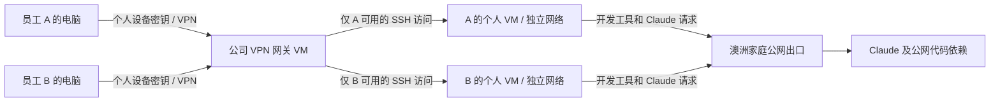

# 员工远程开发环境：第一阶段方案草案

日期：2026-10-21（Australia/Sydney）
状态：头脑风暴已收束，保留候选方案供下一步规格整理；已确认需求与待选设计分别标注。本文不代表部署授权或完成实机验证。
目标：5–10 位在中国出差的员工，通过终端连接澳洲家中的个人 VM，用各自 Claude 订阅 OAuth 令牌完成真实代码任务。

## 1. 已确认范围

| 项目 | 已确认内容 |
|---|---|
| 第一阶段 | 纯终端，Claude Code 可用，能够运行项目开发和测试工具 |
| 后续阶段 | 第二阶段加入浏览器，第三阶段加入 IDE |
| 认证 | 每人独立的订阅 OAuth 令牌；以后再考虑 Team |
| 出口 | 所有 Claude 相关访问，包括授权请求，遵循澳洲 VM／澳洲 IP 约束 |
| 员工权限 | 员工可管理自己 VM 内的软件和开发依赖 |
| 网络 | 公司接入自建维护，独立于个人 Tailscale；员工之间网络隔离 |
| 共享服务 | 前期按不需要处理；未来有需求时另建环境 |
| 恢复 | 采用网络／VPN 原生能力，不额外设计恢复、保活或高可用机制 |
| 资源 | 按用户提供的信息，PVE cluster 与 pve2 剩余内存充足；未读取实机 CPU、磁盘或内存状态 |
| 家庭网络 | OpenWrt 衍生 iStoreOS 网关；仓库记录 N100、192.168.1.1、版本 24.10.8。用户确认 WAN IPv4 与外网查询一致，上行暂按 50 Mbps；实时入站连通及地址稳定性尚待检查 |

技术栈目前未知，第一阶段提供通用环境，由员工按真实项目配置依赖。Linux 适用性应通过试用验证，不能据此承诺 Windows／macOS 专用项目也能直接运行。

## 2. 候选整体结构

建议先以一台独立的公司 VPN 网关、两台测试用个人 VM 验证，再逐步扩到 5–10 人。WireGuard 是首轮实测候选，尚未正式选定。

图中未绘制返回流量及管理员维护通道。A、B 之间、两台 VM 之间、员工网络与家庭／PVE 管理网络之间，默认不开放访问。

公司 VPN 用于员工接入开发 VM。候选采用分流，只下发员工自己的 VM 路由；VM 自身通过公司网关，再经现有 iStoreOS／OpenWrt（192.168.1.1）的澳洲 WAN 上网。分流配置便于使用，实际权限仍由服务端执行。

现有 OpenWrt 承担家庭 WAN、DNS／DHCP 和其他业务；仓库还记录 N100 上的 qnetd 见证及独立代理。公司 VPN 与租户策略优先放在 PVE 内的专用网关。OpenWrt 只承担必要的公网入口转发与现有 WAN 出口；具体规则需与既有配置对账，不能默认已有规则可复用或直接安装 VPN 到边界路由器。

## 3. 网络隔离如何落实

员工拥有客户机管理员权限，所以权限边界放在员工无法修改的网关与 PVE 网络层。

| 访问关系 | 第一阶段规则 |
|---|---|
| 员工设备 → 自己 VM 的 TCP 22 | 允许；SSH 同时支持代码文件传输 |
| 员工设备 → 其他员工设备或 VM | 拒绝 |
| 员工 VM → 其他员工 VM／员工 VPN 地址 | 拒绝主动发起连接；保留本人 SSH 会话的返回流量 |
| 员工设备及 VM → 家庭设备、个人 Tailscale 网络、PVE 管理网 | 拒绝 |
| 员工 VM → 公网项目依赖、Git、Claude 服务 | 经澳洲出口允许；不开放来自公网的 VM 直连入口 |
| 管理员 → 公司网关及个人 VM | 使用明确允许的维护来源 |
| 员工环境 → 内部共享服务 | 当前无放行项 |

建议的隔离实现是每人一个独立二层网络和子网，跨网访问经过网关策略。首轮优先评估所选 PVE 节点内部的隔离网桥，避免为两台 VM 试用改动家庭交换网络；跨节点扩展时再根据现场决定固定 VLAN 或其他受支持的二层隔离方式。采用 VLAN 时，员工网卡使用固定 access VLAN，不向客户机提供 trunk，并配合网卡级过滤限制地址伪装。具体网桥、VLAN 与网段在对账后分配，本文不预占地址。

现有 vmbr0／vmbr1 的名称不等于网络隔离：仓库记录 pve0/pve1 的这两组接口都在 192.168.1.0/24。不能把现有家庭 LAN 直接当作员工隔离网，也不能把旧记录中某个虚拟网卡 firewall=1 当成全局策略已启用的证据。

VPN 网关将每个设备公钥绑定独立隧道地址，再将该地址与其 VM 的允许访问规则对应。即使员工扩大客户端路由，也应仍被网关拒绝访问他人资源。网关转发策略与 PVE 隔离一起验证；不能只改客户端 AllowedIPs 或只设置客户机防火墙。

策略同时考虑 IPv4、IPv6、同节点二层流量以及跨节点流量。第一阶段若不提供员工 IPv6，未配置的 IPv6 路径默认不放行。管理员必要的维护来源需显式允许。

PVE 防火墙规则是否生效依赖实际使用的后端和启用层级；VM 网卡有独立开关。不能把新后端的 VNet／FORWARD 规则直接假设为旧后端可用。实施前先核实版本、后端和当前策略，再采用兼容方案。[PVE 官方防火墙文档源码](https://github.com/proxmox/pve-docs/blob/master/pve-firewall.adoc)

首轮将网关及两台测试 VM 放在一个选定节点上，降低试用变量。正式分配到 cluster 的其他节点或 pve2 前，再验证 VLAN／网桥链路与相同隔离规则；不假设这些环境已自动互通，也不新增集群高可用设计。

## 4. VPN 入口候选

建议首轮测试 WireGuard：现有 iStoreOS／OpenWrt（192.168.1.1）仅转发所需 VPN 端口到 PVE 内的独立公司网关，员工各用自己的设备密钥。公司网关承载公司接入和转发策略；开发依赖安装在个人 VM。

公钥、隧道地址、员工与 VM 的对应关系由管理员管理。每个设备单独登记，撤销设备时不需要更换其他人的密钥。WireGuard 私钥留在其所属设备；网关自己的私钥作为系统部署凭据管理。

仓库 2026-10-04 的只读记录已说明 OpenWrt 的 WAN 使用 DHCP；这不证明公网地址必然频繁变化，固定地址／租约稳定性仍应在实施前核对。入口可使用专用域名，若需要则配置动态更新。LAN 的历史 DHCP 池为 .150–.246，新资源地址不能凭空占用。

NAT 保活等参数根据实际客户端网络按需设置，使用 VPN 自带功能，不额外编写重连脚本或应用恢复逻辑。[WireGuard 官方说明](https://www.wireguard.com/quickstart/)

2026-10-21 用户新增反馈：员工使用 cloudflared 客户端配合原生 SSH 后，延迟仍然很大；此前网页终端也有同类反馈。用户进一步确认：昨天已经在澳洲侧验证，浏览器和直接终端访问均正常，VM 无异常；该基准视为已完成，不重复要求用户重测。员工侧尚无量化 RTT、丢包或明确的 WARP 对照结果。现有证据将优先排查范围缩小到员工侧至澳洲 VM 的远程接入路径，尚不足以判定具体网络跳点或协议为根因。

因此，不把当前 Cloudflare 路径视为已满足日常工作的主入口。下一轮优先测试独立的 WireGuard 直连：员工电脑关闭 WARP，经家中 OpenWrt 的必要端口转发到公司 VPN 网关，再以原生 SSH 访问本人试用 VM。固定员工、网络和目标 VM，与已有 Cloudflare 路径比较；澳洲侧正常基准已完成。

WARP 与 WireGuard 是分开的对照，不是 WireGuard over WARP：WARP 对照启用 WARP 并沿用 cloudflared + 原生 SSH；WireGuard 对照关闭 WARP，也不经 cloudflared，直接 SSH 到本人 VM 的内部地址。前期不设计叠加两种隧道的组合，避免混淆实际路径。WARP 单独开启本身不等于获得公司 VM 的私网访问权限，因此它的对照入口仍是既有 Cloudflare Access。

稳定性仍须在实际工作时段验证，WireGuard 不预设优于现有线路。Cloudflare 已有反馈保留为比较依据，WARP 测试结果仍待明确。用户另提供 VLESS TCP Reality／Vision 节点，计划通过 Clash Verge 的独立客户端代理路径测试既有 Cloudflare 接入；目前未回报效果。该节点凭据及可导入配置不纳入本方案或 Git。任何继续保留的入口必须满足相同身份和 VM 隔离限制。

如果 WireGuard 测试不满足日常工作，先记录失败形态，再比较其他自建 VPN 协议或入口位置。本文不预先加入多协议网关、云中继、额外节点或备用线路。

## 5. VM 起步配置（建议值）

以下是试用起点，不是已确认的工作负载容量或软件安装授权。

| 类型 | 建议初始配置 | 用途 |
|---|---|---|
| 公司 VPN 网关 | 2 vCPU、2 GiB RAM、16–32 GiB 系统盘 | VPN、路由、防火墙及必要基础服务 |
| 每人开发 VM | 4 vCPU、8 GiB RAM、100 GiB 持久系统盘 | 纯终端开发、Git、Claude Code、员工项目依赖 |

开发 VM 建议沿用现有可维护的 Linux 模板，具体发行版由模板现状与 Claude Code 支持条件核实后决定。提供独立普通用户、sudo、SSH 公钥登录、Git 和 Claude Code。员工在自己的目录保存项目、Git 凭据和开发配置。

先不统一安装所有语言、数据库、Docker 或大型编译工具；由试用员工根据真实项目自行配置。观察 CPU、磁盘和内存压力后按个人需要调整。内存充足不代表 CPU 和存储已通过验证。

个人身份信息、SSH 私钥、Claude OAuth 令牌均在实例分配后加入，不能预置进克隆模板。SSH 公钥与 VPN 设备密钥分别管理。

## 6. OAuth 认证与令牌交付

已确认采用每人独立的订阅 OAuth 令牌。官方支持使用 `claude setup-token` 生成长期令牌，目标环境通过 `CLAUDE_CODE_OAUTH_TOKEN` 使用；文档当前说明有效期为一年。生成时仍需一次浏览器授权，运行目标 VM 可以没有浏览器。[官方认证说明](https://code.claude.com/docs/en/authentication#generate-a-long-lived-token)

交付流程建议：

1. 员工按澳洲 VM／澳洲出口约束准备自己的令牌；首次授权入口是交付前置条件，目前未确认已具备，不能默认为中国本地浏览器授权。
2. 员工通过私密输入方式，将令牌配置到自己的 VM。运行时注入 `CLAUDE_CODE_OAUTH_TOKEN`；持久配置仅个人用户可读，权限为 0600，父目录限制访问。
3. 用认证状态检查和一次实际模型请求确认账号可用。确认没有其他 API key 或认证变量抢占优先级，避免误用其他计费来源。
4. 日常从 SSH 登录，进入项目目录后运行 Claude Code。

令牌不进入 Git、Terraform 参数／state、Cloud-Init、共享模板、命令历史、普通运维日志或发给管理员的排错材料。个人令牌由员工管理；如后续需要自动化集中托管，应单独决定管理边界，并按仓库 Vault 约定处理。

令牌过期或撤销后，由员工重新生成并替换。第一阶段不新增认证门户、令牌代发或自动续期系统。OAuth 令牌有功能边界，例如不能建立 Claude Remote Control 会话；本阶段使用原生 SSH，不依赖该功能。

澳洲出口是本方案的技术约束，不代表账号使用资格或不被封禁的保证；这一区别此前已确认说明。

## 7. 员工的实际使用流程

1. 在个人电脑安装并启用公司 VPN 配置。
2. 使用自己的 SSH 密钥连接分配的个人 VM。
3. 从公网代码仓库拉取项目；仓库权限与密钥由员工自行配置。
4. 准备项目需要的工具和依赖，进入项目目录运行 Claude Code。
5. 在 VM 内修改代码、运行检查和测试，并通过 Git 或 SSH 文件传输交付结果。

日常交互是终端；浏览器与 IDE 仍分别在第二、第三阶段提供。员工本地不需要安装或登录 Claude Code。首次生成令牌的授权路径按上一节单独准备。

## 8. 首轮试用与验收

试用先使用一个真实员工账号和两台明确归属的测试 VM，避免用现有无关业务机器作为隔离测试目标。若新增第二位试用员工，每人使用自己的 VPN 密钥、SSH 密钥和 OAuth 令牌。

| 验证项 | 通过依据 |
|---|---|
| 澳洲侧基准 | 用户已在前一天验证浏览器与直接终端均正常，不要求重复检查 |
| 接入 | 员工从实际所在地网络连上公司 VPN，原生 SSH 能正常操作 |
| 日常稳定性 | 在真实工作时段完成持续工作，记录卡顿、掉线及 VPN 原生重连表现，并与现有 Cloudflare 路线比较 |
| 账号 | OAuth 认证成功，实际模型请求使用该员工自己的订阅 |
| 开发任务 | 在 VM 内完成一个真实代码修改、项目检查／测试及结果交付 |
| 员工隔离 | 本人 VM 可达；他人 VM、他人 VPN 地址及员工间二层访问被阻止 |
| 管理网隔离 | 员工设备和 VM 均不能访问家庭、个人网络及 PVE 管理入口 |
| 服务端执行 | 改客户端路由或在 VM 内调整网络配置，不会获得额外访问权限 |
| 出口 | 检查默认路由、代理环境及 IPv4／IPv6 路径；验证 Claude 相关流量由澳洲 VM 走受控出口 |
| 身份隔离 | 模板、另一台 VM、普通日志及 IaC state 不含个人令牌和私钥 |
| 实施安全 | 管理员原有维护通道和无关业务保持可用 |

只查看 IP 查询页面不足以证明 Claude 所有请求的路径，需要结合 VM 的路由、代理配置与网关流量验证。验收不要求采集请求正文或记录 OAuth 令牌。

不预设未经用户确认的硬性延迟数字。用实际打字与交互感受、RTT／抖动／丢包、掉线情况和真实任务完成情况形成判断。试用反馈通过后扩到 5–10 人，再观察多人并发及家庭上行实际占用。

## 9. 最少的日常管理

新增员工：分配个人 VM／网络与员工账号，登记设备公钥及 SSH 公钥，生成仅访问本人 VM 的规则，由员工配置自己的 OAuth 令牌。

停用员工或设备：撤销相应 VPN peer／网关访问规则及 SSH 授权，按确认的数据保留安排处理 VM。个人 Claude 凭据由员工自行撤销；删除 VM 上的令牌副本不等于撤销已签发的令牌。VM 删除及数据清理需具体授权。

排错优先使用 VPN 握手状态、必要的连接日志、VM 服务状态和员工实际反馈。第一阶段不新增监控平台、集中日志平台或恢复系统。

## 10. 与现有环境和仓库的衔接（只读核查结果）

### 现有家庭网络记录

> 🧠 **From Hindsight memory** — 历史记录已识别 N100/iStoreOS 网关 192.168.1.1、pve0/pve1 集群、独立 pve2，以及 OpenWrt eth2 下游交换机承载的 PVE 接入路径。以下具体版本和网桥信息进一步用仓库文件交叉核查；不作为本轮实机状态验证。

| 已有资料 | 记录的环境事实 | 本方案影响 |
|---|---|---|
| ansible/inventory/bare_metal/hosts.yml | gateway 为 iStoreOS 24.10.8（OpenWrt 衍生），192.168.1.1，network_appliance 组；无 Python，排除在 site.yml 之外 | 路由器已知，不应再向用户询问类型；不能直接套用依赖 Python 的 common／tailscale roles |
| docs/guides/gateway-backup.md | 2026-10-04：LAN .1/24、WAN DHCP、LAN DHCP 池 .150–.246；Mac Wi-Fi 经 eth1，PVE MAC 经 eth2，用户确认 eth2 下游有交换机 | 保留既有路由、DNS／DHCP、交换及管理路径；交换机型号、VLAN 能力与当前接线仍未验证 |
| terraform/proxmox/pve-cluster.tf | pve0=.50、pve1=.51；pve2=.52，独立且 vmbr0，VMID 空间独立 | 不将 pve2 当作集群节点，不套用 pve0/pve1 网桥约定 |
| docs/architecture/proxmox-qdevice-architecture.md | pve0/pve1 vmbr0=.20/.21、vmbr1=.50/.51，均在 .1.0/24；N100 上 qnetd 为 .53 | 现有桥名不构成租户隔离；边界网关修改也涉及集群见证的运行环境 |
| docs/guides/cn-exit-singbox-proxy.md | .1:7890 提供独立 sing-box／Tailscale 中国出口代理 | 员工网络不复用该代理；明确阻止访问个人代理入口，保持澳洲出口要求 |

网关备份指南还记录 N100 P2V 为待实施方向，不能假定迁移已经完成。本轮仅核查本地资料，不对网关、交换机或 PVE 实机作修改。

### IaC 职责衔接

> 🧠 **From Hindsight memory (Key decisions and rationale)** — 仓库采用 Terraform 描述 VM 资源与初始化、Ansible 负责主机配置的职责划分；Cloud-Init SSH keys 是创建时输入，后续由 Ansible 管理。

以上已对照当前任务工作区代码核查：

- `terraform/modules/proxmox-vm/main.tf` 使用 `bpg/proxmox`，提供克隆、CPU、内存、磁盘、网桥和初始化，并忽略创建时 SSH key 的后续变化。
- 当前模块的 `network_device` 仅显式设置网卡模型和网桥；没有本方案所需的 VLAN 或网卡防火墙输入。需要实施时，仅补满足隔离所需的最小参数，具体字段以当前 provider 版本能力核对为准。
- `ansible/inventory/terraform.yml` 通过 Terraform provider inventory 衔接主机定义。
- 这些代码事实不证明现场 VLAN、交换机、防火墙后端或 VM 已满足本方案。

若以后进入实施，沿用现有 Terraform／Ansible 分工。系统部署凭据遵循仓库 Vault 约定，个人 OAuth 令牌按上文由员工提供。本次产物是头脑风暴记录和本草案，尚未改动部署代码、执行 Terraform 计划或写入基础设施。下一步可将已确认需求整理为正式规格，并保留接入协议与隔离实现的待验证状态。

## 11. 下一轮需要验证的事实

| 项目 | 当前状态 | 对方案的影响 |
|---|---|---|
| WireGuard 在员工网络中的表现 | 未测试 | 决定是否成为正式入口 |
| 原生 SSH 经 cloudflared 的体验／WARP、VLESS 对照 | 已反馈原生客户端仍高延迟；WARP、VLESS 对照未回报效果 | 换终端未解决问题，继续比较不同接入路径 |
| 家庭路由器、入站能力和公网地址稳定性 | 路由器已知为 iStoreOS／OpenWrt，仓库已有 WAN DHCP 记录；当前端口规则及地址稳定性未核验 | 仅补查实时规则，决定入口转发、域名和更新方式 |
| PVE 防火墙版本、后端及现有 VLAN／网桥 | 已核对文档中的节点／桥和同网段事实；当前规则、交换 VLAN 能力未核验 | 决定隔离配置及跨节点部署方式 |
| 首次 OAuth 令牌的澳洲授权条件 | 尚未确认 | 交付前需要令牌，目标 VM 仍保持纯终端 |
| 试用员工项目、Linux 适用性、CPU／存储负载 | 尚未提供 | 决定工具依赖和个人 VM 配置调整 |

上述是方案验证事项，不代表已有自动任务或部署安排。VPN 协议、VM 配置和 VLAN 实现仍是候选设计；用户确认需求不等于确认每一个候选参数。
