# Architecture Spine — IaC CI-Only Execution

## Design Paradigm

**Policy-gated pipeline control plane with CI-exclusive mutation.** Pull request and `main` are the two code-change lanes, and maintenance is a restricted auxiliary lane. GitHub is the code authority. The Jenkins controller (CT107) and its peer agent (CT110) are separate Proxmox LXCs. After handoff Jenkins is the only normal execution plane for this spine's scope. HCP Terraform stores state while Terraform executes on the agent. RemoteCC keeps its own execution plane and is outside this spine.

```mermaid
flowchart LR
    Dev[Developer] -->|branch and pull request| GitHub[GitHub authoritative repository]
    GitHub -->|repo-validation, no infrastructure secrets| Checks[Validation checks]
    Checks -->|merge to main| Hook[Signed push webhook]
    Hook -->|Cloudflare Tunnel, one path only| Verify{Signature valid?}
    Verify -->|yes| Main[Main lane on deploy identity]
    Main --> Lock[Acquire deployment transaction locks]
    Lock --> Plan[Plan, manifest, and preview]
    Plan --> Approval{Explicit approval}
    Approval --> Apply[Terraform apply]
    Apply --> Inventory[Refresh and resolve inventory]
    Inventory --> Approval2{Approve exact Ansible scope}
    Approval2 --> Deploy[Ansible deploy and verify]
    Deploy --> Unlock[Release transaction locks]
    Apply <--> State[HCP Terraform state]
    Operator[Operator] --> ReadOnly[Read-only plan on plan identity]
    Operator --> Maintenance[Restricted maintenance lane]
    Maintenance --> Lock
```



## Invariants & Rules

### AD-1 — Jenkins owns normal mutation after handoff [ADOPTED]

- **Binds:** `terraform/proxmox`, `terraform/oci`, non-employee Ansible playbooks, helper scripts, documentation, and agent instructions.
- **Prevents:** Unreviewed workstation changes, credential drift, and unaudited state mutation.
- **Rule:** Handoff is per root and per capability: it happens when Jenkins has a verified entry for that root, playbook, or maintenance mode. Until then, local execution and the pre-merge real dry run continue for it as `AGENTS.md` states. After handoff, Jenkins alone performs its writes, except under AD-9 and for the independent watchdog in AD-11. Local machines may still edit, inspect, operate Git, and run read-only `terraform plan -lock=false` and `ansible-playbook --check --diff`; they must not write. The execution map lists every playbook with exactly one owner: `jenkins`, `maintenance`, `remotecc`, or `retired`; an unlisted playbook fails closed. RemoteCC is a standing exception: `terraform/remotecc` and every `remotecc` playbook, including the HAPI and OCI hub plays, stay outside Jenkins and are managed on the RemoteCC side.

### AD-2 — Pull requests validate; immutable `main` commits mutate [ADOPTED]

- **Binds:** GitHub branch protection, GitHub Actions, and all Jenkins jobs.
- **Prevents:** Applying unmerged code, applying a different configuration than the reviewed plan, and exposing mutation credentials to pull-request jobs.
- **Rule:** Pull requests validate only on GitHub Actions through `repo-validation.yml`, which holds no infrastructure credential. Jenkins has no pull-request lane and never checks out a PR ref. `IaC-ReadOnly-Plan` is a manual job that accepts only a fixed root and a generated nonce, reads its pipeline definition from protected `main`, and runs under `iac-plan`. `repo-validation` must become a required check on `main`; today the ruleset does not require it, and changing it needs separate authorization. The main lane runs under `iac-deploy`, checks out an immutable SHA, creates a saved plan and plan manifest for that SHA, pauses for explicit Terraform approval, and applies only that saved plan. After inventory refresh it pauses for a separate approval of the exact Ansible scope.

### AD-3 — GitHub is the sole IaC code authority [ADOPTED]

- **Binds:** Git remotes, Jenkins SCM, branch protection, and GitHub Pages.
- **Prevents:** Split-brain merges and code entering execution from a second source.
- **Rule:** GitHub `main` (`origin/main`) is the sole writable source of truth for this repository, and Jenkins IaC jobs clone only it. No mirror of this repository may feed execution. GitHub Actions holds no infrastructure credential. Gitea remains an ordinary service for private application repositories, including read-only SCM for the `n8n-rental` jobs; it is never an IaC authority or an IaC job trigger. One exception to the mirror rule: `/srv/iac` on `remotecc-ops` is a fast-forward-only copy of `origin/main` that feeds only RemoteCC execution.

### AD-4 — One Terraform root owns one remote state and mutation lock

- **Binds:** Terraform root modules and HCP Terraform workspaces.
- **Prevents:** State collisions, cross-platform blast radius, and concurrent writers.
- **Rule:** Jenkins preflight must assert through HCP configuration/API that each workspace exists in `local` execution mode with the expected organization, Terraform version, and state lineage. Before planning, a deployment transaction acquires sorted locks for every selected Terraform root plus stable conflict domains declared by the execution map, such as platform, service, inventory group, or control plane; it holds them through verification. After refresh, every resolved host must fall within those locked domains or the run stops before Ansible. Locks live in one store, the root runner's registry on the peer agent. A lock key is atomic and canonical: `root:<name>` or `host:<inventory_hostname>`. Service, group, platform, and control-plane names expand to those keys before acquisition, so overlapping domains always contend. HCP state locking remains an additional safeguard: Jenkins plan and apply use a bounded `-lock-timeout`, and a lock failure before apply begins leaves the approval valid within its expiry. Jenkins never writes a root outside this table. `terraform/remotecc` (`iac-remotecc`) belongs to `wsctl`. `terraform/netbox-integration` keeps local state with no backend. `terraform/esxi` is historical.

| Terraform root | HCP workspace |
| --- | --- |
| `terraform/proxmox` | `iac-proxmox-lab` |
| `terraform/oci` | `iac-oci` |

### AD-5 — Credentials are lane-, scope-, and lifetime-bound

- **Binds:** Jenkins Credentials, Ansible Vault, HCP tokens, provider credentials, SSH identities, plans, and generated files.
- **Prevents:** Privilege escalation from a plan job, secret persistence, and cross-platform credential reuse.
- **Rule:** `iac-plan` holds no HCP, Vault, or SSH mutation secret; it reads a signed redacted snapshot and a restricted broker, and a partial result never proves that a root has no changes. Trusted main jobs may receive root-scoped deployment credentials while generating the real plan and retain them through apply, but Terraform mutation remains blocked until approval. Ansible credentials are injected only after its approved host/tag scope is fixed. Credential-version identifiers and keyed non-reversible input digests enter the plan manifest without revealing values. Saved plans and raw plan output are sensitive; only an access-controlled, redacted summary is presented. The Mac keeps all its credentials after handoff, for read-only plans and as a recovery copy under AD-9, so the local no-write rule is procedural, not technical. The OCI API private key is a Jenkins secret-file credential, uploaded by the operator through the UI and bound only to the OCI Terraform stage. On Jenkins, Vault passwords, generated tfvars, OCI private keys, saved plans, and state backups are build-scoped, mode-restricted, excluded from archived artifacts, and removed in unconditional cleanup.

### AD-6 — Execution scope is repository-owned and fails closed

- **Binds:** Change detection, Terraform root selection, playbook selection, broad-impact paths, and manual jobs.
- **Prevents:** Filename heuristics silently skipping deployments or expanding blast radius.
- **Rule:** A versioned execution map classifies changed paths into Terraform roots, Ansible playbooks, an explicit `excluded` class for RemoteCC and other out-of-scope paths, or a `shared` class for paths both planes consume, and declares their dependency DAG and stable conflict domains. Change selection runs over `last_verified_sha..build_sha` per root or playbook. That watermark is stored durably, advances only after verification passes, and is seeded at cutover from the last commit the baseline verified, so a refused or failed build never drops a change. Proxmox and OCI roots are independent unless the map says otherwise, and Ansible follows all selected Terraform applies. An unmatched, `shared`, or broad-impact change cannot auto-deploy; it requires an explicit allow-listed operator scope. Maintenance exposes separate allow-listed modes: `import`; reversible state moves/provider replacement; destructive state removal; destroy; `force-unlock`; and manual playbook. Each mode has typed parameters, before/after state backup where applicable, preview, explicit confirmation text, recovery procedure, audit log, immutable SHA, and the same transaction locks. No arbitrary command parameter is permitted. On partial failure, downstream nodes stop, completed mutations are not auto-rolled back, and retry starts from observed state with a new plan and approval.

### AD-7 — Terraform state precedes Ansible inventory and deployment

- **Binds:** Apply, inventory refresh, Ansible deploy, and verification stages.
- **Prevents:** Configuring nonexistent or stale hosts and reporting deployment success without health verification.
- **Rule:** A selected Terraform apply completes before inventory refresh. Proxmox inventory derives from its Terraform root; OCI remains the repository's static-inventory exception. Jenkins proves the refreshed host set is covered by the pre-acquired conflict-domain locks, then records a digest of the inventory snapshot, resolved host set, playbook, tags, limit, and variables source. An authorized approver then approves that exact Ansible digest; any change invalidates approval. Only playbooks with a working Deploy + Verify contract may auto-deploy, and verification must pass before locks release. Other playbooks remain maintenance-only until repaired.

### AD-8 — NetBox Terraform apply stays disabled [DEFERRED]

- **Binds:** `terraform/netbox-integration`.
- **Prevents:** Terraform overwriting newer live NetBox data or duplicating existing objects.
- **Rule:** Jenkins does not plan or apply this root. Any later takeover first needs its own approved design covering a restore-tested backup, an ownership manifest, imports, a drift-free plan, and a reversible canary.

### AD-9 — Bootstrap and disaster recovery are explicit exceptions

- **Binds:** Jenkins installation, controller outage, and lost CI credentials or state access.
- **Prevents:** Pretending CI can repair itself when unavailable and allowing the exception to become routine deployment practice.
- **Rule:** After handoff, local Terraform or Ansible writes are allowed only for declared disaster recovery; the first bootstrap is the only other AD-9 event. The first peer agent is preferably bootstrapped from the healthy existing Jenkins Web UI/controller executor. Controller executors reach 0 only through the peer specification's S7 gate and a separate approval, after which a normal Jenkins plan reconciles the result. For every AD-9 event, record operator, command, target, reason, and result; restore CI promptly; then reconcile with a normal Jenkins plan. No later feature or configuration change qualifies.

### AD-10 — Executor capability is provisioned and pinned

- **Binds:** Jenkins controller/agent, Terraform CLI, Ansible, collections, Jenkins plugins, and helper runtimes.
- **Prevents:** Runtime dependency downloads producing non-reproducible or incompatible executions.
- **Rule:** One peer Jenkins agent LXC carries separate non-root `iac-plan`, `iac-deploy`, and `iac-apps` Unix accounts, each with its own agent service, 0700 home, and 0700 workspace, and no shared writable path. `iac-plan` has no sudo, Docker socket, deployment SSH identity, mutation credential, or mutation network access; `iac-deploy` and `iac-apps` receive only stage-scoped privileges. A root runner takes one global lock before binding any secret, so jobs from all three identities run one at a time; admission waits in a bounded queue while the lock is held, and a busy runner is never a refusal. Each job runs in a private run directory and must prove process, workspace, temp, and credential cleanup before the next job begins. No identity runs arbitrary shell work on the controller, and no Docker-in-Docker is introduced. `ci/toolchain-bom.yml` and its lock files own the pins; pipelines verify them and fail on mismatch rather than silently upgrading.

### AD-11 — The CI control plane has a separate lifecycle

- **Binds:** Jenkins controller and agent LXCs; jobs, plugin configuration, backups, and credential metadata.
- **Prevents:** A routine pipeline restarting its own controller, manual UI drift, and loss of CI without a recovery path.
- **Rule:** Repository code is the configuration owner: Ansible owns host services and Jenkins Configuration as Code/Job DSL owns Jenkins metadata once its restore gate passes. Secret values remain only in their credential stores. Before a planned controller restart, a signed watchdog/rollback bundle runs independently on the peer agent, captures diagnostics, and may restore only a quiesced application-consistent backup that passed restore-and-boot validation for the exact Jenkins core/plugin/config version tuple. Agent updates also run through this independent path, never from a job on the agent being updated. If no safe watchdog/executor exists, planned change is blocked; AD-9 applies only after declared bootstrap or disaster.

### AD-12 — NetBox events never select code and do not mutate [DEFERRED]

- **Binds:** `Jenkinsfile-webhook-router`, `Jenkinsfile-webhook-router-peer`, and platform provisioning jobs.
- **Prevents:** Treating an external payload as trusted code, bypassing locks, or allowing NetBox to run arbitrary refs and commands.
- **Rule:** The router accepts only token-authenticated payloads on the internal network, cannot supply a Git ref or command, and refuses unknown or missing routes. No event may start Terraform or Ansible mutation. Automated event execution needs its own approved design first.

### AD-13 — Public webhook ingress is signed and cannot select code

- **Binds:** Cloudflare Tunnel ingress, the GitHub repository webhook, and Jenkins push triggers.
- **Prevents:** A forged request triggering builds or filling the approval queue, and a payload choosing what runs.
- **Rule:** The tunnel rule matches exactly `^/github-webhook/$`; every other path returns 404, and the NetBox endpoint is never published. The GitHub webhook carries a shared secret, and Jenkins rejects any delivery whose HMAC-SHA256 signature does not verify, before any job starts. The plugin accepts everything when no secret is configured, so an empty configuration counts as a failure: unsigned and wrongly signed POSTs must return 400 after rollout, after any controller restore, and after any JCasC apply. Rollout sets the secret on GitHub first, then on Jenkins. This is the first change in the initiative and precedes the AD-11 restore gate, as a one-time recorded controller configuration change that JCasC later adopts. The secret's source of truth is Ansible Vault. Cloudflare Access is not an option here, because GitHub webhooks cannot send its service-token headers. A delivery only requests a build: the repository, branch, and pipeline script come from the job configuration, and no payload field reaches a job parameter, ref, or command. A build it starts still stops at both approvals.

### AD-14 — IaC and RemoteCC are managed independently

- **Binds:** `terraform/proxmox`, `terraform/oci`, `terraform/remotecc`, and everything the two sides reach.
- **Prevents:** One side changing an object the other owns, because their locks cannot see each other.
- **Rule:** Jenkins never targets a RemoteCC object: employee VMs, the employee SDN, VM500, `remotecc-ops`, or the OCI hub. There is no cross-plane lock. Whole-host operations on a shared host need the operator to confirm that the other side is idle.

## Consistency Conventions

| Concern | Convention |
| --- | --- |
| Pipeline lanes | `pr` on GitHub Actions, and `main`, `read-only-plan`, `maintenance`, and `apps` on Jenkins. `pr` and `read-only-plan` never mutate; every other mutation requires current explicit approval. `apps` runs the private application jobs under `iac-apps` and follows the same runner, lock, and cleanup rules. |
| Identity | Every run records repository, branch, immutable commit SHA, Jenkins build URL, selected scope, and approver. |
| Plans | One saved plan per root and SHA; never reuse a read-only or local plan for apply, and never re-plan between approval and apply. |
| Plan manifest | Bind root, Git SHA, lockfile digest, non-secret input digest, HCP organization/workspace, state lineage/serial, plan SHA-256, creator build, and expiry. A mismatch, newer mutation, restart, or expiry invalidates approval. |
| Approval | Two separate records bind authorized approver and time: Terraform plan manifest before apply, then refreshed Ansible inventory/host/playbook/tag/limit digest before deploy. The same operator may hold both approvals. Approval is never transferable to a rerun. |
| Audit | IaC jobs keep at least 200 builds. Jenkins build records, including `input` approvers, are the audit store. |
| Notification | Jenkins Mailer (`mail` step) sends on failure and just before each approval `input`. |
| Concurrency | Parallel static validation is allowed; sorted root and stable conflict-domain locks span plan through verify for every mutating transaction. |
| Failure behavior | Unknown scope, missing credential, stale plan, failed refresh, or failed verification blocks downstream mutation and reports failure. |
| Git remotes | `origin` is GitHub. |
| Control-plane restart | A signed, versioned watchdog/rollback bundle runs independently on the peer agent before Jenkins controller restart begins. |
| Entry cutover | For each root or service, exactly one entry holds the push trigger and mutation credentials at any time. A staged run has its trigger off, on a fixed SHA, while the old entry is disabled for that domain. A service's IaC and application jobs move in the same window. Acceptance for the main lane includes two consecutive real pushes that each start a build, because a pipeline with no checkout may leave polling with no baseline. |

## Structural Seed

```text
Jenkinsfile                        # Baseline controller pipeline until cutover
Jenkinsfile-peer                   # Main lane on the peer agent
Jenkinsfile-plan                   # IaC-ReadOnly-Plan
Jenkinsfile-maintenance            # To add: import/state/destroy/manual-playbook workflow
Jenkinsfile-webhook-router         # Baseline NetBox router
Jenkinsfile-webhook-router-peer    # Router on the peer path
ci/
  toolchain-bom.yml                # Pinned toolchain
  agent-jobs.yml                   # Job to node/identity mapping
  proxmox-plan-policy.json         # Read-only broker and projection policy
  execution-map.yml                # To add: changed path -> root/playbook/excluded
scripts/jenkins/                   # Runner, plan, watchdog, and audit helpers
terraform/
  proxmox/                         # iac-proxmox-lab
    jenkins.tf                     # Jenkins controller LXC
    jenkins-agent.tf               # Peer execution LXC
  oci/                             # iac-oci
ansible/
  inventory/                       # Terraform-backed Proxmox plus static OCI
  playbooks/                       # Deploy + verify contracts
```

## Open Questions

- None.

## Deferred

- Cross-Proxmox-node placement and HA for the Jenkins controller and agent; revisit after independent restore tests, because same-node placement still shares physical-host failure.
- Moving Terraform execution from Jenkins-local to HCP remote/agent execution; revisit only if Jenkins-local networking or executor reproducibility becomes inadequate.
- Automated NetBox events (AD-12) and NetBox Terraform takeover (AD-8); revisit after handoff.
- Moving IaC authority to Gitea, or a GitHub mirror; declined on 2026-11-05 because validation, review, and documentation flows all run on GitHub.
- Finishing the IaC and RemoteCC separation: `terraform/modules`, shared Ansible roles, and shared physical hosts; revisit in the RemoteCC work.
- Technically enforcing the local no-write rule; host-side key restriction was declined on 2026-11-05 because it costs Mac root SSH and the pre-merge Ansible dry run. Revisit if that trade-off changes.
- Retiring Gitea; revisit if private application repositories leave it.
