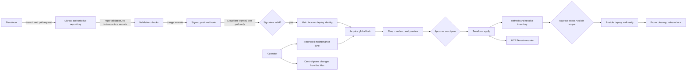

# Architecture Spine — IaC CI-Only Execution

## Design Paradigm

**Policy-gated pipeline control plane with CI-exclusive mutation.** Pull request and `main` are the two code-change lanes, and maintenance is a restricted auxiliary lane. GitHub is the code authority. The Jenkins controller (CT107) and its peer agent (CT110) are separate Proxmox LXCs. After handoff Jenkins is the only normal execution plane for this spine's scope. Pipelines are standard Jenkins: stages run directly on the agent, with no root runner, admission service, or watchdog between them. HCP Terraform stores state while Terraform executes on the agent. RemoteCC keeps its own execution plane and is outside this spine.



## Invariants & Rules

### AD-1 — Jenkins owns normal mutation after handoff [ADOPTED]

- **Binds:** `terraform/proxmox`, `terraform/oci`, non-employee Ansible playbooks, helper scripts, documentation, and agent instructions.
- **Prevents:** Unreviewed workstation changes, credential drift, and unaudited state mutation.
- **Rule:** Handoff is per root and per capability: it happens when Jenkins has a verified entry for that root, playbook, or maintenance mode. Until then, local execution and the pre-merge real dry run continue for it as `AGENTS.md` states. After handoff, Jenkins alone performs its writes, except under AD-9 and for the `control-plane` owner below. Local machines may still edit, inspect, operate Git, and run `terraform plan -lock=false` and `ansible-playbook --check --diff`. Those two change no production configuration, but they connect to hosts, run probes, and may write short-lived candidate files; `check_mode: false` is allowed only on reads and temporary candidates. CI rejects a write module (`file`, `copy`, `template`, and similar) carrying it unless its target is a temporary candidate; `command` and `shell` cannot be judged statically and are reviewed at merge. A task rendering a secret sets `diff: false` or `no_log`. The execution map lists every playbook with exactly one owner: `jenkins`, `maintenance`, `control-plane`, `remotecc`, or `retired`; an unlisted playbook fails closed. `control-plane` covers `deploy-jenkins`, `upgrade-jenkins`, `deploy-jenkins-agent`, and `deploy-cloudflared`: the operator runs them from the Mac and records them in AD-9 format, and Jenkins refuses them. A Jenkins plan that touches CT107 or CT110 fails closed for the same reason, and that change also runs from the Mac. RemoteCC is a standing exception: `terraform/remotecc` and every `remotecc` playbook, including the HAPI and OCI hub plays, stay outside Jenkins and are managed on the RemoteCC side.

### AD-2 — Pull requests validate; immutable `main` commits mutate [ADOPTED]

- **Binds:** GitHub branch protection, GitHub Actions, and all Jenkins jobs.
- **Prevents:** Applying unmerged code, applying a different configuration than the reviewed plan, and exposing mutation credentials to pull-request jobs.
- **Rule:** Pull requests validate only on GitHub Actions through `repo-validation.yml`, which holds no infrastructure credential. That validation is a quality check, not a security boundary: it runs scripts from the PR head, so a PR changing the workflow, `scripts/ci/`, or `tests/ci/` is reviewed at merge. Jenkins has no pull-request lane and never checks out a PR ref. Jenkins has no read-only plan job: the preview is the plan created before approval in the main lane, and the Mac may run a read-only plan. `repo-validation` must become a required check on `main`; today the ruleset does not require it, and changing it needs separate authorization. The main lane runs under `iac-deploy`, resolves the current `origin/main` head after taking the AD-4 lock, fetches that immutable SHA with `git` rather than the `checkout` step so the polling baseline stays intact, creates a saved plan and plan manifest for that SHA, pauses for explicit Terraform approval, and applies only that saved plan. After inventory refresh it pauses for a separate approval of the exact Ansible scope.

### AD-3 — GitHub is the sole IaC code authority [ADOPTED]

- **Binds:** Git remotes, Jenkins SCM, branch protection, and GitHub Pages.
- **Prevents:** Split-brain merges and code entering execution from a second source.
- **Rule:** GitHub `main` (`origin/main`) is the sole writable source of truth for this repository, and Jenkins IaC jobs clone only it. No mirror of this repository may feed execution. GitHub Actions holds no infrastructure credential. Gitea remains an ordinary service for private application repositories, including read-only SCM for the `n8n-rental` jobs; it is never an IaC authority or an IaC job trigger. One exception to the mirror rule: `/srv/iac` on `remotecc-ops` is a fast-forward-only copy of `origin/main` that feeds only RemoteCC execution.

### AD-4 — One Terraform root owns one remote state and mutation lock

- **Binds:** Terraform root modules and HCP Terraform workspaces.
- **Prevents:** State collisions, cross-platform blast radius, and concurrent writers.
- **Rule:** Jenkins preflight asserts through the HCP API that each workspace in this table exists in `local` execution mode under the expected organization, and refuses any other workspace. The workspace Terraform version is metadata only in local mode; the runtime guarantee is the agent's own `terraform version` check against the BOM. State lineage comes from the state itself, because the HCP API does not return it. Every Jenkins job that mutates, including `apps` and `maintenance`, holds one global Lockable Resources lock, `iac-global`, from before its first credential binding until its terminal state. The lock is declared in JCasC, and CI checks that every Jenkinsfile uses exactly that literal, because a misspelled name silently creates a second lock. Waiting jobs queue in Jenkins, and a busy lock is never a refusal. A pending approval keeps the lock and is bounded by a timeout inside the lock, because a timeout around it would kill queued builds. Cleanup and marker handling run in a `try`/`finally` inside the lock. Jenkins releases the lock on abort or crash without proof of cleanup, so a released lock is never evidence of cleanup; the marker is. The terminal states are: success; failure or abort with cleanup proven, where the lock releases, the watermark stays, and repair is a new run; and quarantine. Mutating pipelines set `disableResume()`, so a controller restart ends the build and voids any pending approval. Each job writes an in-progress marker before binding any credential and clears it only after proving cleanup, so a lost agent or killed build leaves the marker behind. Markers live in one agent-wide location with a directory per identity, writable only by its owner and readable by both. Every job checks both identities' markers before binding credentials, and an unreadable or present marker refuses. Only the `verify-and-release` maintenance mode clears a marker, running as the marker's owner. HCP state locking remains an additional safeguard: Jenkins plan and apply use a bounded `-lock-timeout`, a lock failure before apply begins leaves the approval valid within its expiry, and `force-unlock` applies only to the HCP state lock. Jenkins never writes a root outside this table. `terraform/remotecc` (`iac-remotecc`) belongs to `wsctl`. `terraform/netbox-integration` keeps local state with no backend. `terraform/esxi` is historical.

| Terraform root | HCP workspace |
| --- | --- |
| `terraform/proxmox` | `iac-proxmox-lab` |
| `terraform/oci` | `iac-oci` |

### AD-5 — Credentials are lane-, scope-, and lifetime-bound

- **Binds:** Jenkins Credentials, Ansible Vault, HCP tokens, provider credentials, SSH identities, plans, and generated files.
- **Prevents:** Secret persistence, two stores disagreeing about one credential, and cross-platform credential reuse.
- **Rule:** Jenkins Credentials is the single CI runtime store. Each credential ID has one store and one writer. Deployment credentials sit in a folder that holds only the deploy jobs, and application credentials in their own folder; deleting a folder deletes its credentials. The webhook secret and agent connection secrets sit in the global store, because the GitHub plugin cannot read a folder. One exception to the single store: Mailer cannot reference a credential, so the Resend key lives in Mailer's global configuration, set and rotated by hand by the operator. Ansible Vault stays the source of truth for IaC credentials, so a rotation updates both. The OCI API private key has no Vault source: it is a secret-file credential the operator uploads through the UI. JCasC never carries a `credentials:` section, because that section replaces rather than merges, and `CASC_STRICT_SECRET_RESOLUTION=true` is set; it catches undefined variables, not empty values. Pipelines bind credentials with `withCredentials` per stage, and a binding never spans an `input`. Terraform credentials are bound only inside that root's transaction, once for plan and again for apply. The OCI key is bound only to the OCI transaction. Ansible credentials are bound only after the approved host and tag scope is fixed. Credentials carry no version in the plan manifest, so a rotation does not invalidate an approval; a wrong credential fails authentication. The organization is on HCP Free without teams, so one HCP token reaches every workspace, including `iac-remotecc`; the limit is per transaction and procedural, enforced by the AD-4 preflight. Accepted risks: compromise of CT107 exposes every deployment credential; plaintext briefly passes through the agent process; `JENKINS_HOME` backups contain every credential, stay root-only, and need `master.key` to restore. Saved plans and raw plan output are sensitive; only an access-controlled, redacted summary is presented. The Mac keeps all its credentials after handoff, for read-only plans and as a recovery copy under AD-9, so the local no-write rule is procedural, not technical. On Jenkins, Vault passwords, generated tfvars, OCI private keys, saved plans, and state backups are build-scoped, mode-restricted, excluded from archived artifacts, and removed in unconditional cleanup.

### AD-6 — Execution scope is repository-owned and fails closed

- **Binds:** Change detection, Terraform root selection, playbook selection, broad-impact paths, and manual jobs.
- **Prevents:** Filename heuristics silently skipping deployments or expanding blast radius.
- **Rule:** A versioned execution map classifies changed paths into Terraform roots, Ansible playbooks, an explicit `excluded` class for RemoteCC and other out-of-scope paths, or a `shared` class for paths both planes consume, and declares their dependency DAG. For each playbook it also declares the allowed inventory groups and every delegate target. Delegate targets resolve through inventory and enter the approval summary and credential scope; an unresolved target refuses. CI scans `delegate_to` against the map, and the normal lane refuses CT107 and CT110 as a target or delegate. `site.yml` and `hosts: all` plays stay out of the normal lane. One main-lane build is one batch: it takes the AD-4 lock once and runs every selected root in DAG order, then the Ansible playbooks, with no child job holding or waiting on the lock. Inside the batch each Terraform root is its own transaction, with its own manifest, approval, and watermark, and each playbook depends on at most one root, otherwise it refuses. A later build waits on the AD-4 lock. Change selection runs over `last_verified_sha..build_sha` per root or playbook. That watermark lives in `iac-deploy`'s state directory on CT110, is written only by the main lane, advances only along `main` ancestors, and is seeded at cutover from the last commit the baseline verified, so a refused or failed build never drops a change. A root's watermark advances once its apply and every playbook depending on it verify; a playbook's watermark advances when it verifies. A run that mutated a root or playbook and then failed sets a `dirty` flag beside its watermark. Selection always includes a dirty scope, even when the Git diff is empty, for example after a full revert, and only a verified run clears the flag. A missing watermark refuses until a maintenance mode reseeds it. The normal lane deploys only the `main` head it resolved after taking the lock, so a queued build never deploys an older commit, and a build with no selected scope ends without mutation. A build whose running pipeline differs from the pipeline file at that head stops and leaves the change to the next build. Rollback is a forward revert commit. Proxmox and OCI roots are independent unless the map says otherwise, and Ansible follows all selected Terraform applies. An unmatched, `shared`, or broad-impact change cannot auto-deploy; it requires an explicit allow-listed operator scope. Maintenance exposes separate allow-listed modes: `import`; reversible state moves/provider replacement; destructive state removal; destroy; `force-unlock`; `verify-and-release`; `reseed-watermark`; and manual playbook. Each mode has typed parameters, before/after state backup where applicable, preview, explicit confirmation text, recovery procedure, audit log, immutable SHA, and the same global lock, except that `verify-and-release` runs against the marker it clears. No arbitrary command parameter is permitted. On partial failure, downstream nodes stop, completed mutations are not auto-rolled back, and retry starts from observed state with a new plan and approval.

### AD-7 — Terraform state precedes Ansible inventory and deployment

- **Binds:** Apply, inventory refresh, Ansible deploy, and verification stages.
- **Prevents:** Configuring nonexistent or stale hosts and reporting deployment success without health verification.
- **Rule:** A selected Terraform apply completes before inventory refresh. Proxmox inventory derives from its Terraform root; OCI remains the repository's static-inventory exception. Jenkins runs Ansible with explicit `-i` for `inventory/groups.yml`, `inventory/terraform.yml`, and `inventory/oci/hosts.yml`, never the default inventory directory, and proves that `group_vars` and `host_vars` still load. It proves the refreshed host set falls within the playbook's allowed groups, then records a digest of the inventory snapshot, resolved host set, delegate targets, playbook, tags, limit, and variables source. An authorized approver then approves that exact Ansible digest; any change invalidates approval. Only playbooks with a working Deploy + Verify contract and no mutable external reference may auto-deploy; floating image tags, unpinned install scripts, and similar references are scanned by CI and fixed at each playbook's handoff. Verification must pass before the transaction succeeds. Other playbooks remain maintenance-only until repaired.

### AD-8 — NetBox Terraform apply stays disabled [DEFERRED]

- **Binds:** `terraform/netbox-integration`.
- **Prevents:** Terraform overwriting newer live NetBox data or duplicating existing objects.
- **Rule:** Jenkins does not plan or apply this root. Any later takeover first needs its own approved design covering a restore-tested backup, an ownership manifest, imports, a drift-free plan, and a reversible canary.

### AD-9 — Bootstrap and disaster recovery are explicit exceptions

- **Binds:** Jenkins installation, controller outage, and lost CI credentials or state access.
- **Prevents:** Pretending CI can repair itself when unavailable and allowing the exception to become routine deployment practice.
- **Rule:** After handoff, local Terraform or Ansible writes are allowed only for declared disaster recovery, the first bootstrap, and the AD-1 `control-plane` owner. The first peer agent is preferably bootstrapped from the healthy existing Jenkins Web UI/controller executor. The first bootstrap's Terraform change is limited to CT110 and its inventory entry, including importing CT110 into state; anything else in the diff stops it. Controller executors reach 0 only through the peer specification's S7 gate and a separate approval, after which a normal Jenkins plan reconciles the result. For every AD-9 event, record operator, command, target, reason, and result; restore CI promptly; then reconcile with a normal Jenkins plan. No later feature or configuration change qualifies, other than the `control-plane` owner.

### AD-10 — Executor capability is provisioned and pinned

- **Binds:** Jenkins controller/agent, Terraform CLI, Ansible, collections, Jenkins plugins, and helper runtimes.
- **Prevents:** Runtime dependency downloads producing non-reproducible or incompatible executions.
- **Rule:** One peer Jenkins agent LXC carries separate non-root `iac-deploy` and `iac-apps` Unix accounts, each with its own agent service, 0700 home, and 0700 workspace, and no shared writable path; each receives only stage-scoped privileges. Pipeline stages run directly on the agent as ordinary `sh` steps, one mutating job at a time under the AD-4 lock, and each job must prove process, workspace, temp, and credential cleanup before it clears its marker. Outbound traffic is limited by per-user nftables rules on CT110, loaded before the agent services start. They guard the private network: each identity reaches only its declared private hosts, and every other private range is refused. Public HTTPS, DNS, and SSH to declared OCI hosts stay open, so a cloud endpoint's IP change never breaks a deployment. Exfiltration to the public internet is an accepted risk, because Jenkins runs only `main`. The rules are proven in the LXC before real credentials arrive: load, survive a CT restart, and show one refused and one allowed case. Accepted limits: the rules cannot tell the agent JVM from a build step under the same UID, and they do not constrain UID 0. No identity runs arbitrary shell work on the controller, and no Docker-in-Docker is introduced. Main-lane jobs turn off lightweight checkout and keep `skipDefaultCheckout(true)`, because SCM polling needs a recorded checkout; that controller-side clone runs no repository hook or shell, and the Jenkinsfile itself runs in the Groovy sandbox as for any Pipeline. This clone is the one exception to the rule above, and CT107 needs `git`. `ci/agent-jobs.yml` records this state, and CI and the pipeline both verify it. `ci/toolchain-bom.yml` and its lock files own every pin: Jenkins core, every plugin the pipelines use including Lockable Resources, Mailer, Job DSL, and the Pipeline step plugins, cloudflared, and tools. CI fails on a missing pin, and pipelines verify pins and fail on mismatch rather than silently upgrading. `requirements.txt` and the BOM pin ansible-core 2.19.15; staying on 2.19 past its end of life is an accepted risk, because `cloud.terraform` blocks 2.21 and the agent's Python 3.11 blocks 2.20.

### AD-11 — The CI control plane has a separate lifecycle

- **Binds:** Jenkins controller and agent LXCs, Gitea placement, jobs, plugin configuration, backups, and credential metadata.
- **Prevents:** A routine pipeline restarting its own controller, manual UI drift, and loss of CI without a recovery path.
- **Rule:** Repository code is the configuration owner: Ansible owns host services and Jenkins Configuration as Code/Job DSL owns Jenkins metadata once its restore gate passes, except credentials under AD-5. Secret values remain only in their credential stores and the AD-5 Mailer exception. A planned controller or agent change is a `control-plane` operator action from the Mac, never a job on the system being changed, and there is no watchdog. The operator puts Jenkins in quiet-down so no new build starts, waits for builds and agent child processes to end, stops Jenkins, archives `JENKINS_HOME` and service configuration, makes the change, verifies it, and resumes, recording the event in AD-9 format. Planned change without a verified backup is forbidden. A verified backup is a fresh archive with a checked digest, taken by a procedure that passed its latest restore drill. Restores are drilled periodically on an isolated copy with no production egress, no triggers or running jobs, and no real agent connections, and the drill proves the copy boots; a drill copy is never a production controller. A restore qualifies only if the backup matches the exact Jenkins core/plugin/config version tuple and production has had no write since it was taken; otherwise re-capture and rehearse. Each restore reruns the AD-13 probe. Security patching has a fixed path: Jenkins leaves all published advisory ranges before CT110 takes real deployment credentials, and High advisories are patched within 14 days. A security upgrade uses the same verified backup and does not wait for the next periodic drill. Rollback is a manual backup restore. Whole-CT PBS restore of CT107 stays forbidden until Gitea has moved to its own LXC with a `gitea` group and `deploy-gitea` has become an ordinary `jenkins`-owned playbook; cloudflared stays on CT107.

### AD-12 — NetBox events never select code and do not mutate [DEFERRED]

- **Binds:** `Jenkinsfile-webhook-router`, `Jenkinsfile-webhook-router-peer`, and platform provisioning jobs.
- **Prevents:** Treating an external payload as trusted code, bypassing locks, or allowing NetBox to run arbitrary refs and commands.
- **Rule:** The router accepts only token-authenticated payloads on the internal network, cannot supply a Git ref or command, and refuses unknown or missing routes. No event may start Terraform or Ansible mutation. Automated event execution needs its own approved design first.

### AD-13 — Public webhook ingress is signed and cannot select code

- **Binds:** Cloudflare Tunnel ingress, the GitHub repository webhook, and Jenkins push triggers.
- **Prevents:** A forged request triggering builds or filling the approval queue, and a payload choosing what runs.
- **Rule:** The tunnel rule matches exactly `^/github-webhook/$`; every other path returns 404, and the NetBox endpoint is never published. The GitHub webhook carries a shared secret, and Jenkins rejects any delivery whose HMAC-SHA256 signature does not verify, before any job starts. The plugin accepts everything when no secret is configured, so an empty configuration counts as a failure: unsigned and wrongly signed POSTs must return 400 after rollout, after any controller restore, and after any JCasC apply. The acceptance probe is a complete `X-GitHub-Event: ping` delivery with a non-empty JSON body, sent unsigned, wrongly signed, and correctly signed, because an empty request returns 400 even with no secret configured. A POST carrying `X-Jenkins-Validation` returns 200 without signature checks and exposes only the instance public key; this is an accepted risk, confirmed before rollout to start no build, otherwise a Cloudflare rule rejects that header. Rollout sets the secret on GitHub first, then on Jenkins. This is the first change in the initiative and precedes the AD-11 restore gate, as a one-time recorded controller configuration change whose non-secret configuration JCasC later adopts. The secret's source of truth is Ansible Vault. Cloudflare Access is not an option here, because GitHub webhooks cannot send custom headers. A delivery only requests a build: the repository, branch, and pipeline script come from the job configuration, and no payload field reaches a job parameter, ref, or command. A build it starts still stops at both approvals.

### AD-14 — IaC and RemoteCC are managed independently

- **Binds:** `terraform/proxmox`, `terraform/oci`, `terraform/remotecc`, and everything the two sides reach.
- **Prevents:** One side changing an object the other owns, because their locks cannot see each other.
- **Rule:** Jenkins never targets a RemoteCC object: employee VMs, the employee SDN, VM500, `remotecc-ops`, or the hub services on the OCI host. The OCI hub's cloud firewall stays in `terraform/oci` under Jenkins: `oci_core_network_security_group.oci_hub` and `oci_core_network_security_group_security_rule.oci_hub`. `terraform/oci/oci-hub-ingress.auto.tfvars.json` is a `shared` path under AD-6. There is no cross-plane lock. Whole-host operations on a shared host need the operator to confirm that the other side is idle.

### AD-15 — Every shared deployment object has one owner

- **Binds:** Files, fields, and services that both an IaC playbook and an `apps` job can reach.
- **Prevents:** Serial runs silently overwriting each other's values, such as `N8N_VERSION` in a shared `.env`.
- **Rule:** Each file or field has exactly one owner. Runtime configuration belongs to IaC, and application content belongs to the `apps` lane. A shared file is either split or has its fields assigned by the execution map. A lane changing one side of a shared service verifies the result against the other side's currently deployed version. `n8n-rental` is audited against this rule before its handoff, and `n8n_checkout_app` stays false.

## Consistency Conventions

| Concern | Convention |
| --- | --- |
| Pipeline lanes | `pr` on GitHub Actions, and `main`, `maintenance`, and `apps` on Jenkins. `pr` never mutates; every other mutation requires current explicit approval. `apps` runs the private application jobs under `iac-apps` and follows the same lock and cleanup rules. |
| Identity | Every run records repository, branch, immutable commit SHA, Jenkins build URL, selected scope, and approver. |
| Plans | One saved plan per root and SHA; never reuse a local plan for apply, and never re-plan between approval and apply. |
| Plan manifest | Bind root, Git SHA, lockfile digest, non-secret input digest, HCP organization/workspace, state lineage/serial, plan SHA-256, creator build, and expiry. A mismatch, newer mutation, restart (through `disableResume()`), or expiry invalidates approval. |
| Manifest format | One versioned schema and one shared helper own the plan manifest, Ansible scope, and digest: canonical JSON, sorted sets, SHA-256. No stage defines its own encoding. |
| Approval | Two separate records bind authorized approver and time: Terraform plan manifest before apply, then refreshed Ansible inventory/host/playbook/tag/limit digest before deploy. The same operator may hold both approvals. Approval is never transferable to a rerun. |
| Audit | IaC jobs keep at least 200 builds. Jenkins build records, including `input` approvers, are the audit store. Records written after the backup are lost on a controller restore; this is an accepted risk. |
| Notification | Jenkins Mailer (`mail` step) sends on failure and just before each approval `input`, through Resend SMTP from CT107, using a `sending_access` API key limited to one verified domain, used only by Jenkins and tested before rollout. A mail failure is logged and never fails the build. |
| Concurrency | Parallel static validation is allowed; the single AD-4 lock spans every mutating job. |
| Failure behavior | Unknown scope, missing credential, stale plan, failed refresh, failed verification, or a leftover in-progress marker blocks downstream mutation and reports failure. |
| Enforcement | Pipeline checks are procedural: a Jenkins administrator can bypass them. This is an accepted risk. Replay has no off switch: only administrators hold `Run/Replay` or Job/Configure, which implies it, on the deploy folders. Mutating pipelines set `disableRestartFromStage()`, because restarting from a stage could skip an approval. |
| Git remotes | `origin` is GitHub. |
| Control-plane restart | Operator action under AD-11: quiet-down, drain, verified backup, change, verify, resume. |
| Entry cutover | For each root or service, exactly one entry holds the push trigger and mutation credentials at any time. A staged run has its trigger off, on a fixed SHA, while the old entry is disabled for that domain. A service's IaC and application jobs move in the same window. Acceptance for the main lane includes two consecutive real pushes that each start a build, plus a push after a failed build, because polling compares against the last recorded checkout. |

## Structural Seed

```text
Jenkinsfile                        # Baseline controller pipeline until cutover
Jenkinsfile-peer                   # Main lane on the peer agent
Jenkinsfile-maintenance            # To add: import/state/destroy/manual-playbook workflow
Jenkinsfile-webhook-router         # Baseline NetBox router
Jenkinsfile-webhook-router-peer    # Router on the peer path
ci/
  toolchain-bom.yml                # Pinned toolchain
  agent-jobs.yml                   # Job to node/identity mapping
  execution-map.yml                # To add: changed path -> root/playbook/excluded
scripts/jenkins/                   # Pipeline and audit helpers
terraform/
  proxmox/                         # iac-proxmox-lab
    jenkins.tf                     # Jenkins controller LXC
    jenkins-agent.tf               # Peer execution LXC
    gitea.tf                       # To add: Gitea LXC moved off CT107
  oci/                             # iac-oci
ansible/
  inventory/                       # Terraform-backed Proxmox plus static OCI
  playbooks/                       # Deploy + verify contracts
```

## Open Questions

- None.

## Deferred

- Cross-Proxmox-node placement and HA for the Jenkins controller and agent; revisit after independent restore tests, because same-node placement still shares physical-host failure.
- Moving Terraform execution from Jenkins-local to HCP remote/agent execution; revisit only if Jenkins-local networking or executor reproducibility becomes inadequate.
- Automated NetBox events (AD-12) and NetBox Terraform takeover (AD-8); revisit after handoff.
- Moving IaC authority to Gitea, or a GitHub mirror; declined on 2026-11-05 because validation, review, and documentation flows all run on GitHub.
- Finishing the IaC and RemoteCC separation: RemoteCC Terraform and Ansible files, including `terraform-remotecc.yml`, move to the private `remotecc` repository under `IaC/`; `terraform/modules`, shared Ansible roles, and shared physical hosts follow. Moving `iac-remotecc` to its own HCP organization is the route to real token isolation, and is unverified on Free. Revisit in the RemoteCC work.
- Per-workspace HCP tokens; they need a paid tier with teams, and were declined on 2026-11-06. Revisit if Jenkins and RemoteCC tokens cannot be separated by organization.
- Technical mutual exclusion between Jenkins and RemoteCC on shared hosts; the operator confirmation in AD-14 stands. Revisit if the two planes collide.
- Provider and tool upgrades: bpg 0.70 predates its PVE 9 compatibility statement and works today; Terraform, oracle/oci, and ansible/ansible pins are behind. Upgrade separately with a real plan.
- An alert when `main` is ahead of the watermark; GitHub does not redeliver failed webhooks, so until then a missed push waits for the next push or a manual build.
- Technically enforcing the local no-write rule; host-side key restriction was declined on 2026-11-05 because it costs Mac root SSH and the pre-merge Ansible dry run. Revisit if that trade-off changes.
- Retiring Gitea; revisit if private application repositories leave it.

## Verified Facts

Checked on 2026-11-06 unless stated. Recheck before relying on them.

| Fact | Source |
| --- | --- |
| HCP organization `homelab-roseville` is `free_standard` with `teams: false`; only the `owners` team exists | HCP API, read-only |
| Latest Jenkins LTS is 2.580.2; published advisories cover versions up to 2.580.1 | Jenkins advisories, review-reality |
| ansible-core 2.19 reaches end of life this month; 2.20 needs Python 3.12 or later; 2.21 removes a parameter `cloud.terraform` uses | review-reality |
| `check_mode: false` appears 79 times after the one-off playbook cleanup, none changing production configuration | Static audit of `ansible/` |
| Lockable Resources 1582.v54e3b_a_8eda_3a_ has no current advisory and needs core 2.568.3 | Jenkins update center |
| `CASC_STRICT_SECRET_RESOLUTION` exists in JCasC 2117.vc05a_0b_e6b_f4e; an absent `credentials:` key leaves credentials alone | Plugin source and docs |
| Replay has no disable switch; Mailer has no `credentialsId` | Plugin source; JENKINS-39874 |
| Resend SMTP is `smtp.resend.com`, user `resend`, password the API key; not yet tested from CT107 | Resend docs |
| The live tunnel path is unanchored | `ansible/inventory/host_vars/jenkins.yml:14`; live configuration unverified |
