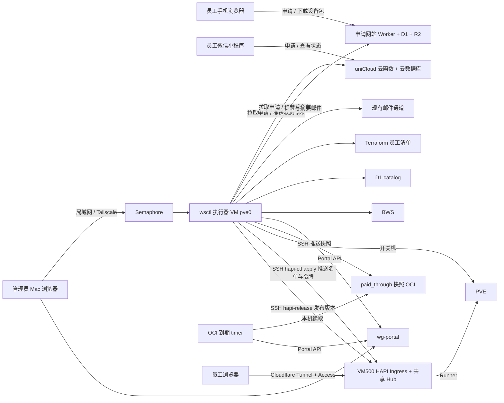
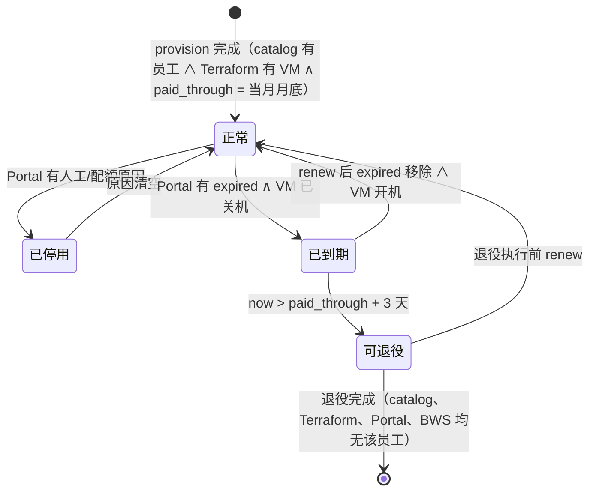
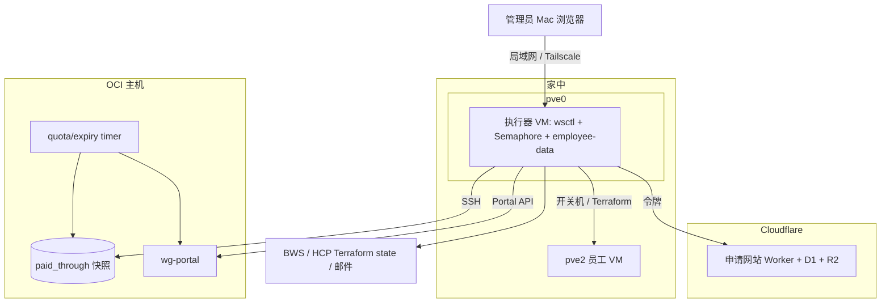

# Architecture Spine — 员工工作区生命周期

## Design Paradigm

**单一写者 + 派生状态。** 每一类事实只有一个所有者，只有它（或经唯一执行器调用它）能写；生命周期状态不存储，任何视图都从各所有者的当前事实推导。写入一律走命令（`wsctl` 子命令、执行器定时任务或 OCI 定时任务），读一律走查询（`wsctl status`）。收费在系统之外线下完成，系统只记录"付到哪天"。

| 层 | 组件 | 位置 |
| --- | --- | --- |
| 员工入口 | 申请网站：规格、申请表、设备包下载（Cloudflare Worker + D1 + R2） | Cloudflare |
| 员工入口 | 微信小程序：规格、申请表、查看自己的状态与到期日（uniCloud 支付宝云：云函数 + 云数据库） | uniCloud |
| 管理员入口 | Semaphore（调用 `wsctl`）、wg-portal 页面、PVE 页面 | 执行器 VM / OCI / 家中 |
| 命令执行 | `wsctl` → `oci-hub-admin.py` 及 `hub-*.py` | pve0 上的执行器 VM |
| 定时执行 | 执行器：提醒、到期关机/续费开机；OCI：`oci-hub-quota.timer`（配额 + 到期断开） | 执行器 VM / OCI |
| 查询 | `hub-status.view`（`wsctl status`） | 执行器 VM |

## Invariants & Rules



### AD-1 — 唯一执行入口与审批 [ADOPTED]

- **Binds:** 所有写 Terraform、catalog、BWS、Portal、PVE 电源的命令；Semaphore 模板
- **Prevents:** 第二个开户引擎、绕过人工审批的写通道
- **Rule:** 跨系统写入只经 `wsctl`（原 `onboard.sh`，保留为转发 `wsctl` 的兼容入口，文档与 skill 改完后删除；oci-hub 为唯一 profile，不再需要 `--profile`）。会创建或删除资源的子命令先生成计划并计算 SHA，展示给管理员，确认后以同一 SHA 执行；计划、输入或代码变化即拒绝。Semaphore 用 `--approve <SHA>` 达到同一效果。`renew`、`remind`、到期关机/续费开机不创建或删除资源，不需要确认。Semaphore 只调用这些子命令，不内嵌业务逻辑。OCI timer 只能增删 Portal 原因（AD-9）。

### AD-2 — 事实所有权表 [ADOPTED]

- **Binds:** all
- **Prevents:** 同一事实两个所有者、副本漂移
- **Rule:**

| 事实 | 唯一所有者 | 其他组件 |
| --- | --- | --- |
| 收款 | 系统之外（线下） | 不记录 |
| 员工申请（邮箱、姓名、手机号等） | 提交所在的入口：网站 D1 或 uniCloud 云数据库 | 执行器只读拉取、合并（AD-19）；开户后员工主数据以 catalog 为准 |
| 小程序展示的员工状态与到期日 | catalog 等事实（AD-3 推导） | uniCloud 中只存执行器推送的展示副本 |
| `paid_through` | catalog（由 `wsctl provision`/`renew` 写；管理员可在 D1 控制台改） | OCI 快照是执行器推送的只读副本（AD-12） |
| VM 存在与规格 | Terraform `terraform/proxmox/oci-hub-workspaces.auto.tfvars.json` | 只读 |
| VM 电源状态 | PVE（Terraform 不管理） | 只由执行器按 AD-16 开关 |
| 员工、邮箱、设备、overlay、主机公钥 | 网站 D1 的 `employees` 表（catalog） | 执行器的 `catalog.json` 是本地快照，registry 为派生视图 |
| 接入开关（用户/设备 Disabled、DisabledReason） | wg-portal | 执行器与 timer 经同一 Portal API 增删自己的原因 |
| 私钥 | BWS `EmployeeWorkspace-OCIHub` | 只在运行时物化；设备包在 R2 中临时存放（AD-17） |
| HAPI 能否使用 | 不存储：员工在册且未到期（AD-3、AD-20） | VM500 的 `config.json` 中的 routes、`tokens/`、`credentials.json`、`agents.json`、`authorize.inc`、两份 Nginx 配置和 9443 worker 防火墙规则都是派生内容，只由 `hapi-ctl` 写入（AD-23） |
| VM500 信任配置（issuer、audience、origin、Hub 监听地址） | IaC 写入的 `trust.json` | `config.json` 中的同名字段是 `hapi-ctl` 生成的副本 |
| `employee-access.nft` 的基础规则 | VM500 现有文件 | `hapi-ctl` 原样保留；从零重建见 Deferred |
| HAPI 身份放行（邮箱） | 不存储：catalog 派生 | Cloudflare Access 策略是投影，只由 `hapi-sync` 整份写入，手工修改会被覆盖 |
| 员工 HAPI 令牌 | BWS 员工工作区记录 | 运行时物化；经 `hapi-ctl apply` 送到 VM500 |

### AD-3 — 生命周期状态只推导不存储

- **Binds:** `hub-status`、Semaphore 视图
- **Prevents:** 存储的状态与 Portal 页面手工操作或 Terraform 现实不一致
- **Rule:** 任何组件不得持久化"正常/已停用/已到期/可退役/已退役"之类的员工生命周期字段。状态按下图从事实计算；"可退役"由读取方按 `now > paid_through + 3 天` 现算。`paid_through` 是业务事实，不属于生命周期状态。



### AD-4 — 发起方调用对方 [ADOPTED]

- **Binds:** 组件间所有调用
- **Prevents:** 双向耦合；公网主机获得对家中的调用通道
- **Rule:** 流程上的发起方主动调用对方，按上方依赖图单向。执行器拉取申请、上传设备包、推送快照与状态副本、发送邮件、开关 VM；申请网站与 uniCloud 只被调用；OCI timer 不调用执行器、Terraform、BWS 或 PVE。

### AD-5 — 统一标识 [ADOPTED]

- **Binds:** 申请网站、catalog、Portal、Terraform、主机名、OCI 快照
- **Prevents:** 跨系统无法关联
- **Rule:** 邮箱（小写规范化）是员工的唯一外部标识。`employee_id` 由邮箱按现有派生规则生成，是内部跨系统键：Portal 身份 `oci-hub:user:<employee_id>` / `oci-hub:vm:<employee_id>`，主机名 `oci-hub-<employee_id>`，Terraform 清单键 `<employee_id>`。OCI 快照只含 `employee_id`，不含邮箱。HAPI 的 route `email` 与 Cloudflare Access 放行邮箱就是员工邮箱，`namespace` 与 `workspace_id` 取 `employee_id`。

### AD-6 — 开户以网站申请为单位

- **Binds:** `wsctl request`、`wsctl provision`、Semaphore 开户模板
- **Prevents:** 手输邮箱错误；开户后没有到期日期
- **Rule:** `wsctl request` 从两个入口拉取未处理的申请并按 AD-19 合并，落为 `employee-data/requests/oci-hub/<site|mp>-<申请 ID>.json`；管理员线下沟通并收款后，执行 `wsctl provision --request <申请 ID>`，邮箱与基本信息取自请求文件。开户同时把 `paid_through` 设为当月月底（`Australia/Sydney`）、推送快照（AD-12）、默认启用 WireGuard 与 HAPI 两种接入（AD-20）、上传设备包并发出下载邮件（AD-17）。不需要的申请由 `wsctl request --dismiss <申请 ID>` 标记为已处理。

### AD-7 — 执行器回写申请里程碑（已退役）

- **Binds:** —
- **Prevents:** —
- **Rule:** 已退役：没有展示开户进度的员工端。开户完成的通知由设备包下载邮件承担。ID 不再复用。

### AD-8 — 计费周期与续费

- **Binds:** `wsctl provision`、`wsctl renew`、OCI timer、到期关机任务
- **Prevents:** 各处对"到期"理解不同
- **Rule:** `paid_through` 恒为某个自然月最后一刻（`Australia/Sydney`，`23:59:59`）。开户时为当月月底。`wsctl renew <邮箱> N`：若未过期，在原到期月上加 N 个月；若已过期，从本月起加 N 个月；结果取那个月的月底。续费只改 `paid_through` 并推送快照，不重新开户、不重发设备包。无宽限期。

### AD-9 — 到期断开在 OCI 执行

- **Binds:** `oci-hub-quota.timer`、wg-portal
- **Prevents:** 依赖家中网络；覆盖人工原因
- **Rule:** timer 在本机读取 `paid_through` 快照：`now > paid_through` 则给 `oci-hub:user:<employee_id>` 添加原因 `expired`，否则移除 `expired`；只增删 `expired` 与既有 `quota_exhausted:YYYY-MM`，其他原因原样保留。快照缺失或无法读取时沿用上次有效值；快照里没有的员工不做任何处理。timer 每轮重新施加 `expired`，管理员在页面上对已到期用户直接启用会在下一轮被重新停用，要放行须先 `renew`。timer 除 Portal 原因外不做任何写入。

### AD-10 — 退役

- **Binds:** `wsctl retire`、Semaphore 退役模板
- **Prevents:** 误删付费员工；遗留孤儿资源
- **Rule:** 退役永不自动执行。`wsctl retire` 一次列出所有满足 `now > paid_through + 3 天` 的员工及每人将删除的内容（Terraform 销毁、Portal 用户与设备、HAPI 的 Access 放行与 route/credential/agent、BWS 密钥、R2 设备包、catalog 记录），管理员确认一次即批量执行（AD-1）。执行每个员工前重新读取 catalog 中的 `paid_through`，已续费则跳过。退役不备份，VM 数据永久删除。删除顺序：Portal 身份 → Terraform VM → BWS → R2 → catalog → `hapi-sync`（route、credential、agent、令牌和 Access 放行随 catalog 派生）→ 推送快照；`hapi-sync` 失败时，下一次 `enforce` 让 route 下线，其余残留由每日 `hapi-sync` 清理。中断后可按运行记录续跑。退役后 VMID、网卡槽位、overlay 与设备地址随记录删除回到池中，可分配给新员工（2026-11-02 用户决定，取代原"永不回收"）；Hub/PVE boundary 中该员工的条目一并删除。同一邮箱退役后再开户按新申请处理。

### AD-11 — Portal 对账

- **Binds:** 执行器所有 Portal 写入、`hub-status`
- **Prevents:** 执行器覆盖管理员在页面上的操作
- **Rule:** 执行器写 Portal 前先回读对象；只增删自己负责的原因，不清空 `DisabledReason`。页面手工停用/启用是合法状态，执行器不纠正。Portal API 无 CAS，回读与写入之间的并发修改不保证原子，冲突时以写后回读结果为准并报告。

### AD-12 — paid_through 快照推送契约

- **Binds:** `wsctl provision`/`renew`/`retire`、OCI timer
- **Prevents:** 增量推送丢失或乱序导致误断开、误恢复
- **Rule:** 快照是全体员工 `employee_id → paid_through` 的整份替换，带单调递增的 `generation`。执行器每次修改 `paid_through` 或员工集合后经 SSH 推送：先写临时文件再原子改名。timer 拒绝 `generation` 不大于已接受值的快照。快照只含 `employee_id`、`paid_through`、`generation`，不含邮箱或凭据。

### AD-13 — 申请网站

- **Binds:** 申请网站、`wsctl request`
- **Prevents:** 公网入口触及内部系统；表单被刷
- **Rule:** 网站提供规格介绍、联系方式、申请表与设备包下载页（AD-17），不提供登录或员工状态查询。部署在 Cloudflare Worker，绑定域名 `cc.willfan.me`（不使用 `*.workers.dev`），页面移动端优先。提交接口先校验 Turnstile，再按 IP 限频；Turnstile 无法加载时只靠限频。D1 存申请内容、下载记录和 catalog，不存凭据。管理接口只接受执行器持有的令牌，只提供：列出未处理申请、标记已处理、上传/删除设备包、读取下载记录。

### AD-14 — 到期提醒与管理员摘要

- **Binds:** `wsctl remind`、`wsctl status`、Semaphore 每日定时
- **Prevents:** 员工不知道即将到期；重复提醒；多余 VM 无人发现
- **Rule:** Semaphore 每天运行 `wsctl hapi-sync` 和 `wsctl remind`：给 `paid_through` 落在本月底且尚未续费的员工发提醒邮件，同一员工同一 `paid_through` 只发一次；同时给管理员发摘要，列出新申请、可退役员工、孤儿资源，以及 uniCloud 免费空间的到期日（距到期不足 7 天时标红提醒续期）。孤儿资源指 Terraform/PVE 有员工 VM 而 catalog 无对应员工，或 catalog 有员工而无 VM；`wsctl status` 同样显示这三类。提醒晚发不影响到期执行（AD-9、AD-16）。

### AD-15 — 执行器主机

- **Binds:** 执行器 VM、`wsctl`、Semaphore、所有执行器凭据
- **Prevents:** 依赖 Mac 在线；公网主机同时持有全部写权限；两个执行器并发写
- **Rule:** 执行器常驻 pve0 上一台由 Terraform 创建的专用 VM。它不开放任何公网入站端口，所有连接都由它主动发起；管理员只经局域网或 Tailscale 访问其上的 Semaphore。BWS token、runtime vault、SSH 密钥、邮件授权、Cloudflare 管理令牌只存放在这台 VM，迁移完成后从 Mac 清除。同一时间只有这一台执行器；Mac 不再执行任何写命令。HAPI 不设独立执行器或独立管理凭据：`remotecc/hapi-admin` 的隔离、身份绑定与重试逻辑并入 `wsctl`，原有的 HAPI 专用机器账号与 Sandbox 绑定在合并后撤销。

### AD-16 — 到期关机与续费开机

- **Binds:** 执行器定时任务、PVE
- **Prevents:** 员工在 VM 内预置反向隧道，到期后绕过 Portal 继续使用
- **Rule:** Semaphore 每 5 分钟运行一次：把带到期状态的名单推给 VM500（AD-23），推送限时 60 秒，对 catalog 中 `now > paid_through` 的员工关闭其 VM；对已续费的员工，开机。到期只让 HAPI route 变为 `enabled: false`，Runner 令牌不动。名单推送失败不阻止关机，下一轮重试。“是否到期”只有一份实现（`hub-expiry`），`enforce` 与 `hapi-sync` 共用；生效时间是下一次成功的 `enforce`，通常 5 分钟内。紧急停用某人时由管理员手工关闭其 VM，`enforce` 不会把手工关闭的 VM 开回来。只操作 catalog 中员工的 VM，不碰其他 VM。管理员在 PVE 页面手工开机的已到期 VM，会在下一轮被重新关机，要放行须先 `renew`。关机不删除磁盘。

### AD-17 — 设备包下载

- **Binds:** `wsctl provision`/`reissue`/`retire`、申请网站、R2
- **Prevents:** 依赖不可靠的外部临时网盘；私钥长期暴露；邮件预扫描用掉下载次数
- **Rule:** 执行器把设备包上传到申请网站（存于 D1；Worker 内以 put/get/delete 封装，需要大文件时换 R2），并给员工发一封带随机下载链接的邮件，替代 Temp.sh。链接 24 小时内有效，最多下载 3 次；链接打开的是下载页，需点击按钮才下载。下载满 3 次或过期后，Worker 删除文件；需要重新下载时由 `wsctl reissue` 重新生成。设备包不另加密码。员工在网站登录（AD-21）后，"我的工作区"页也可在同一有效期内下载，与邮件链接共用 3 次额度；失效后显示"请联系管理员重新发送"（2026-11-02 用户决定）。

### AD-18 — 小程序入口

- **Binds:** 微信小程序、uniCloud 云函数与云数据库
- **Prevents:** 小程序后端成为第二个事实来源；未登录提交；云端持有凭据
- **Rule:** 小程序以个人主体备案，后端为 uniCloud 支付宝云免费空间，请求域名用 uniCloud 自带域名，不另办备案。员工经微信登录（openid）后可查看规格、提交申请、查看自己的状态与到期日；提交按 openid 限频。云数据库只存申请、邮箱验证码哈希与执行器推送的状态副本，不存私钥。云端唯一的凭据是仅有发信权限的 Resend 密钥，用于发送邮箱验证码（2026-11-02 用户决定放宽）。员工经微信登录后，还需邮箱验证码证明邮箱归属，才能看到该邮箱的状态。云函数的管理接口只接受执行器持有的令牌。小程序不提供设备包下载，设备包始终经邮件链接到网站下载（AD-17）。云端数据丢失时由执行器重新推送恢复。页面不出现收费或付款字样。

### AD-19 — 多入口申请汇总

- **Binds:** `wsctl request`、申请网站、uniCloud
- **Prevents:** 两个入口的申请撞号、重复开户、处理结果写错入口
- **Rule:** 两个入口提交的字段相同。执行器分别拉取，文件名带来源前缀 `site-` 或 `mp-`。同一邮箱在两个入口都有未处理申请时只算一条，`wsctl request` 标出它出现在哪些入口。`provision` 或 `dismiss` 之后，只把"已处理"标记回写到该申请所在的入口。任一入口拉取失败，不影响另一个入口，也不影响开户；`wsctl status` 显示失败的来源。

### AD-20 — 接入方式是可插拔模块

- **Binds:** `wsctl provision`、`wsctl access`、`wsctl retire`、到期任务、wg-portal、VM500 HAPI、Cloudflare Access
- **Prevents:** 两种接入方式各开一台 VM；一种方式到期时另一种仍可进入；HAPI 状态脱离生命周期管理
- **Rule:** 每个员工只有一台 VM，WireGuard 与 HAPI 是接入这台 VM 的两种方式，开户时默认都启用。HAPI 没有单独的开关：员工在册且未到期就能用。WireGuard 的开关在 wg-portal（AD-9、AD-11）。HAPI 的身份放行由 `hapi-sync` 按 catalog 整份同步到 Cloudflare Access。人工或配额停用 WireGuard 不影响 HAPI。到期与续费对两种方式同时生效：WireGuard 由 OCI timer 处理（AD-9），HAPI 由执行器的 5 分钟任务处理（AD-16），VM 关机是第三层。每个员工的 HAPI 令牌只绑定该员工自己的 namespace。

### AD-21 — 员工自助查看与统一文案风格

- **Binds:** 申请网站、微信小程序、执行器状态推送
- **Prevents:** 两个入口说法不一、状态各自为政
- **Rule:** 网站与小程序都提供规格、申请与"我的工作区"三部分。员工经邮箱验证码证明邮箱归属后查看该邮箱的状态与到期日；网站验证后签发 2 小时有效的 HttpOnly 会话 cookie，过期需重新验证。网站"我的工作区"页同时提供设备包下载（AD-17），小程序只提示到网站下载（AD-18）。状态只来自执行器推送的副本（与 uniCloud 相同的字段），网站与小程序不自行推导。两端文案来自同一份 JSON 文案源，构建时分别生成；视觉采用一套新设计，两端共用同一组设计 token。

### AD-22 — HAPI 应用版本发布

- **Binds:** `remotecc/hapi-control/`、`wsctl hapi-release`、VM500 的 `/opt/hapi-control/`、`hapi-control-plane`、`hapi-shared-hub`
- **Prevents:** 应用代码由两条路径下发；改页面要走名单同步；页面、客户端和路由分步生效
- **Rule:** 换一名员工或改一行页面时要动的东西不属于 IaC。鉴权、stream guard、登录页、Kasm 客户端、Nginx 模板与生成器、`hapi-ctl` 都在私有 `hapi-control/`，只经 `wsctl hapi-release` 发布；IaC 只管 VM、软件包、系统用户、单元、`trust.json`、`hapi-hub-config.py`、Tunnel 和 Hub 二进制。版本号是发布内容的 sha256 前 16 位（执行器的工作树没有 Git 元数据），`/opt/hapi-control/releases/<版本>/` 不可变，`current` 指向在用版本。发布走“计划 → 批准”，由人触发，不并入 `hapi-sync`、`enforce` 或推送钩子；审批 SHA 覆盖目标版本、线上版本和包内容，不覆盖名单。切换由 `hapi-ctl activate` 持锁完成：用目标版本渲染并校验候选配置，切软链接，替换配置，重载 Nginx，版本含 Python 改动时重启鉴权，再做健康检查；失败时在同一把锁内切回。健康检查指两个服务运行中、`hapi-auth.py --check` 通过、未带身份访问本机入口得到 403 而不是 5xx，最多等 30 秒。切换过程中页面、Nginx 和鉴权可能短暂不一致，所以相邻版本必须能共存，不能共存的改动分两次发布。回滚只换代码，同样经 `activate`。

### AD-23 — VM500 动态文件的唯一写入口

- **Binds:** `hapi-ctl apply`、`wsctl enforce`、`wsctl hapi-sync`、IaC 角色
- **Prevents:** 空变量覆盖路由；路由与 Nginx 指纹错配；到期状态被另一条路径改回
- **Rule:** AD-2 列出的 VM500 派生内容只由 `hapi-ctl` 写入，它只由 `wsctl` 经 SSH 调用，有两个写入子命令，共用一把 `flock`（`/run/hapi-control/lock`，等待最多 30 秒）。`apply` 经 stdin 接收名单，调用前必须通过 `require_fresh_catalog`，名单取自同一进程刚成功的 `catalog()`；读不到台账就不写，名单冻结，不拒绝在册员工。`activate` 不接收名单，用目标版本和现有路由重新渲染，D1 不可用时也能发布和回滚。`config.json` 与 Nginx 由同一份路由快照生成，全部校验通过才替换。替换前写 `/run/hapi-control/pending`，重载全部成功后才清除；标记存在时即使内容无变化也要重载。`enforce` 只送名单，且不送空名单；`hapi-sync` 送名单和令牌，只有它才回收令牌：既不在令牌列表、也不在名单的才删。名单中有但本机没有令牌的员工不生成路由。IaC 角色不写这些内容，日常路径不调用 Ansible。

### AD-24 — `wsctl` 与 `hapi-ctl` 的协议

- **Binds:** `hub-hapi.roster()`、`hapi-ctl apply`、`wsctl hapi-release`
- **Prevents:** 两种名单形状；执行器与 VM500 版本不同步时静默写错；回滚让到期员工恢复登录
- **Rule:** 名单只由 `hub-hapi.roster()` 构建，`enforce` 和 `hapi-sync` 都调用它，它不访问 BWS。载荷固定为 `{schema, employees: [{id, email, address, enabled}], tokens?}`，当前 `schema` 为 2，地址和到期都在执行器算好。`hapi-ctl` 遇到不支持的 `schema` 或未知字段一律拒绝，不写任何文件。推送到执行器会立刻改变 `wsctl` 的行为，所以协议变更先发布兼容新旧 `schema` 的 `hapi-ctl`，再推送新 `wsctl`。`manifest.json` 声明支持的 `schema`，`hapi-release` 在计划阶段拒绝不支持当前 `schema` 的目标版本，回滚也一样。

## Consistency Conventions

| Concern | Convention |
| --- | --- |
| 命令名 | `wsctl request`、`provision`、`renew`、`remind`、`reissue`、`access`、`retire`、`status`、`hapi-sync`、`hapi-install`、`hapi-release` |
| 确认 | 创建或删除资源的命令：展示计划 → 确认执行；Semaphore 用 `--approve <SHA>`；`request`、`renew`、`remind`、`status`、开关机无确认 |
| 命令输出 | 单个 JSON 对象到 stdout；错误为 `UPPER_SNAKE` 码（沿用 `HUB_*` 前缀风格）到 stderr；交互提示写到 stderr |
| 时间 | 存储与传输用带偏移的 ISO 8601；计费边界一律按 `Australia/Sydney` 计算；断开在一个 OCI timer 周期内生效（当前 `OnUnitActiveSec=5s`），关机在 5 分钟内生效 |
| Portal 原因字符串 | 执行器/timer 只使用 `expired`、`quota_exhausted:YYYY-MM`；人工原因不限格式且不被改写 |
| 运行数据位置 | 执行器 VM 上的 `employee-data/`；代码目录不存运行数据 |
| 幂等 | 每个写命令与定时任务可重放；以运行记录检查点续跑，不重复外部写入 |

## Stack

| Name | Version |
| --- | --- |
| Python（执行器） | 3.14（以执行器 VM 实际安装为准，与 Mac 当前 3.14.7 保持一致） |
| ansible-core（`.venv`，uv 管理） | `>=2.16,<2.21`（当前 2.20.10） |
| Terraform provider bpg/proxmox | 0.70.0 |
| wg-portal | v2.3.1 |
| Semaphore UI | v2.19.17（2026-10-20 最新稳定版，安装时复核） |
| Cloudflare Workers + D1 + R2 + Turnstile（申请网站） | 托管服务，无版本号；Worker 用纯 JavaScript，不引入前端框架 |
| uniCloud 支付宝云免费空间（小程序后端） | 托管服务，无版本号；免费空间每月手动续期 |
| 微信原生小程序 | 沿用 `remotecc/employee-miniprogram/` 现有前端 |

## Structural Seed



```text
remotecc/
  employee-admin/        # 执行器（私有 Git）：wsctl 入口；新增 request、renew、remind、retire、reissue、快照推送、开关机
  employee-data/         # 迁到执行器 VM
    requests/oci-hub/    # 从网站拉取的申请 <申请 ID>.json
    oci-hub/runtime/terminal/catalog.json   # 员工主记录，新增 paid_through
  apply-site/            # 新增（私有）：Worker 源码、D1 schema
  hapi-control/          # 私有：HAPI 应用代码与 hapi-ctl（AD-22）
  employee-miniprogram/  # 搁置
terraform/proxmox/       # 新增执行器 VM（pve0）
ansible/roles/           # 新增执行器 VM 角色（wsctl 运行环境 + Semaphore）；oci-hub 的 timer 增加到期逻辑
```

## Capability → Architecture Map

| Capability / Area | Lives in | Governed by |
| --- | --- | --- |
| 员工申请 | 申请网站、`wsctl request` | AD-4、AD-6、AD-13 |
| 开户 | `wsctl provision` | AD-1、AD-5、AD-6、AD-8 |
| 设备包下载 | 申请网站、R2 | AD-17 |
| 续费 | `wsctl renew` | AD-8、AD-12 |
| 到期提醒与管理员摘要 | `wsctl remind`（每日） | AD-14 |
| 到期断开 | OCI timer | AD-9、AD-11、AD-12 |
| 到期关机 / 续费开机 | 执行器定时任务 | AD-16 |
| 日常停用/恢复 | wg-portal 页面 | AD-2、AD-11 |
| 重发设备包 | `wsctl reissue` | AD-1、AD-17 |
| 退役 | `wsctl retire` | AD-1、AD-10 |
| 总览 | `wsctl status` | AD-2、AD-3、AD-14 |
| HAPI 名单同步 | `wsctl enforce`、`wsctl hapi-sync` → `hapi-ctl apply` | AD-16、AD-20、AD-23、AD-24 |
| HAPI 应用发版 | `wsctl hapi-release` | AD-22 |
| 执行器与管理面板 | pve0 执行器 VM + Semaphore | AD-1、AD-15 |

## Deferred

| 事项 | 为什么可以等 |
| --- | --- |
| 在线收费 | 业务规模上来后再做；届时只替换 `paid_through` 的写入来源（AD-2、AD-8），其余不变。Stripe、Airwallex、国内直连的调研结论在 memlog |
| uniCloud 付费空间 | 先用免费空间；续期负担或额度超标停服成为问题时再升级 |
| 网站上的员工状态查询 | 状态查询由小程序提供（AD-18） |
| PVE 只读 API token | 执行器与 PVE 同在局域网，沿用现有访问方式；需要更细权限时再加 |
| 执行器 VM 的具体规格、Tailscale 接入细节、Semaphore 数据库 | 建 VM 时定，不影响命令契约 |
| R2 | 设备包约 1.6 KB 且即删，存 D1 即可（2026-11-01）；需要放大文件时再开通 R2，只改 Worker 存取封装 |
| 邮箱变更 | 当前无此需求；变更等同新员工 |
| Hub 二进制并入版本发布 | 有状态、带迁移门禁、很少升级；继续由 `hapi-shared-hub` 管理 |
| VM500 从零重建 | 恢复靠 VM 级备份，从零重建是备用方案；防火墙基础规则只存在于现有文件，真要走备用方案时再定来源和启动顺序 |
| Cloudflare Access 应用和 Tunnel 纳入 Terraform | 目前手工配置，变化极少；不影响名单和发版 |
