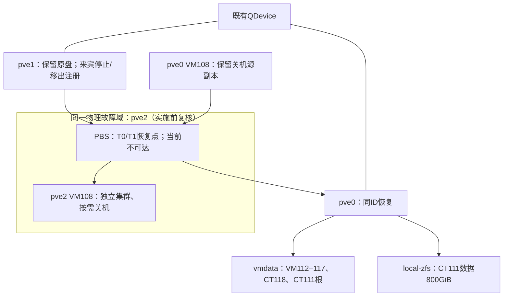

# Architecture Spine — Proxmox 整合迁移

## Design Paradigm

Backup-and-Restore with Single-Writer Cutover：冷备份是传输边界，单一注册与写入栅栏是切换边界，T0/T1 恢复点区分无新写入和已有新写入的回退。

## Invariants & Rules

### AD-1 — 单一身份与写入者 [ADOPTED]

- **Binds:** all
- **Prevents:** 相同VMID/IP/MAC的双份注册、启动及分叉写入。
- **Rule:** 保留原VMID/IP/MAC；同集群任一时刻只有一份注册；独立pve2的源/目标也只有一条权威数据谱系：目标首次启动前退下旧源注册并保留原盘，目标此后是唯一权威副本。源/目标自动启动和会重新分配留置ID的自动化冻结，ID在旧源卷清理前不得复用。

### AD-2 — 冷备份恢复为传输边界

- **Binds:** CAP-1, CAP-2, CAP-3, CAP-4
- **Prevents:** 假定LVM离线流能直接导入ZFS，或把缩块设备当文件恢复。
- **Rule:** 使用已停机T0备份恢复到目标；不使用直接LVM→ZFS离线存储映射，不做热迁移，不缩源ext4。恢复参数显式列出全部rootfs/mpX/VM磁盘归属；变更前模板/镜像/安装介质不由恢复点内容自动推定。

### AD-3 — 同ID受控注册交接 [ASSUMPTION]

- **Binds:** CAP-3, CAP-6
- **Prevents:** 已占用VMID的force恢复、源盘先被销毁及无锁配置搬运。
- **Rule:** 同集群源停止并保存私有配置/卷清单后，持原生配置锁仅退下源注册，保留全部源卷；确认集群VMID空闲后恢复目标同ID。该内部API路径须隔离演练并获准，演练与两端执行节点的软件包版本和相关模块SHA256必须匹配，未验证或有升级就禁止进入切换；不以qm/pct destroy替代。

### AD-4 — T0至开放写入的顺序

- **Binds:** CAP-1, CAP-3, CAP-4
- **Prevents:** 备份过程中恢复源业务、未校验数据即开放客户端。
- **Rule:** 停业务写入→停来宾→T0备份及验证→源宿主离线完整清单与卸载→源注册交接→目标完整恢复→隔离校验→管理身份核对→开放写入。恢复默认start=0/onboot=0，功能验证所需启动先隔离生产客户端。

### AD-5 — 容量由硬限制与峰值账本约束

- **Binds:** CAP-1, CAP-3, CAP-4
- **Prevents:** 把配置容量、可写字节、预留与临时拷贝混为一谈。
- **Rule:** vmdata准入按新增336GiB预算与128GiB余量计算，不计尚保留的VM108释放；fileserver目标800GiB，live加snapshots总quota不超800GiB，rpool系统可写余量的准入/运行下限为64GiB（不是CT111 reservation带来的系统硬预留）。PVE mp0 size=refquota，硬quota/reservation由变更清单统一管理，Samba由Webmin/操作者拥有，报告上限固定760GiB，相对800GiB硬限额留40GiB差额；差额用于元数据与写入余量，不是额外可承诺备份容量。CT111获准备份固定stop模式。rpool的SMART/历史写错误解释及ZFS健康是准入项；源盘清理还须迁后数据备份verify通过。恢复前/后刷新字节账本，忽略压缩和去重收益。

### AD-6 — 源盘保留与清理隔离

- **Binds:** CAP-1, CAP-5, CAP-6
- **Prevents:** 无回退原盘、同VMID跨存储误删、把未知unused记录当垃圾。
- **Rule:** 正常切换不删除源盘；原配置/真实卷由私有清单保管，未知unused0保持原状；同一节点有同ID孤立保留卷时禁止qm disk rescan/qm rescan和ID复用。T0/T1创建即protected并在验证后复核，取消保护另行授权，任何任务retention不得删除它们。观察和验收结束后仅按另行授权的精确卷清理，不按VMID扫描批量删除。

### AD-7 — 内容与元数据是完整性边界

- **Binds:** CAP-3, CAP-4
- **Prevents:** 仅看du/HTTP状态/抽样文件便判全量数据一致。
- **Rule:** 写入栅栏下比对完整相对路径、类型、文件内容摘要、UID/GID、mode、ACL/xattr及硬链接组；源与目标使用相同ID映射。两端均用宿主离线视图和同一份已核实ID映射，源在退注册前采集。权限错误及清单差异未解释前不得放行。Time Machine还须两Mac历史、增量与恢复验收。

### AD-8 — VM108按需生命周期 [ADOPTED]

- **Binds:** CAP-2
- **Prevents:** 把正在运行的实验负载当空VM关闭或由IaC再次启动。
- **Rule:** 先记录containerlab/Docker运行与停止恢复方法，再停机备份；pve2验证后关机/onboot=0，源配置退注册并私有归档、源盘保留且ID留置；只有权威回退流程能重新注册源。IaC明确started=false/on_boot=false。

### AD-9 — 管理写入只有一条有效身份路径

- **Binds:** CAP-5
- **Prevents:** 旧provider/state把来宾回迁、重建或重启。
- **Rule:** 迁前取得iac-proxmox-lab写维护窗口，暂停所有该state的写者。仅把VM108、CT111、VM117改为服务文件中的直接adoption资源，按runbook固定地址清单state rm旧资源后import目标，保留Terraform ownership；不改共享模块lifecycle、不重放download_file/file_id、不自动转手工。完整及定向计划均不得意外新建/销毁/替换/启动/重启；PBS VM100必须零变更。手工来宾不批量接管。

### AD-10 — 集群与见证保持既有拓扑 [ADOPTED]

- **Binds:** CAP-6
- **Prevents:** 来宾迁空被误当成可退群，或pve1停机后同时失去见证。
- **Rule:** pve2独立、pve1保留成员及QDevice；观察24–48h后单独批准关机，验证pve0获见证票且quorate，失败恢复pve1；不降票、不退群。

### AD-11 — 以目标最新数据决定回退

- **Binds:** CAP-1, CAP-2, CAP-3, CAP-4, CAP-6
- **Prevents:** 目标已写入后启旧盘丢数据，或回退又需要一份无空间承载的全量副本。
- **Rule:** 目标首次启动前可R0恢复原盘/原配置；首次启动后默认先T1保全最新数据，R0例外必须有无新业务写入的完整书面证据和操作者明确接受验证副作用丢弃。回退账本不够时停在目标保全状态；需释放精确源旧卷则另行授权且保留T0/T1，禁止不加区分的强制覆盖。

### AD-12 — 文档授权与实施准入分离

- **Binds:** all
- **Prevents:** 规格写完被误当迁移已准入，或绕过外发审批补齐必需评审。
- **Rule:** 本轮只读与文档；所有生产写入、state写入、清理和关机遵守单独授权。策略待决或必需评审未执行则状态保持draft；即使文档定稿也不等于获准生产写入或已经满足现场准入。

### AD-13 — 回退空间按池累计认领

- **Binds:** CAP-1, CAP-2, CAP-3, CAP-6
- **Prevents:** 多来宾各自把同一份thin pool空间认领为回退余量。
- **Rule:** 一个操作者维护node/pool累计回退账本；已开写guest的A分支认领总额不得超过data/metadata各自可写空间减安全余量，恢复按账本串行扣减。登记整机故障回退的全体认领；不足者只能走已批准B或C，不宣称可即时整机回源。

### AD-14 — 启动与常态内存准入 [ADOPTED]

- **Binds:** CAP-1, CAP-2, CAP-3, CAP-6
- **Prevents:** 隔离验证/恢复并发触发OOM，或把69GiB配置当成物理可兑现容量。
- **Rule:** 每次新增启动前MemAvailable至少等于该guest配置内存加8GiB宿主余量，ARC有效上限必须已记录；一次只验一台，Windows在其他迁入guest之前验证后关机，禁止与全量校验/高负载验收并发。pve2含现有PBS及其他运行负载计算。常态采用用户选定的按实测受控超配：MemAvailable低于8GiB持续60秒或memory PSI some avg60达到10%持续60秒，暂停后续启动、开写和新增重任务；低于4GiB持续15秒或任何OOM进入保全，按runbook附录G及变更单停止获准负载。恢复至10GiB以上且PSI低于阈值持续15分钟后人工放行；不能靠新增swap掩盖。阈值是初始保守操作规则，不代表满载容量或防OOM保证。

### AD-15 — PBS共享故障域的恢复边界 [ADOPTED]

- **Binds:** CAP-1, CAP-2, CAP-5, CAP-6
- **Prevents:** 将同一pve2宿主上的VM108和PBS误当彼此独立的恢复副本。
- **Rule:** 按仓库既有拓扑将PBS VM100与VM108纳入同一pve2故障域并现场复核，预算包含PBS16GiB、VM10832GiB、ARC/宿主及其他guest。PBS健康和恢复点可达才能开始切换；用户接受沿用该故障域，不以前置独立副本扩展本次范围；每次恢复须确认可读恢复点及数据截止点，较新不可读数据不计入恢复承诺，不保证双机故障回退或RPO0。

## Consistency Conventions

| Concern | Convention |
|---|---|
| 资源身份 | endpoint/node/VMID/volume四元组；ID108在独立节点不是同集群注册 |
| 容量 | bytes为证据，GiB=2^30；源df/du、池available、reservation、quota分列 |
| 时间/日志 | Australia/Sydney；私有变更清单记录T0/T1、哈希、退出码、UPID及阶段状态，不放凭据 |
| PBS恢复点身份 | server/datastore/namespace/type/ID/timestamp/owner及精确restore volid；pve2 VM108新备份独立namespace，T0/T1 protected |
| 同ID注册交接 | 原配置先私有归档、原生锁、停止状态、哈希及无冲突检查；源原盘不随交接销毁 |

## Stack

| Name | Version |
|---|---|
| Proxmox VE（现有pve0/pve1） | 9.0.3 |
| libpve-storage-perl（pve0） | 9.0.13 |
| qemu-server（pve0） | 9.0.16 |
| pve-container（pve0） | 6.0.9 |
| OpenZFS（pve0） | 2.3.3-pve1 |
| libpve-guest-common-perl（pve0/pve1） | 6.0.2 |
| pve-cluster（pve0/pve1） | 9.0.6 |
| qemu-server（pve1） | 9.0.16 |
| pve-container（pve1） | 6.0.9 |
| libpve-storage-perl（pve1） | 9.0.13 |
| bpg/proxmox（仓库锁定） | 0.70.0 |

## Structural Seed

## Capability → Architecture Map

| Capability | Lives in | Governed by |
|---|---|---|
| CAP-1 | 准入/备份/恢复证据 | AD-2,4,5,6,11,13,14,15 |
| CAP-2 | pve2 VM108及其IaC绑定 | AD-1,2,8,9,11,13,14,15 |
| CAP-3 | pve0八来宾 | AD-1,2,3,4,5,7,14 |
| CAP-4 | CT111与两Mac | AD-4,5,7,11 |
| CAP-5 | Terraform/Ansible/NetBox/PBS | AD-1,6,9,12,15 |
| CAP-6 | 恢复、观察与集群 | AD-1,6,10,11,12,13,14,15 |

## Deferred

- pve2具体存储/VMID/版本及PBS恢复访问：实施准入现场核实，未满足不实施。
- AD-3内部API交接演练与单独批准：不得交给执行者自由猜测；失败必须修订方案，禁止换成destroy。
- 维护日期、按实测吞吐调整窗口及清理期限：操作者确定后进入变更单。
- 驱动SPEC及其migration-plan/acceptance尚需由bmad-spec吸收本次方法、336GiB账本、源盘保留和窗口修订；对齐前不得进入实施。
