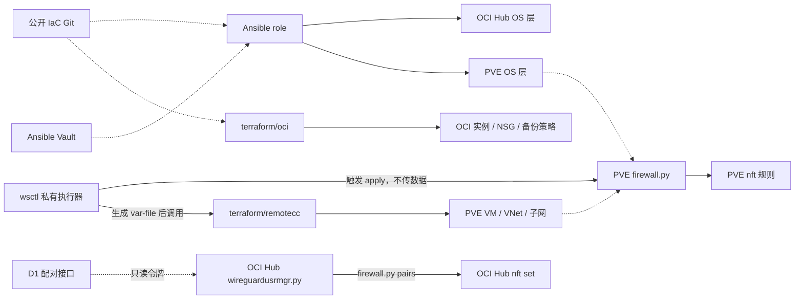

# Architecture Spine — IaC：OCI Hub 与员工工作区基础设施

2026-11-22 从员工生命周期 spine 拆出，那份 spine 已迁到私有 remotecc 仓库并原样继承这里的决定。AD 编号沿用原编号，不重排；AD-28（VM 记录归 D1）留在私有 spine。

## Design Paradigm

**三层所有权。** 云和虚拟化资源归 Terraform，OS 配置归 Ansible，随员工变化的数据不进 Git，由私有执行器 `wsctl` 作为输入提供。本 spine 的决定约束公开代码，也约束 `wsctl` 与公开代码的接口；私有 spine 原样继承。

| 层 | 组件 | 位置 |
| --- | --- | --- |
| 云资源 | `terraform/oci`：实例、NSG、备份策略 | OCI |
| 虚拟化资源 | `terraform/remotecc`：员工 VM、VNet、子网（输入是运行时生成的 var-file） | PVE |
| OS 配置 | `oci-hub`、`oci-hub-pve` role；`scripts/oci-hub/firewall.py` | OCI Hub、PVE |
| 应用数据（不在本仓库） | `wsctl`、D1 catalog、`wireguardusrmgr.py` | 执行器 VM、Cloudflare、OCI Hub |

## Invariants & Rules



以下是 2026-11 确定的目标状态，落地前以现有代码为准；Hub 指 OCI Hub。建议落地顺序：AD-25、AD-31，然后 AD-28（私有）、AD-29，再 AD-26、AD-27，最后 AD-30。AD-26 必须在 AD-29 之后：`pve-sdn.py` 的 VNet 列表现在来自策略文件，取消文件前 SDN 要先迁走。

### AD-25 — 所有权分三层 [ADOPTED]

- **Binds:** `terraform/`、`ansible/`、`wsctl`、settings
- **Prevents:** 静态拓扑只存在于线上文件；同一配置散在主机文件和运行数据里
- **Rule:** 云和虚拟化资源归 Terraform，员工数据作为输入，不写进 Git。OS 配置（防火墙代码和静态参数、systemd 单元、sysctl、黑洞路由）归 Ansible。应用数据（员工、设备、配对）归 `wsctl` 和各事实所有者。判定标准：不随员工变化的 infra 和 OS 配置进 IaC，随员工变化的数据不进 Git。settings 不再保存静态网络参数。这些参数放一份不含插值的变量文件，role 和 `wsctl` 读同一份，`wsctl` 只读。`endpoint` 只存 OCI Hub 的 IPv4，端口由使用方拼接（设备 51824，工作区 51825）。值进公开仓库前逐项判断，不宜公开的放 Vault，`wsctl` 不依赖 Vault 里的值

### AD-26 — 防火墙从主机对象派生 [ADOPTED]

- **Binds:** `scripts/oci-hub/firewall.py`（原 `boundary.py`）、`oci-hub-pve`、VM 启动 hook、`wsctl provision`/`retire`
- **Prevents:** 主机上的员工数据副本；多个模块改写同一文件；线上文件成为数据来源
- **Rule:** 不设员工层文件。PVE 上 `firewall.py` 读本机已应用的 SDN 配置和 VM 配置生成规则，读不到就失败：工作区是 `ocihub` zone 里名为 `oh<VMID>` 的 VNet，其子网、网关、地址、MAC 必须等于 VMID 算出的值，不符则拒绝加载并拒绝启动该 VM。算法只有一份：有效 VMID 502 至 754，子网是 `aggregate` 起始地址加 (VMID-500)×256 的 /30，网关 +1，VM +2，MAC 是 `02:ed:` 加 VMID 的 4 字节；overlay 不在此列，归 catalog。`firewall.py` 和 var-file 生成共用同一组测试向量。管理来源和 HAPI 放行对所有 VM 相同，不按员工存储，渲染时由 OS 层的 `management_sources`、`control_address` 展开。`wsctl` 只改对象，改完触发 PVE 的 apply，不传数据。开户时 VNet 先于规则出现，VM 保持停止，规则加载后才启动。规则在 `pve-guests` 之前加载（`Requires=`、`After=pve-cluster.service`）。对象读取、渲染、加载和 hook 校验共用一把 PVE 本机锁，hook 比对当前对象摘要和已加载规则的摘要，不符就拒绝启动。摘要由 `firewall.py` 里同一个函数计算，只含参与渲染的字段。`boundary.json` 的 `generation`、`management_access`、`hapi_*_grants` 废弃；`disabled` 是否保留由实现 story 核对。`service-egress.json` 和 `cloudflare_tunnel_vmids` 切换后不再读取，切换前盘点内容并核对放行等价。改名在同一 story 完成，覆盖文件、`oci-hub-boundary.service` 和私有代码里硬编码的路径。切换前必须做两项验证：新渲染结果与线上规则一致；只读预检现有 VM 全部符合 VMID 算法。接受的代价：规则跟随对象，不再与独立批准的策略比对

### AD-27 — Hub 配对走 nft set [ADOPTED]

- **Binds:** `firewall.py`、OCI Hub 上的 `wireguardusrmgr.py`（原 `services/oci-hub/executor.py`，配置原 `executor.json`，改名和 `firewall` 同一 story）、`register`、`retire`、`readdress`、网站配对接口
- **Prevents:** 公开代码调用私有代码；配对存两份；加人时重写规则
- **Rule:** OCI Hub 规则固定，归 OS 层；设备与工作区的配对是 nft set 的元素。所有 nft 操作都在 `firewall.py`：加载规则和 set，重载时保留元素，`pairs` 动作从 stdin 接收完整配对列表，在一个事务里替换元素。重载和 `pairs` 共用一把 OCI Hub 本机锁，读取、保留和替换都在锁内。`wireguardusrmgr.py` 是 `pairs` 的唯一调用者：用只读令牌从网站配对接口读取完整配对（AD-13），定时拉取，`register`、`retire`、`readdress` 后立即拉取，开机后第一次拉取完成填充。读取失败时不动现有元素，开机时读不到就保持空 set 并重试。set 未填入时设备和 VM 之间不通。`firewall.py` 的规则校验排除 set 元素，配对校验归 `wireguardusrmgr.py`。账本继续服务配额，不作为配对来源。Mosh 是规则里的固定范围 60000-61000，不进 set 元素，`mosh_ports` 字段废弃。逐配对的 iptables FORWARD 规则改成按接口的静态规则，由先运行的 nft 链丢弃未配对流量。`firewall.py` 不读 D1 和账本，`wireguardusrmgr.py` 不写 nft 语法，两边只共享 `pairs` 的输入，也就是配对接口的响应（AD-13）。网站配对接口的 `generation` 和配对内容必须来自同一份一致快照，影响配对的写入都要让 `generation` 前进，所以相同 generation 的配对内容必须相同。`firewall.py` 在本机锁内记录已接受的 generation 和内容摘要，拒绝更旧的响应；相同 generation 内容相同时可重放，内容不同就失败且不动现有元素。空列表合法，格式不符就失败且不动现有元素。`interfaces` 经 role 生成的 `wireguardusrmgr.json` 下发。配对在 `registered` 之后、`enabled` 之前生效，`wsctl` 不触发 OCI Hub 的 apply。上线时先发布新 `wireguardusrmgr.py`，它在 `firewall.py` 还没有 `pairs` 动作时跳过更新，再切规则。PVE 规则暂不改 set

### AD-29 — PVE SDN 归 Terraform（目标）[ADOPTED]

- **Binds:** `terraform/remotecc`、bpg/proxmox、`oci-hub-pve`、`pve-sdn.py`
- **Prevents:** VM 和 VNet 分属两个写者；SDN 清理靠单独脚本
- **Rule:** 目标状态下 zone、VNet、子网和 VM 由同一份 Terraform 输入创建和删除，`pve-sdn.py` 退役。实现 story 先升级 provider 并确认 plan 没有意外差异，版本钉在 1.0 以下，再导入现有对象。provider 不支持 SDN 全局锁，applier 会提交全部 pending，所以 Terraform 运行前做预检：取锁确认没有无关 pending 后释放，依靠 `wsctl` 运行锁串行，接受预检到提交之间的窗口。升级前核实共享模块 `proxmox-vm`、`terraform/proxmox` 和 API token 的 SDN 权限。完成前 `oci-hub-pve` 仍是 SDN 唯一写者，部署合同里“固定 0.70、不升级”一条由该 story 修订

### AD-30 — 防火墙代码只由 role 下发 [ADOPTED]

- **Binds:** `oci-hub`、`oci-hub-pve`、`deploy-oci-hub-terminal.yml`
- **Prevents:** 多条路径写同一份代码；开户流程带着旧 checkout 覆盖线上
- **Rule:** `firewall.py` 属 OS 层，只由这两个 role 下发。`wsctl` 流程只触发 PVE 的 apply，terminal play 不再复制任何代码。`configure-oci-hub-mosh-boundary.yml` 退役。跑 role 前必须确认 `/srv/iac` 是最新的（自动同步见 Deferred）。`iac.git` 的部署钩子也持 `wsctl` 运行锁，写路径运行中不换代码（读路径见私有 AD-33），计划摘要包含 IaC commit

### AD-31 — Hub 服务配置归 IaC [ADOPTED]

- **Binds:** `oci-hub` role、`portal.yaml`、`wireguardusrmgr.json`、Ansible Vault
- **Prevents:** 线上文件成为唯一副本；role 无法重跑
- **Rule:** 静态配置放 role 和 inventory，`wireguardusrmgr.json` 由 role 生成，字段固定为现有的 `profile`、`database`、`portal_url`、`portal_username`、`portal_token`，加 AD-27 的 `interfaces`、`pairs_url`、`pairs_token`。Portal 的 4 个密钥（管理员密码、API 令牌、session、CSRF）和配对接口的只读令牌放 Ansible Vault，role 可随时重跑。密钥迁移属于凭据改动，需单独授权
- **落地（2026-11-17，用户授权）：** 4 个 Portal 密钥原样从线上 `portal.yaml` 复制进 IaC Vault（`vault_oci_hub_portal_*`，未轮换，BWS 仍有恢复副本，轮换时两边一起改）；`executor.json` 由 role 用现有字段加 `usage_file` 生成；Portal 程序改为从上游 Release 下载并校验固定 sha256；`boundary.json` 只在新主机上写入，已有主机由 `wsctl` 维护。文件名仍是 `executor.json`，AD-27 的 `interfaces`、`pairs_url`、`pairs_token` 等 AD-27 落地再加

### AD-32 — Hub 备份与恢复 [ADOPTED]

- **Binds:** `terraform/oci`、OCI Hub 启动卷、`endpoint`、`wsctl`
- **Prevents:** 给执行器加 OCI 凭据；恢复时才发现 IP 变了没有预案；恢复后账本和 D1 不一致
- **Rule:** OCI Hub 整机丢失靠启动卷备份恢复，从零重建是备用。Terraform 自定义备份策略，每周一次，保留期 4 周，留在 5 份免费额度内，手动备份也计入。策略实际分配失败时改用定时任务调 OCI API，并自己清理旧备份，运行位置由 story 定，不放执行器（AD-15 不变）。恢复优先在同一实例上替换启动卷以保留临时 IP。同机的 Anki、unified-proxy、BookOrbit 会一起回退，恢复前确认它们空闲。恢复前用 `terraform/oci` 的隔离开关关闭 WireGuard 入站，防止备份里的旧身份重新生效，隔离期间 NSG 只经这个开关变更。恢复后先确认备份里的服务版本和配置兼容，按 AD-27 的顺序升级。恢复后推送 `paid_through` 快照（AD-12），用新命令按 D1 双向对账：补登记备份之后开户的员工，清掉备份之后退役或改址的身份。全部通过才解除隔离，任一步失败就保持。备份之后的月用量、采样基线和 Portal 人工原因会回退，这是接受的数据损失，恢复报告要列出。Hub 实例设 `prevent_destroy`，`ignore_changes` 加 `source_details`。公网 IP 保持临时 IP，变更时按 `docs/deployment/oci-hub-ip-change.md` 处理。上线前置：演练替换启动卷后 IP 不变、`terraform plan` 无漂移、备份策略绑定仍有效。新实例恢复分支在“全量切换 endpoint” story 完成前受阻

## 与私有 spine 的接口

| 接口 | 定义处 | 本仓库一侧 |
| --- | --- | --- |
| 配对接口响应 `{"schema":1,"generation":N,"pairs":[{"device":"<设备隧道 IPv4>","workspace":"<VM overlay IPv4>"}]}` | 私有 AD-13 | `firewall.py pairs` 的输入（AD-27） |
| 运行时生成的 Terraform `-var-file` | 私有 AD-28 | `terraform/remotecc` 的输入；读取失败不能当成空清单 |
| `wsctl` 运行锁 | 私有 AD-33 | 部署钩子在检出期间持有（AD-30）；SDN 预检靠它串行（AD-29） |
| `paid_through` 快照 | 私有 AD-12 | Hub 恢复后重新推送（AD-32） |
| 执行器不持 OCI 凭据 | 私有 AD-15 | 备份任务不放执行器（AD-32） |

## Consistency Conventions

| Concern | Convention |
| --- | --- |
| “Hub”一词 | OCI 上的 WireGuard 主机称 OCI Hub；VM500 上的称 HAPI Hub |
| 员工数据 | 不进 Git；Terraform 读运行时生成的 `-var-file`，读取失败不能当成空清单（私有 AD-28） |
| 公开前检查 | 值进公开仓库前逐项判断，不宜公开的放 Vault（AD-25） |

## Stack

| Name | Version |
| --- | --- |
| ansible-core（`.venv`，uv 管理） | `>=2.16,<2.21`（当前 2.20.10） |
| Terraform provider bpg/proxmox | 0.70.0（AD-29 要升级，目标版本在实现 story 核验并钉在 1.0 以下；2026-11 最新为 0.120.0） |
| Terraform provider oracle/oci | 8.3.0 |
| wg-portal | v2.3.1 |

## Structural Seed

```text
terraform/oci/           # OCI Hub 实例、NSG、备份策略
terraform/remotecc/      # 员工 VM、VM500、执行器 VM
scripts/oci-hub/         # firewall.py（原 boundary.py）
ansible/roles/           # oci-hub、oci-hub-pve、执行器 VM 角色
```

| 重建顺序 | OCI Hub 整机恢复 | 从零重建（备用，账本丢失的处理未定，受阻） |
| --- | --- | --- |
| 1 | 确认同机服务空闲，打开隔离开关，恢复启动卷，优先同一实例替换；不能替换就走 IP 预案（受阻，见 AD-32） | Terraform 建实例和网络，按 IP 预案改地址 |
| 2 | `terraform plan` 确认无漂移，核对备份策略绑定 | `deploy-oci-hub.yml --skip-tags verify` |
| 3 | `oci-hub-release` 确认服务版本兼容，再跑 `oci-hub` role（AD-31 落地后才能重跑） | `wsctl oci-hub-release --new-hub` |
| 4 | 推送 `paid_through` 快照，按 D1 双向对账 | `wsctl` 从 D1 重新登记全部身份，推送快照 |
| 5 | `wireguardusrmgr.py` 从 D1 填入 nft set，解除隔离 | `deploy-oci-hub.yml --tags verify` |

## Deferred

| 事项 | 为什么可以等 |
| --- | --- |
| 执行器 IaC 自动同步 | 走 CI/CD，暂不做；在此之前手动 `git push`，上线 story 先确认 `/srv/iac` 是最新的（AD-30） |
| 保留公网 IP | 临时 IP 不能原地转成同地址的保留 IP；下次本来要重发全部设备包时一起做 |
| PVE 规则改 nft set | OCI Hub 先做（AD-27）；PVE 规则复杂，现有渲染够用 |
| OCI Hub 从零重建 | 恢复靠启动卷备份，从零重建是备用；账本丢失时如何处理（部署合同不允许重新初始化为零）到时再定 |
| Cloudflare Access 应用和 Tunnel 纳入 Terraform | 目前手工配置，变化极少 |
