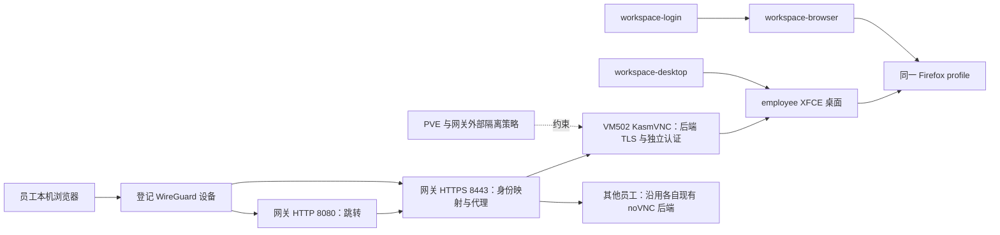

# Architecture Spine — VM502 XFCE + KasmVNC 试点

## Design Paradigm

采用分层架构：登记设备身份由接入层解析，网关选择唯一 VM 后端，VM 内桌面层管理 employee 的图形进程。员工拥有 VM sudo；员工隔离与访问撤销由 VM 外部执行。

## Inherited Invariants

原员工工作区 spine 是无 AD 的占位草稿，不据此虚构父 AD。以下约束继承现行 SPEC 与已批准的日常浏览器追加范围；本次明确的命令停止语义及端口选择优先于历史实现。

| 来源 | 本次绑定的约束 |
| --- | --- |
| SPEC CAP-1、CAP-3、CAP-6 | 每员工独立 VM、保留 sudo；网关固定映射、VM 外隔离、设备撤销及员工停用保盘 |
| SPEC CAP-2、CAP-4 | 本人订阅 OAuth；浏览器、CLI 与相关请求均在澳洲 VM；不增加防 sudo 替换凭据机制 |
| SPEC CAP-5 | 本次只绑定共享入口迁移及新设备 bootstrap；不据此承诺 5–10 人并发或授权推广桌面。新员工上线仍执行原最低检查，入口检查采用 CA 信任、8080 跳转和 HTTPS 8443 |
| SPEC CAP-7 与日常浏览器追加范围 | employee 身份、单一持久 profile、按需启动；断线及 OAuth 结束不关闭日常浏览器；重启后手动启动 |
| 现行凭据规则 | 个人令牌、浏览器会话不进入代码、普通日志、交付材料；含登录态的备份按既有授权处理 |

## Invariants & Rules

### AD-1 — 保留现有 VM 与系统 [ADOPTED]

- **Binds:** 安装包选择、Ansible 部署、Terraform。
- **Prevents:** 将桌面试点变成系统迁移或重建，或把其他发行版安装包视为已兼容。
- **Rule:** 仅 VM502 安装 XFCE + KasmVNC，保留当前规格、磁盘、员工身份与系统。实施先核实 VM502 实际 OS/架构，再在同一 OS 版本/架构、无员工数据或个人凭据的独立临时环境验证固定版本安装包、依赖及实际 systemd/X11 启动；模板文件只能作为线索。优先复用已获授权且满足这些条件的环境，不克隆 VM502 或复制其 home/profile/令牌；新建基础设施或安装依赖仍须另有明确授权，单纯依赖解析成功不能代替启动验证。兼容验证失败即停止安装，不自动跨发行版混装、强制忽略依赖、源码编译或重建 VM。此文档不授予安装、部署、重启或 Terraform apply 权限。

### AD-2 — 接入身份与隔离由 VM 外部拥有 [ADOPTED]

- **Binds:** 网关路由、PVE/网关网络策略、KasmVNC。
- **Prevents:** 客户端选择其他 VM、利用桌面端口绕过受管入口，或依赖员工可改的客户机规则隔离。
- **Rule:** 只接受已登记、启用且所属员工未停用的 WireGuard 设备；源身份由现有 peer 地址约束与受管映射共同确定。忽略并覆盖客户端提供的目标、端口、认证和转发身份头；每个设备只能进入其分配 VM。VM502 后端只绑定专属内部地址，由 VM 外规则仅允许网关连接；保留受保护网络、IPv4/IPv6、地址伪装及公网回流的既有隔离。SSH/SFTP 继续走现有受管入口，不增加转发、任意代理或直连 VM 的权限。

### AD-3 — 8080 HTTP 跳转，8443 HTTPS 提供桌面 [ADOPTED]

- **Binds:** 网关监听、客户端 URL、静态资源与 WebSocket。
- **Prevents:** 新旧协议混用、HTTP 承载桌面、HTTPS 页面连接明文 WebSocket。
- **Rule:** 两个监听均只绑定现有网关 WireGuard 私网地址。8080 校验登记设备与准确 Host 后，仅将入口导航跳转至固定的 `https://网关私网地址:8443/`；不透传任意 Host、目标或查询参数，不代理桌面、WebSocket 或认证。8443 提供 HTTPS/WSS；静态资源与 WebSocket 均走相同设备映射，握手严格校验 canonical Host 与 HTTPS Origin，拒绝异源请求。8080 不接受 WebSocket 升级。旧 HTTP 8443 在切换后退役；更新连接配置、命令输出和 bootstrap，不能依赖旧地址自动恢复。KasmVNC 自带客户端与其 WebSocket 协议一起替换 VM502 的 noVNC/websockify 链路，不复用旧 `/websockify` 协议假设。

### AD-4 — 网关代管每 VM 独立后端认证 [ADOPTED]

- **Binds:** 网关凭据存储、KasmVNC 用户、代理请求。
- **Prevents:** 全员共享后端密码、浏览器持有后端秘密、有效密码绕过设备撤销。
- **Rule:** 本条新增后端认证仅用于 KasmVNC（首轮 VM502）；其他 VM 的旧 noVNC 后端保持既有 HTTP 与认证边界，按 AD-10 显式描述。VM502 建立独立 KasmVNC 后端凭据，仅授予画面读写所需权限，不授予 owner/API 管理权限。网关先验证设备归属，再注入该 VM 的认证；浏览器无第二套密码登录。客户端 Authorization 必须被覆盖，后端认证失败不得把 Basic challenge 传给浏览器诱导输入。后端密码及证书身份由唯一管理员 provisioning 流程生成/轮换并记录于同一 Vault 记录与私密签发记录；每个匹配的密码/证书/信任引用组合具有不可变代次，AD-10 描述固定引用当前代次。两个 Ansible role 只消费这份来源，不在目标端各自生成、覆盖或每次重跑轮换。正常部署只读取描述固定的代次，不解析可变 latest、不提前消费待切换代次。轮换先在管理员存储暂存新代次，不改活动文件；role 重跑、续证与轮换不得静默停止/重启运行中的桌面。需要重启才能加载新材料时，持有人确认保存工作后才按计划维护，通过 workspace-desktop 正常 stop/start 生效；未经确认，仍有效且未撤销的当前代次和路由继续使用。为验证临时启动桌面须属于已同意的维护操作，验证结束恢复此前运行/停止状态。实际生效事务持有 AD-9 的目标锁，再关闭目标路由、将后端更新为待切换代次并验证，原子推进当前描述代次、部署网关并开放路由；失败保持关闭并恢复上一组匹配配置。回滚期保留前一代完整材料，任何 role 独立重跑都不得擅自推进代次。系统部署秘密沿用 Vault 及私密部署渠道，落盘仅相关服务可读，不出现在 URL、仓库、Terraform state、bootstrap 包或普通日志。任何缓存、静态资源、开发 API 或 WebSocket 路径都不能绕过映射校验。

### AD-5 — 私有 CA 建立两段 TLS 信任 [ADOPTED]

- **Binds:** 证书签发、设备 bootstrap、网关上游 TLS。
- **Prevents:** 忽略浏览器证书警告、关闭后端校验，或把 CA 签发权放进员工 VM。
- **Rule:** 管理员私密保管本试点专用 CA 私钥；签发策略只允许登记的网关私网 IP 及 KasmVNC 后端标识，服务证书使用 serverAuth，不签任意公网域名或员工自选身份。员工设备对该 CA 的信任依赖管理员遵守签发策略与保管签发私钥；此范围是管理策略，不声称根证书自带密码学名称限制。设备只取得经独立可信渠道核验的公开根证书，bootstrap 显式完成系统/目标浏览器的信任安装。网关证书 SAN 匹配实际私网入口 IP；KasmVNC 后端证书具有唯一身份，网关验证链与目标身份，验证失败拒绝代理；旧 noVNC HTTP 后端是 AD-10 明示的兼容类型，不要求其安装证书，也不把 TLS 失败降级为该类型。VM502 只获得自身服务证书与私钥，不获得 CA 私钥。续证和轮换由唯一管理员 provisioning 流程负责；签发记录写明到期日与管理员续期计划，Ansible 前置检查报告剩余有效期。先部署信任与新证书再切换，核对有效期，过期不得降级明文或禁用校验。安装信任及重启浏览器的必要操作由设备持有人完成。

### AD-6 — 一个桌面、一个 Firefox profile、分别控制生命周期 [ADOPTED]

- **Binds:** systemd、workspace-desktop、workspace-browser、workspace-login。
- **Prevents:** 两个显示服务争用 profile、浏览器关闭杀死开发任务，或 OAuth 清理误停桌面。
- **Rule:** AD-6/AD-7 的新控制语义仅适用于 AD-10 选择的 kasmvnc 目标；legacy 目标继续原 CAP-7 的浏览器/临时显示生命周期，共享命令只能按受管描述显式分支，不运行时探测或把新停止语义推给其他 VM。KasmVNC/XFCE 与 Firefox 全部以现有 employee 身份运行，使用同一个受管显示。桌面和浏览器采用同一系统级 systemd 管理器，分别使用 `employee-desktop.service` 与 `employee-browser.service`，均设置 `User=employee` 且不 enable 开机启动，两个服务均设置 `Restart=no`；不依赖 SSH 登录会话或 systemd 用户管理器存活。browser 依赖 desktop 就绪并随 desktop 停止，browser stop 不向 desktop 传播停止。desktop/Xvnc 异常退出时停止 browser、移除运行记录，status 明示失败；不自动恢复图形进程，由显式 start 恢复。desktop 唯一拥有显示号、XAUTHORITY、D-Bus 与运行目录，原子发布到 `/run/employee-desktop/session.json`，仅 employee 及管理员可读；browser/login 消费同一记录，不自行选择显示号或推断路径。记录只有显示实际可用才发布，重启/停止时清除陈旧记录。`workspace-desktop start/status/stop` 管理完整桌面；stop 先正常关闭受管 Firefox，再结束受管图形进程，不操作 SSH 独立任务。`workspace-browser start/open` 先调用与 workspace-desktop start 相同的模式/锁/就绪检查路径，允许按需拉起桌面；不只靠 systemd 依赖链绕过前置检查，再启动或复用 Firefox，`status` 分别识别未运行/就绪失败，`stop` 只关闭受管 Firefox；再次打开复用原 profile。保留 `/home/employee/.local/share/employee-workspace/firefox`，不创建第二份日常 profile；Firefox 二进制（包括新标签转交的临时进程）只在 browser 服务进程组内执行，主进程及 profile 写锁归该服务持有；所有受管入口、OAuth opener、XFCE 默认浏览器及快捷方式均委托 workspace-browser；CLI 通过 employee 专属 `/run/employee-browser/control.sock` 向 browser 服务发送启动就绪后打开 URL 的请求，不在 SSH/XFCE 调用方执行 Firefox。控制 socket 只允许本机 employee/管理员访问，仅接受固定 open 动作及合法 http/https URL，不接受命令或环境参数，不记录个人授权 URL。命令控制两个系统单元统一使用现有模式的 `sudo -n systemctl`，配置仅这些单元必要 start/stop/is-active 操作的非交互 sudoers 条目；这不撤销员工原有 sudo 权限。关闭 XFCE 自动保存/恢复应用会话及 Firefox 独立自启动，停止时不依赖进程名模糊匹配；重复启动/打开通过同一启动锁串行化。受管桌面禁用自动锁屏、密码屏保及空闲挂起，避免引入第二套解锁凭据；访问身份继续由网关管理。桌面停止会结束其中图形程序，文件和已保存登录态保留，未保存窗口状态不作持久性承诺。

### AD-7 — 断线与 OAuth 不拥有桌面退出权 [ADOPTED]

- **Binds:** 客户端连接、桌面监督、Claude 授权流程。
- **Prevents:** 最后一个网页断开即退出，或用浏览器可见状态冒充订阅登录成功。
- **Rule:** 关闭网页、断开 WireGuard/SSH 及最后一个 viewer 离开均不停止桌面或 Firefox；重连进入同一运行实例。同一员工的多个登记设备可同时观看和操作该实例；新连接不断开旧连接，也不需要旧连接确认，不创建每设备桌面。共享桌面只有一个几何尺寸；新连接只适配当前尺寸，不自动覆盖它。显式远端尺寸调整作用于共享桌面，按最后一次有效调整生效，所有设备同步，不能为不同设备创建第二个显示会话。VM 重启后服务保持未自动启动，需手动 start，重启前运行进程不承诺恢复。`workspace-login` 保留现有交互式 employee 调用、并发互斥、30 分钟授权超时和认证来源检查，复用同一 Firefox；成功、取消和超时仅结束本次授权流程，不关闭日常浏览器、注销账号或删除凭据。OAuth 页面与回调在澳洲 VM 内完成，不在本机打开个人授权 URL；成功由实际 CLI 认证来源及本人 UAT 判定。

### AD-8 — 撤销关闭现有连接，停用由外部执行 [ADOPTED]

- **Binds:** WireGuard、网关长连接、员工停用。
- **Prevents:** 删除映射后既有 WebSocket 仍可观看操作，或员工 sudo 恢复停用接入。
- **Rule:** 设备撤销同时移除 peer/映射、拒绝新请求并主动终止该设备已建立的 HTTP/WSS/SSH/SFTP 通道；不能只依赖 nginx graceful reload。连接终止必须在网关侧执行；若用独立网关 viewer 代理服务硬重启来清除长连接，允许其他 viewer 短时重连，但须验证已撤销设备不能恢复。不得终止 VM 内 KasmVNC/Xvnc、XFCE、desktop 或 browser 服务来实现设备撤销。设备撤销不删除 profile、不关闭该员工桌面，其他有效设备仍可访问。员工停用撤销其全部设备与受管身份，依既有 VM 外断网/停机规则结束全部访问并保留磁盘；个人凭据删除及盘处理另按既有授权执行。

### AD-9 — 切换与回滚只有一个 profile 写入者 [ADOPTED]

- **Binds:** Ansible 切换、旧服务、数据与网关迁移。
- **Prevents:** 安装时误启第二个桌面、切换覆盖活跃登录态、回滚把 HTTP 当 HTTPS。
- **Rule:** 部署前记录 VM502 实况与旧服务/端口/映射；确认已保存工作，正常停受管浏览器后才处理 profile。按既有个人凭据备份许可保存私密一致副本；许可不明时暂停涉及 profile 副本的操作，不自动做含凭据快照。保留旧服务配置，安装不得自动启动 KasmVNC；停止旧显示及代理并确认 profile 无写入者后，才启动新显示、Firefox 和映射。受管描述 type 是持久唯一模式开关，相关部署、轮换、切换与各 start 命令共享位于目标 VM 的 `/run/lock/employee-desktop.lock`（flock），AD-6 的启动锁即这把锁；目标 VM 内的单一事务进程在整个目标事务期间持有它；全部 VM 侧步骤（包括正常 stop/start 与验证）由该进程或继承同一锁描述符的子进程执行，不能另起无锁句柄的 SSH 命令执行内部 start。网关步骤仍由管理员控制端在此持锁期间执行，网关/PVE/CA 管理凭据不下发到员工 VM。共同内部 start 函数接收已持有的锁句柄与本事务标识，不嵌套重取锁。事务开始生成唯一事务 ID，写入目标 VM 的 `/var/lib/employee-workspace/transition.json` 持久进行中标记；仅在成功或完成回滚后清除。内部 start 仅在无标记，或调用方是持锁事务进程/其继承子进程且所传事务 ID 与标记一致时放行，并照常检查模式、端口及 profile。外部 CLI（含 browser start/open）永远不传事务 ID，也不得读取标记中的 ID 后冒充内部调用，不提供免锁或免标记参数；只要存在标记，外部 start 一律拒绝。连接中断或进程退出后即使 flock 释放，持久标记继续阻止外部启动；仅管理员复核完整模式/代次后显式恢复，不自动清标记。start 检查当前模式、标记、端口及 profile 归属。非当前模式的专属单元保持停止且 mask，共用名称单元在切换锁内替换为选定模式配置；退出、重跑或 VM 重启不得使被退役栈复活。VM502 新旧后端不得同时使用该 profile。失败先关闭新后端，再恢复旧服务及 VM502 映射，默认保留当前 profile；恢复旧 profile 副本须明确授权，不自动覆盖新增登录态。切换顺序为：先确认所有在用登记设备已安装并验证 CA 信任、更新新 URL，再迁移网关至 8080/HTTPS 8443，验证其代理旧后端可用，再切换 VM502 至 KasmVNC。只允许“新入口+新 VM502”“新入口+旧 VM502”“旧入口+旧 VM502”三种服务组合。回滚顺序相反：先恢复 VM502 旧后端并验证，再按需要恢复旧 HTTP 8443 及对应客户端配置；VM502 无法先恢复时必须保持其路由关闭，禁止将新 KasmVNC 经旧 HTTP 入口提供。不能仅恢复 nginx 而留下 HTTPS 客户端。其他员工只迁移入口协议，保持原桌面后端及归属。

### AD-10 — 每目标的后端描述由同一管理员配置拥有 [ADOPTED]

- **Binds:** employee-workspace role、employee-access role、切换与回滚。
- **Prevents:** 两端各自猜测协议、入口路径、证书身份或凭据，发生 TLS 降级或错误路由。
- **Rule:** 员工与设备归属只由现有受管映射拥有，后端描述以不可变 VM ID 为键，不另存一份可独立修改的员工归属；网关先由受管映射解析 VM ID，再读取其唯一管理员描述。两侧 role 与连接命令共同消费该描述，记录后端类型、固定地址/端口、服务端解析的客户端路径及固定凭据/证书代次引用。`kasmvnc` 类型必须使用 HTTPS 后端，带唯一 TLS 校验身份、信任链与 Vault 凭据引用；`legacy-novnc` 类型明确使用原 HTTP 6081 与原客户端路径，无新增 TLS/密码引用。客户端唯一 canonical 入口为 `https://网关私网地址:8443/`，8080 仅跳至这个地址；网关在 HTTPS 根路径按已经解析的目标类型分派其客户端入口：legacy 使用原 `/vnc.html` 入口，KasmVNC 使用本包客户端入口。连接命令/bootstrap 不自行拼接类型专属路径，资源与 WSS 均沿同一目标描述解析。不得从客户端参数、端口探测或握手失败自动推断/改变类型。目标路由启停状态同样持久记录于该描述，不使用可被下次整表渲染丢弃的临时开关。网关所有配置变更（含设备撤销、目标关闭、其他 VM 部署及轮换）只由 employee-access 的统一写入入口执行，在网关 `/run/lock/employee-access-policy.lock`（flock）内读取最新受管映射、目标描述和路由状态并验证后原子生效；禁止用加锁前的配置快照覆盖最新状态或恢复已撤销身份。多锁顺序固定为先目标 VM 锁、再网关全局锁；撤销只取网关锁，不反向等待 VM 锁。模式切换更新同一描述并验证配置；失败目标保持关闭，不回落到其他员工或未声明协议。新增桌面后端仅 VM502 使用，其他 VM 保持 legacy 类型；回滚同样恢复完整匹配描述。

## Structural Seed

| 单元 | 初始职责与接口 |
| --- | --- |
| 现有 employee-workspace role | 增加仅 VM502 启用的桌面配置，适配两个生命周期及登录命令；复用 employee 用户与 home |
| 现有 employee-access role | WG 地址 HTTP 8080/HTTPS 8443，设备固定映射、TLS 和按目标注入认证；保留其他 VM 的 noVNC 路由 |
| VM502 KasmVNC | 首轮复用当前内部后端端口 6081，协议改为经校验证书的 HTTPS/WSS；显式配置端口，禁止 auto 分配影响映射 |
| 其他 VM 后端 | 维持现有内部 HTTP 6081/noVNC；入口 TLS 迁移不安装桌面、不改变这些 VM 的进程生命周期 |
| 私有 bootstrap | 增加 CA 信任及 canonical HTTPS URL；不携带 CA 私钥、后端密码或个人 profile |
| Terraform/PVE | 不改变 VM502 系统、磁盘与规格；外部防火墙仅按精确入口/后端需要调整，保留其余隔离规则 |

第一轮只开放经网关的 WebSocket 传输；不开放 WebRTC/UDP、STUN/TURN 或新增公网端口。以实际协议配置和外部规则共同保证无旁路；编码优化不改变此边界。

## Stack & Compatibility

以下是 2026-10-23 的冷启动种子，安装清单由实现锁定。KasmVNC 的升级、安全更新与版本漂移由管理员维护：只按 AD-1 的兼容验证与 AD-9 的切换流程显式升级，不通过后台自动升级或跨版本覆盖；部署前发现运行包与批准版本不一致时停止并报告，不自动升降级。

| Name | Version | 约束 |
| --- | --- | --- |
| KasmVNC | 1.5.0 | 官方固定 release；实际发行版资产、SHA256 与依赖验证通过后才能安装 |
| XFCE | 目标 OS 官方软件源候选版本，实施前记录完整包版本 | 上游稳定版为 4.20；不据此强装 4.20，不额外引入第三方源 |
| Ubuntu / amd64 | 保留 VM502 实际版本；模板种子为 26.04 | 尚未读取 VM502 运行系统；不能声称已兼容 |
| Firefox / nginx / systemd / WireGuard | 沿用已部署版本，实施前记录 | 不因本试点独立升级全体基础组件 |

KasmVNC 1.5.0 的官方安装列表及 release 资产未列出 Ubuntu 26.04 包；24.04 Noble 包存在不代表兼容 26.04。若 VM502 确为 26.04，实施须给出隔离兼容证据与明确包来源，否则保持原服务并暂停安装（AD-1）。

本机试点优先使用 Chrome/Edge；VM 内继续使用现有 Firefox。Firefox 客户端的剪贴板面板可作功能对照。官方不支持 Safari 直接连接 KasmVNC；本方案经网关代理的 Safari 行为仍须实测，不预先承诺。首轮采用本机 IME 组字，经 KasmVNC 客户端 IME 模式向 VM 内应用提交文本；受管桌面不同时启用 VM 内组字引擎，避免双重组字。须验证终端和 Firefox 的实际中文输入，不能仅由安装字体判定通过；本机 IME 路径不满足时暂停该项验收，再决定是否改为 VM 内输入法。

## Implementation Acceptance

| 范围 | 必须形成的证据 |
| --- | --- |
| 安装兼容与回退 | 真实 OS/架构、固定包与校验、隔离安装及启动结果；桌面安装仅 VM502 变更，网关迁移单独核对；profile 互斥；模式切换后重跑/重启不会复活旧栈；按 AD-9 验证三种允许组合及反向回退，禁止旧 HTTP 入口承载新 KasmVNC |
| 认证与 TLS | 8080 仅跳转；8443 HTTPS/WSS；无证书警告；无信任、错 SAN、KasmVNC 后端错证书或认证错误均失败；旧 HTTP 后端仅按明示 legacy 类型放行；浏览器不取得后端密码 |
| 隔离与撤销 | VM502 所属设备成功；其他员工、未登记/撤销设备、错误 Host/Origin、伪造认证头及目标参数失败；撤销后已建连接中断；LAN/公网/其他 VM 无法直连后端；既有 SSH/SFTP 与 VM 外隔离回归通过 |
| 生命周期与登录态 | 双设备并发连接同一桌面，新连接不踢旧连接；共享尺寸调整一致；无额外解锁提示；断线重连窗口/程序仍在；browser stop 不杀图形终端；desktop stop 结束图形程序但保留 SSH 独立任务；服务异常明确报错且不自动重启，显式 start 可恢复；同一事务在标记存在期间可凭继承锁句柄及匹配事务 ID 完成自身 start/验证，同时外部 start 被拒绝；中断后标记仍拒绝外部 start，恢复不会重入死锁；轮换不强制重启、维护后恢复原运行状态；VM 重启手动 start；同 profile、OAuth 成功/取消/超时和 CLI --check 适配新组件 |
| 基本操作 | Firefox、终端、文件管理器、中文输入、双向文本复制粘贴、窗口缩放；本人完成真实 OAuth 并核对账号、来源与澳洲出口 |
| 中国网络体验 | 同设备/网络/分辨率/任务与原 noVNC 顺序对照，记录打字回显、代码滚动、画质、流量和 VM CPU/内存；由本人确认可用，不预设未经同意的性能阈值 |
| 共享入口迁移 | 其他员工的当前 noVNC 在 HTTPS 8443 经原归属映射可用，8080 引导有效；至少一台 legacy VM 验证共享命令的原 CAP-7 分支：start/status/open/stop、OAuth 完成/取消保留浏览器、stop 关闭旧图形后端、输出 canonical HTTPS URL，且不读取新 session.json 或启动 KasmVNC；CA 安装与 URL 更新先于切换，不能以 VM502 单机通过代替 |

静态检查不替代实网、撤销长连接、个人 OAuth 与中国侧验收。试点通过不自动授权推广其他员工 VM。

## Deferred

- 精确 XFCE 包版本及显示号：在实际 OS 和依赖验证时确定；显示号只能由 AD-6 的桌面运行记录分发。首轮中文组字位置已固定为本机，VM 内输入法仅在该路径不满足且另行决定后考虑。
- WebRTC/UDP、GPU 与视频编码调优：仅在首轮 WebSocket 基准证明需要时重新决策，当前不开放相关网络路径。
- 自动开机启动、HA、集中桌面平台、IDE 基线及其他 VM 推广：不属于本试点；重启后按需启动已经确定。
- 自动证书平台与通用门户：本次采用管理员签发/续期与既有 bootstrap，不引入新平台。
- 系统迁移或源码编译：只有 AD-1 兼容失败且用户另行选择后才重新设计，不属于默认恢复路径。

## Source Anchors

- 当前 brownfield 文件位于 `/Users/weierfu/.codex/worktrees/employee-claude-architecture/IaC/`：`_bmad-output/specs/spec-employee-claude-workspace/SPEC.md`、`docs/planning/employee-workspace-browser-auth-change.md`、`ansible/roles/employee-workspace/files/workspace-browser.py`、`workspace-login.py`、`tasks/login.yml`、`ansible/roles/employee-access/templates/auth-viewer-nginx.conf.j2`、`tasks/auth-viewer-policy.yml`、`terraform/proxmox/employee-template.tf`。该工作树含未提交部署变更，实施不能只取其 HEAD 代替这些现行输入。
- [KasmVNC 1.5.0 release](https://github.com/kasmtech/KasmVNC/releases/tag/v1.5.0)、[安装支持列表](https://docs.kasmvnc.com/docs/install)、[实际发布资产](https://github.com/kasmtech/KasmVNC/releases/expanded_assets/v1.5.0)：版本与安装兼容范围。
- [KasmVNC Server Side](https://docs.kasmvnc.com/docs/serverside)、[Configuration](https://docs.kasmvnc.com/docs/configuration)、[Client Side](https://docs.kasmvnc.com/docs/clientside)：独立认证用户、TLS、端口、会话与客户端限制。
- [XFCE 下载页](https://www.xfce.org/download/)：上游稳定版 4.20，发行版包版本由其软件源决定。

## Review State

机械 lint、独立输入对账、原生技术核验及指定 PAL 架构 rubric/一致性评审均已完成；已修订实质发现，最终受影响条款核验均为 PASS，无未处理阻塞项。两项实际返回模型均为 `claude-opus-5-5`、退出码 0。审核通过的是本架构契约，实施兼容验证与实网/本人验收仍按上文执行。
