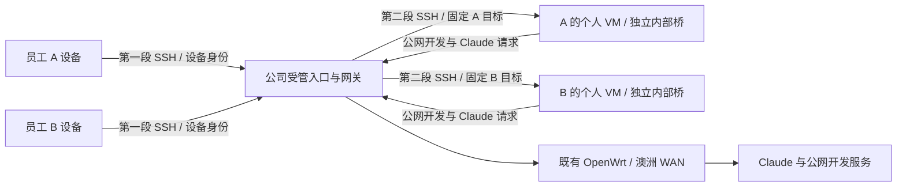

# 待验证的实现方案 / Implementation options

已确认的权限和接入边界以现行SPEC为准：员工拥有本人VM的sudo，自主管理依赖和工具；公司提供基础Claude Code、按设备身份映射的受管SSH入口及VM外隔离。以下拓扑和资源参数是实施建议，不代表现场已部署或验收通过。

## 接入与候选拓扑

员工SSH在受管入口终止，入口按已认证设备身份建立到本人VM的独立第二段SSH；SFTP采用同一固定目标映射。员工不获得入口通用shell，不自行选择第二段目标，不使用ProxyJump或直接访问客机SSH。受管入口与路由可部署在同一专用网关VM，具体实现仍须验证；图省略合法返回、管理员维护和首次OAuth授权。

开发VM正常访问公网代码仓库、依赖和开发服务，经受管路由及既有澳洲WAN出网。家庭、PVE管理、个人Tailscale、公司管理面等受保护目的地由VM外策略拒绝，覆盖IPv4／IPv6及公网回流。该方案不承诺全面识别或阻止员工自定义加密隧道、终端字节中继，也不声称能阻止sudo用户修改本人VM中的客户端、令牌或运行配置。公司维护的路由与入口控制按现行验收范围证明。

OAuth登录使用的实际浏览器会话和Claude CLI仍在澳洲VM，保留实际身份、授权流程和出口证据；不要求建立能对抗sudo用户的令牌来源绑定。第一阶段图形授权入口尚未获准，Q-2仍须核实可用操作路径。

## 接入路径和当前证据

| 路径 | 当前状态与下一步 |
|---|---|
| Cloudflare 网页终端 | 员工已反馈高延迟；具体网页终端实现未完全确认 |
| cloudflared + 原生 SSH | 员工也反馈高延迟，单纯换客户端未解决；历史路径由SSH ProxyCommand调用cloudflared |
| WARP + 既有 cloudflared／原生 SSH | 尚无对照结果；DNS-only模式不等同WARP隧道 |
| 自建 WireGuard | 保留为线路试测候选，未部署、未测试；若采用，应只提供到受管入口的访问，不恢复员工直连客机SSH |
| VLESS TCP Reality／Vision 客户端代理 + 既有 Cloudflare | 用户提供过候选，尚无效果反馈；节点分享链接与含凭据配置不进入本契约 |

WARP与WireGuard分开测试，不采用WireGuard over WARP。普通WARP本身不授予公司私网访问；若沿用现有网页终端做WARP对照，不需要客户端cloudflared。Cloudflare／WARP／VLESS仅作对照；性能结果不自动改变公司接入自建维护的要求。[Cloudflare 原生 SSH 说明](https://developers.cloudflare.com/cloudflare-one/networks/connectors/cloudflare-tunnel/use-cases/ssh/ssh-cloudflared-authentication/)

比较线路时尽量固定员工、网络、测量方法和端点；旧交互反馈及不可比数据只作参考，正式选择依赖真实工作验证。旧A-5中“Q-8前必须无员工代码、无OAuth、无Claude”的特殊试测次序不再作为强制推定；这不授权部署、使用个人凭据或跳过受保护网络隔离。具体试测、凭据配置和外部变更仍需相应授权。

正式保留的旧／新公司入口均须符合现行设备身份映射、受管SSH及网络隔离规则。Q-4／5核对已有试用VM、Access应用和连接器；上线前对旧公司入口明确下线或纳管，不假定新入口使旧通道自动失效。

若选用WireGuard，私钥留在设备，管理员登记公钥、设备身份及受管入口访问关系；可用握手状态排错，保活按实际NAT条件使用协议原生能力，不新增重连脚本。[WireGuard 官方说明](https://www.wireguard.com/quickstart/)

若首轮接入不满足实际工作，先记录失败形态再比较其他自建协议／入口位置；不预先建设多协议网关、云中继或备用线。

## 网络实现候选

- 首轮建议单节点、每位员工独立内部bridge和子网；bridge无物理端口、不向客户机提供trunk。专用网关一张上联网卡及每员工一张内部网卡，员工VM只接本人内部bridge。此为实施建议，不代表现场已有这些接口。
- PVE／网关在VM外执行隔离及IP／MAC伪装限制。内部bridge不配置宿主IP并不能单独证明宿主不可达，仍须验证宿主输入、IPv6／link-local和受保护最终目的地。
- 先核实PVE版本、后端、全局／客机／网卡启用层级和实际规则；现有bridge名称及单个网卡firewall标志均不能证明隔离生效。[PVE 官方文档](https://github.com/proxmox/pve-docs/blob/master/pve-firewall.adoc)
- 当前bpg/proxmox 0.70.0的Linux bridge资源在创建、更新和删除时调用节点网络重载。部署前须核对节点待应用网络变更及管理恢复路径，不接管现有家庭／管理bridge。[版本化实现](https://github.com/bpg/terraform-provider-proxmox/blob/v0.70.0/fwprovider/network/resource_linux_bridge.go)
- VMID、网段、bridge名、DNS、上联和维护来源须对账，不从示例推定真实分配。跨节点时再核验链路／交换机能力及隔离方式，不默认内部bridge跨节点互通。

## 试用规模和资源建议

建议从一台受管网关、两台明确归属的测试VM起步，在一个选定节点验证。一个真实员工使用本人VM，另一台作为拒绝访问的授权目标；增加第二员工时各用独立的设备接入身份、目标映射和个人OAuth。不得借用无关业务机器做攻击或隔离目标。

| 对象 | 草案建议起点 | 状态 |
|---|---|---|
| 公司受管入口／网关 | 2 vCPU、2 GiB RAM、16–32 GiB 系统盘 | 未定容量／部署参数 |
| 每人开发 VM | 4 vCPU、8 GiB RAM、100 GiB 持久系统盘 | 依真实项目调整；持久性理解见 A-1 |

候选沿用可维护Linux模板、个人用户、sudo、公钥认证、Git和基础Claude Code。员工自行安装、配置和升级依赖及工具；Linux适用性及CPU／磁盘／内存负载经真实任务验证，不承诺Windows／macOS专用项目可直接运行。

试用通过后扩至5–10人。跨节点或分配到独立pve2前重新验证相同隔离结果；不推定pve2属于集群或链路自动互通，不新增HA。

员工停用撤销受管入口身份、映射和会话，并从VM外断网或停机、保留磁盘；具体操作入口与副本处理按现行SPEC及Q-6落实。设备级撤销覆盖公司受管会话，不扩大为对任意第三方自建通道的保证。
