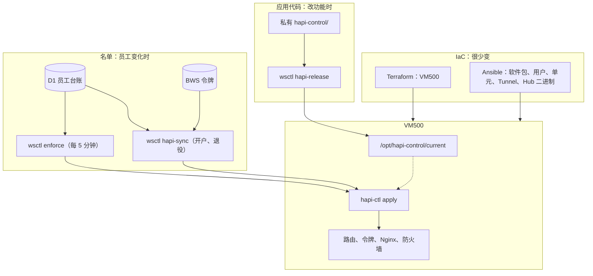
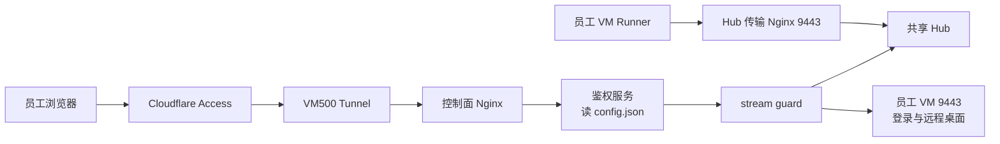
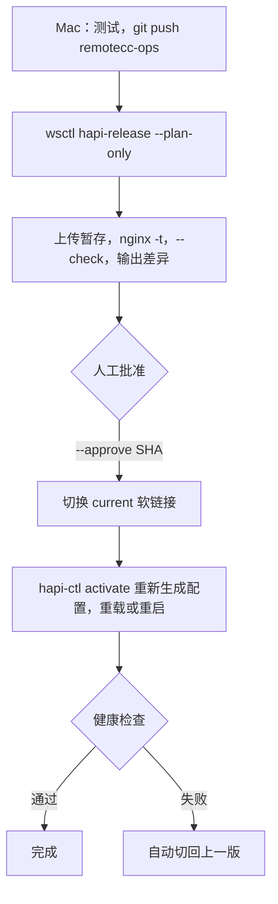
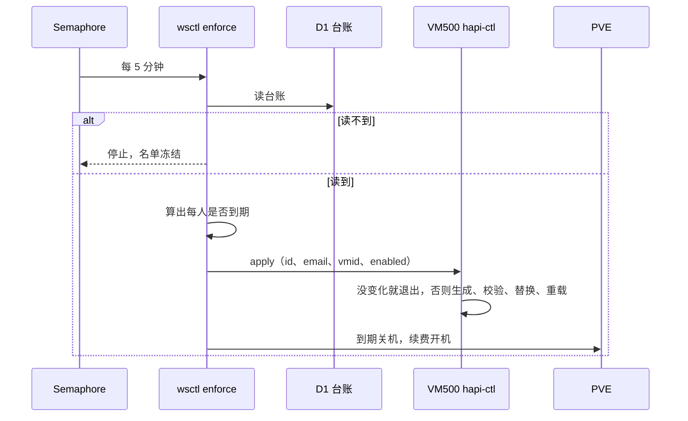
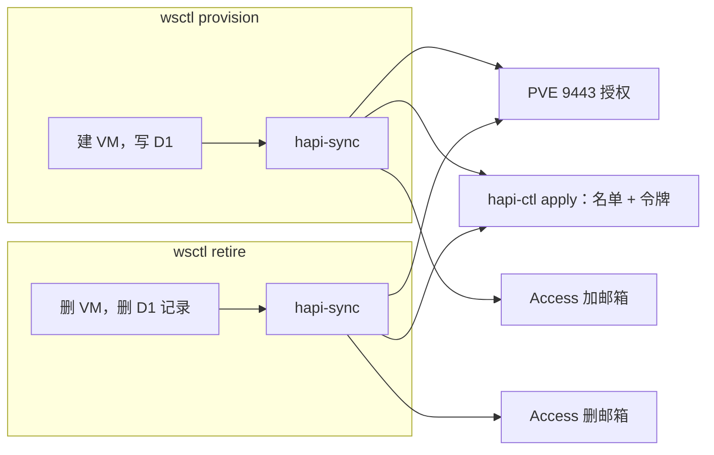

# HAPI 控制面维护说明

这份说明写给将来维护 HAPI 的自己：东西在哪、怎么发版、名单怎么走、出问题先看哪里。

## 一句话

IaC 管机器，`hapi-release` 管代码，`enforce` 和 `hapi-sync` 管名单。三条路互不混用，日常都不经过 Ansible。



判断一件东西归哪条路：**换一名员工或改一行页面时要不要动它？** 不用动的归 IaC。

## 东西在哪

| 内容 | 位置 |
|---|---|
| 应用源码 | Mac：`~/Projects/IaC/remotecc/hapi-control/`；执行器：`/srv/remotecc/hapi-control` |
| 线上版本 | VM500：`/opt/hapi-control/releases/<版本>/`，`current` 指向在用版本 |
| 派生文件 | VM500：`/etc/hapi-control-plane/`、`/etc/hapi-shared-hub/`、`/etc/employee-access.nft` |
| 基础设施 | `terraform/remotecc/employee-access.tf`、`ansible/roles/hapi-control-plane`、`hapi-shared-hub`、`hapi-ingress` |

**不要手工改派生文件**，下一轮 `enforce` 会覆盖。

## 请求怎么走



两点容易忘：

- 所有浏览器流量都经过鉴权进程，所以重启鉴权服务会让在线员工断开几秒。
- Runner 走另一条路，不受鉴权重启影响。

## 发版



```bash
cd ~/Projects/IaC/remotecc && git push remotecc-ops HEAD:main
```

```bash
sudo /srv/remotecc/wsctl/wsctl hapi-release --plan-only
```

```bash
sudo /srv/remotecc/wsctl/wsctl hapi-release --approve <SHA>
```

后两条在执行器上运行。计划里写明是否需要重启鉴权服务：改了 Python 才重启，只改页面或 Nginx 不断线。

回滚：

```bash
sudo /srv/remotecc/wsctl/wsctl hapi-release --rollback <版本>
```

回滚只换代码，不动名单和令牌。相邻版本必须能共存：要改 `config.json` 格式或路由时分两次发布。要改 `wsctl` 与 `hapi-ctl` 的协议时，先发布兼容新旧 `schema` 的 `hapi-ctl`，再推送 `wsctl`，因为推送到执行器后 `wsctl` 立即生效。

升级 KasmVNC 只改 `hapi-control/` 里的版本和校验值，内联脚本的 CSP 摘要也在这里。

## 名单怎么走



规则：

- **能否使用不存储**：员工在册且未到期就能用，没有单独的 HAPI 开关。
- **到期**：下一次成功的 `enforce` 拒绝登录，通常 5 分钟内。只停 route，Runner 令牌不动，VM 同一轮关机。
- **续费**：同样在下一轮恢复，身份绑定不变。
- **紧急停用**：手工关掉这名员工的 VM，`enforce` 不会开回来。员工还能打开 HAPI 页面和 Hub 里的会话记录，但 VM 上做不了事。
- **令牌**：只有 `hapi-sync` 送，也只有它能回收。
- **读不到台账**：名单冻结，在册员工照常用，不会全部被拒。

## 新员工和退役



退役时 `hapi-sync` 失败也不用慌：下一轮 `enforce` 会让路由下线。令牌、PVE 授权和 Access 邮箱的残留由每日 `hapi-sync` 清理，也可以手动运行。

## 出问题先看哪里

| 现象 | 先查 |
|---|---|
| 全部员工进不去 | `hapi-control-auth`、`hapi-control-proxy`、`hapi-ingress-tunnel` 是否在运行；`readlink /opt/hapi-control/current` 是否为最近发布的版本 |
| 发版后出问题 | 先 `hapi-release --rollback`，再查原因 |
| 某人进不去 | 是否到期；`config.json` 里的 `enabled`；Access 策略里有没有邮箱 |
| 新员工进不去 | 令牌是否送达：`hapi-sync` 的结果；PVE 9443 授权 |
| 到期员工还能进 | Semaphore 里 `wsctl enforce` 的结果，看有没有 `ENFORCE_HAPI_PUSH_FAILED` |
| 配置被改回去 | 手工改过派生文件；派生文件每轮都可能被重新生成 |
| 重载失败 | `/run/hapi-control/pending` 还在，说明上次没成功，下一轮会重试 |
| `hapi-ctl` 报 schema 不支持 | `wsctl` 比 VM500 上的版本新，先发布 `hapi-control` |

## 不要做的事

- 不要手工改派生文件。
- 不要让 IaC 角色写路由、令牌或名单文件。
- 不要把发版并入 `hapi-sync` 或 `enforce`，它们会自动运行。
- 不要把令牌写进 D1，也不要把管理令牌放到 VM500。
- 不要在 Mac 上运行写操作，走执行器上的 `wsctl`。
