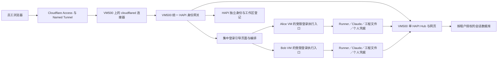

# HAPI／Cloudflare 员工工作区开户设计

状态：统一入口、单Hub与会话数据库现已在VM500运行；VM502保留原Runner、Claude及localhost3006兼容代理。独立BWS、固定namespace、最终数据库导入及20项现场验收已完成；用户已完成Cloudflare登录并确认HAPI可用，完整新员工开户仍未就绪。参见[迁移记录](../planning/2026-10-30-hapi-single-hub-migration.md)。

网络阶段已补充独立计划、VM外边界角色、停止创建的VM模块与pre-start门禁，见[网络开户自动化](../guides/hapi-network-automation.md)。按用户要求直接在pve2新建两台测试VM，现有vmbr0端口ACL的35项真实通信与11项生命周期验收通过，详见[两VM验收记录](../planning/2026-10-30-hapi-two-vm-pve2.md)。两台QA VM随后已按原Terraform state回收，关联测试接入和pve2巡检已退役，见[回收记录](../planning/2026-10-31-hapi-qa-retirement.md)；组件和验收证据继续保留。VLAN后端仍未实测；私有开户执行器、正式分配／state绑定、新员工HAPI／Cloudflare身份绑定及全新VM个人首次授权验收仍待补齐，此进展不表示已能自动交付员工VM。

本文件落实用户已确认的方向：HAPI 开户独立于 WireGuard 的 `employee-provision`／`onboard.sh`；员工统一访问 `https://hapi.willfan.me`，身份验证后进入本人独立 VM。VM500 明确承担 HAPI 控制面与统一公网接入，Cloudflare Tunnel 连接器终结在 VM500。本文不是部署记录，不授权创建基础设施、申请新凭据、发送邮件或迁移既有工作区。

## 1. 边界与现有基线

| 内容 | HAPI 新流程 | 原 WireGuard 流程 |
|---|---|---|
| 员工接入 | 浏览器、Cloudflare Access／Tunnel | WireGuard，含 existing／oci-hub |
| 管理入口 | 本任务工作树已有独立基础设施候选入口；完整开户未实现 | 原 `remotecc/employee-admin/onboard.sh` |
| 私有源码／运行数据 | 主checkout的独立`remotecc/hapi-admin/`／`remotecc/hapi-data/`，绑定专用Sandbox | 原 employee-admin／employee-data |
| 台账与恢复 | HAPI 独立登记、计划、检查点、回执 | 原工作区／设备登记与检查点 |
| 员工交付 | 统一网址及网页登录说明 | 原设备接入包和 bootstrap 说明 |
| 凭据边界 | HapiWorkspace项目与专用机器授权已建立，服务凭据固定映射namespace | 原EmployeeWorkspace已按用户指定退役；OCI-Hub项目保持独立 |

主checkout的私有`hapi-admin/hapi-entry.py`已正式绑定独立数据目录、IaC任务工作树及专用Sandbox，支持doctor／request／plan-infra／apply-infra／status，见[管理员运行绑定](../guides/hapi-admin-runtime.md)。17项合成执行器、5项绑定回归及正式doctor／挂载检查通过，生成Terraform的init-backend-false／validate已通过；未用它新增真实员工或执行实际apply。它只标记基础设施就绪，不发布服务／身份／邮件；私有源码有独立本地Git，没有私有Git远端。公开IaC仅保存技能、通用基础设施代码和说明；真实邮箱、分配、计划、状态与凭据保存在私有运行区。

可以复用 VM 模块、干净基线模板、基础配置和登录助手代码；不能调用旧开户入口以完成 HAPI 开户，不能读写 WireGuard 的申请、设备身份、状态库或接入包。同一邮箱可在两套系统存在，不能因此自动认领、复用或迁移旧 VM。VMID、IP、域名及 Terraform 所有权须做共享基础设施层面的冲突检查。

当前已知基线：

- VM500现已部署身份检查、按登记代理、票据交换、集中登录页面及单共享Hub；固定版本鉴权补丁绑定独立凭据／namespace及JWT凭据版本。`hapi-workspace`中的每VM Hub布局属于旧原型，后续使用`hapi-shared-hub`与worker组件。完整新员工开户后端及新VM个人首次授权仍待验收。

- `employee-hapi` 角色仍硬限制 VM502／`employee-control` 及试点域名；多员工部署不能靠命令行绕过断言。
- HAPI v0.33.2 已有 REST、SSE、终端 Socket.IO 和 `/api/auth`；不原生把 Cloudflare 邮箱身份变为 HAPI 会话。
- `codex/vm502-login-guide` 的网页登录引导已部署到VM502，作为本设计可复用的登录组件。部署记录包含6082服务、Tunnel version3、协议检查及幂等验证；当前个人账号已登录，尚不能用该状态代替全新VM的首次OAuth验收。源版本已核对为本地提交`bf4e5bd`，取用的9个源文件摘要与该提交tree一致；拆分后的派生文件另有摘要记录，后续以获批代码／artifact交付，不以可变工作树作为部署来源。
- VM502是管理员保留试点，不作为新员工槽位；本次按单独授权完成Hub／数据迁移，原Runner PID、项目和Claude登录状态保留，旧Hub启动已禁用并设门禁。HAPI凭据已转入独立BWS项目。
- UCloud／优选 CF 上游／Argo 属于独立网络优化，不是本流程创建 PVE 工作 VM 的前置依赖。

## 2. 目标体验与服务结构



用户已明确选择单Hub。目标是VM500集中Hub、同版本网页和会话／消息数据库；员工VM保留Runner、Claude、工程文件、个人浏览器与授权。原“每员工VM独立Hub”是历史原型布局，不再作为新部署目标；VM502旧Hub已按批准的迁移计划停止并禁用，原Runner与localhost3006兼容代理继续运行。

所有员工使用同一域名；VM500将受验证Access身份绑定到服务器端固定namespace，再访问共享Hub。每位员工／Runner持独立且可撤销的凭据，不能把共同base＋可修改namespace后缀当权限边界；原生不足已通过7项真实上游HTTP／Socket认证探针复现，见[单Hub评估](../planning/2026-10-30-hapi-shared-hub-assessment.md)。CF身份、应用JWT与允许的namespace必须一致，不能仅依赖共享Hub签名有效。个人工程目录和Claude凭据保持在本人VM，会话数据由Hub按租户授权保护。

VM500运行专用Tunnel连接器、身份网关、单Hub、集中网页／登录引导和编排。统一入口连接器、身份／代理服务及共享Hub已在VM500运行；应用请求进入本机Hub，个人登录执行仍通过mTLS访问本人VM。员工VM不持公网Tunnel token，主动连接VM500 Hub；登录执行／画面仍保留受限私有通道，不能因移Hub直接删TLS适配器。HAPI继续使用独立账号、配置、登记与网络所有权。

用户于2026-10-30进一步明确：VM500上的WireGuard网关当前仍运行、尚未退役，准备迁向OCI并退役原实现；VM500的目标职责不包含WireGuard网关。不能把目标状态当作旧服务已停止，也不据当前运行状态设计长期共存。实施前核对服务、接口、路由／NAT、防火墙、凭据引用和Terraform所有权，以及OCI接入与回退依赖，按独立迁移计划退役。HAPI改动不得提前移除仍在承载流量的旧规则或中断现有用户；VM500作为HAPI共享控制面的故障影响仍须列入计划。

VM500的网关职责限定为员工接入；员工VM自身出网沿用其默认路由：

| 方向 | 目标职责与路径 |
|---|---|
| 员工访问工作区 | 浏览器 → Cloudflare Access → Tunnel → VM500连接器／身份网关 → 本人VM；无员工VM公网直达入口 |
| 员工VM访问外部服务 | VM → 其已批准的默认路由 → 外部服务；HAPI不要求经VM500转发／NAT，不因部署接入网关修改默认路由 |

Cloudflare Tunnel负责应用接入，VM500不作为本方案的员工VM通用互联网出口。使用默认路由不等于给VM分配公网IP，也不取消VM外横向和管理网络隔离。若现有VM默认路由实际仍依赖VM500旧WireGuard网关，须在旧网关退役计划中明确替代路径并验收连通性；这是迁移依赖，不是HAPI新增集中出网要求。

VM502直连专用Tunnel是历史单人试点，现已由side chat迁至VM500并停止旧连接器；原角色增加统一入口marker保护，不能重新部署旧独立入口。仓库提交`10e551a`仍解释旧布局的来源，不作为新员工模板。Hub及数据库已迁入VM500，Runner保留在VM502，详见单Hub迁移记录。

## 3. 独立登记与输入契约

普通申请只要求邮箱，例如以下**拟定输入格式**：

```yaml
recipient: alice@example.com
```

管理员工具先按规范化邮箱查 HAPI 登记；新申请默认取邮箱 `@` 前的小写用户名作为工作区 ID，仅纯数字用户名增加 `user` 前缀。ID必须通过系统账号／资源名校验；含不支持字符、长度超限或与其他邮箱碰撞时请求管理员指定合法 ID，不静默删字符、截断或合并。HAPI资源使用独立`hapi-`命名前缀，不把任意输入直接拼成命令或路径。重跑复用同一登记，不轮换已有密钥。员工显示名和未来邮箱变更不自动转移 VM 所有权。

HAPI 台账为本流程唯一业务登记源，至少保存：

| 分组 | 非秘密字段 |
|---|---|
| 身份 | 收件邮箱、工作区 ID、启用状态、Access issuer／subject 绑定 |
| 资源 | PVE 节点、VMID、MAC、网络分配、模板及基线版本、state 资源地址 |
| 接入 | 统一公开 origin、受控后端 endpoint、TLS 身份、路由代次 |
| 生命周期 | 申请摘要、计划 SHA、检查点、验证记录摘要、交付回执 |
| 秘密引用 | BWS 记录 ID／版本引用；不保存秘密值 |

若开户时尚无 Access subject，可预登记获批邮箱；首次登录仅允许预期 issuer／应用签发且邮箱完全匹配的身份，通过原子写入绑定 subject。后续 subject 或归属冲突停止处理，不自动换绑。由该台账生成网关路由快照，不手工维护另一份员工对应表。

## 4. 身份登录与 HAPI 会话衔接

1. Access 保护整个统一主机名。延续用户偏好的应用级 7 天会话作为初始设计；实施时批准具体应用，不改账户全局时长。
2. 网关验证 Access JWT 的签名、issuer、audience、有效期和身份，再查当前台账。未知、停用或未批准身份拒绝访问；后端故障返回本人工作区不可用，不切到其他 VM。
3. 同源`POST /_workspace/session`在网关依据受验证身份取得绑定本人namespace的服务凭据，调用VM500共享Hub的`/api/auth`，返回该namespace的短期JWT和最小身份／代次。接口保持同源、CSRF与不缓存；不得接收客户端自选namespace作为授权依据。当前线上实现已切换至VM500共享Hub。
4. HAPI 前端增加独立的入口身份认证来源，接入现有认证初始化和刷新逻辑；不要求员工输入基础 token。当前版本 JWT 为 4 小时，是否能刷新以 Access 和工作区状态为准。刷新失败清除应用会话，不延长已失效的入口授权。
5. REST、SSE、Socket.IO polling／WebSocket进入共享Hub前，核对CF身份与应用JWT namespace一致；登录执行／画面按经授权的本人机器映射选VM。客户端邮箱、VMID、机器ID、cookie或有效但属于另一身份的JWT均不能扩大权限。既有流绑定原身份／namespace／工作区代次。
6. 同一浏览器换账号前清除前一身份的应用会话和私有数据缓存，关闭旧 SSE／WebSocket，再加载新身份。注销／停用须终止对应活跃路由会话；不能仅依赖 Access cookie 自然过期来宣称已有连接已撤销。

### 4.1 Access策略与撤销来源

HAPI独立台账中的获批且启用邮箱生成统一Access应用的allow名单；不使用“所有邮箱允许、只靠网关拦截”作为初始方案。开启新工作区前，先发布禁用路由和精确Access策略增量，读回策略／AUD后再启用本人路由，验证通过才交付；失败保留本人路由禁用，不覆盖其他人的策略。保存策略对象ID、基线版本／摘要和本次增量，检测并发修改，不全量覆盖未知规则。

停用先在网关禁用本人身份／路由并关闭长连接，再同步移除Access allow项；即使Access会话尚有7天有效期或策略同步失败，网关也必须拒绝。会话终止和策略移除分开记录，未完成项阻止退役完成。恢复需管理员批准重新启用，重新验证策略、身份绑定与后台服务，不能凭后端恢复自动解禁。

### 4.2 应用能力与日志基线

保留试点的`--no-relay`、Runner的`HAPI_DISABLE_PEER_TOOLS=1`及非必要推送关闭配置。统一网关在Hub之前拒绝`/api/push/*`，不因集中Hub重新开放。精确配置按锁定版本验证，不将试点能力限制默认为新版仍成立。

网关、反向代理和Tunnel的日志不得记录认证头、Cookie、授权码、HAPI JWT或含令牌的query；错误正文不回显上游秘密。实施时核对SSE及Socket.IO真实认证载体，配置查询参数脱敏并使用合成票据验证，不用真实秘密做日志测试。

HAPI原生namespace的共享基础token＋客户端后缀不能提供本项目要求的身份隔离。用户已选择单Hub，因此必须实现并验证独立凭据→固定namespace及全通道授权，不能直接启用原生共享token配置；未经该验证不向多个员工开放。

BWS继续作为HAPI基础令牌和Tunnel令牌的管理来源；当前VM502试点已通过BWS生成受控runtime配置，再将服务所需令牌物化到VM。BWS负责秘密管理与分发，运行时调用Hub仍需使用相应令牌，不能把“存储在BWS”理解为服务从不接触秘密值。新流程的独立BWS授权边界不改变这一原则。

共享Hub目标下，网关以本人作用域凭据换短期JWT；长期凭据仍由BWS管理，运行时只物化所需值。旧“员工VM本机交换以减少Hub令牌在500副本”的评审建议不再自动适用于新布局；具体权限与持有者须在新迁移计划明确，不暗示短期JWT可消除控制面被攻破的影响。

长期服务凭据不发给浏览器。网关只获得所需的 HAPI 服务凭据和自身传输身份，不获得管理员 BWS 机器令牌、员工 SSH／WireGuard 私钥或个人 Claude 凭据。Claude 的登录、浏览器 profile 和凭据文件始终保留在本人 VM。

## 5. VM 网络与首次启动

HAPI 使用独立的 Terraform 资源集合及 state／工作区，拟定源码根为 `terraform/hapi-workspaces/`；具体 backend 名称须由实施计划确定，不因 init 自动创建 HCP 工作区。不向旧 `employee_workspaces` 或 `oci_hub_workspaces` 登记 HAPI 新 VM。

PVE 网络和 ACL 使用独立 HAPI 资源及规则所有权。精确VNet、地址、管理来源和端口清单必须先进入计划；VM500承担HAPI员工接入转发，不承担员工VM自身出网。保留工作VM已批准的默认路由；新VM在计划中明确其实际网关与DNS，不自动指向VM500。HAPI新增接口及防火墙规则须明确归属；VM500当前WireGuard规则按迁移清单核定依赖与退役，不能盲目叠加、覆盖或提前删除。VM500资源在任何时刻仅由一个state管理，沿用当前经核实的归属；如需转移state则另列精确迁移计划，HAPI state不重复认领该VM。

- 新 VM 从已批准的干净基线克隆，首次保持停止、禁止自动启动。模板不含个人 Claude 认证、浏览器登录会话或员工服务凭据。
- 先配置并回读 PVE 侧网络隔离、反欺骗和启动约束，再启动。员工保留 sudo，隔离由 VM 外边界执行。
- 管理 SSH 仅允许批准的管理员来源。统一网关仅允许连接本人登记的 HAPI 服务代理端口，不能获得通用 VM 管理访问。
- VM 内 Hub `3006`、登录执行服务（拟沿用 `6082`）、查看服务 `6081`／RFB `5901`保持 loopback。拟用 VM 私有服务入口 `9443`，通过受验证 TLS 和网关客户端身份转发固定服务；网关必须核对目标 VM 的 TLS 身份，不只信任 IP。
- 服务入口仅允许批准网关来源，VM 的服务器证书不能作为网关客户端身份。禁止跨工作区、管理网段及其他私网横向访问；开发出网及 DNS 按获批策略放行，覆盖 IPv6 绕过情形。

复用模块前确认其能表达停机创建、保护、边界校验和启动门禁；现有通用模块不足时实现 HAPI 专用资源包装，不能以共享模块为由省略约束。资源、网段或 VMID 被其他流程占用时停止，不能导入或接管。

### 5.1 服务传输身份的管理

MVP保留受验证TLS与客户端身份，不用“在同一私网”替代服务认证。拟使用HAPI专用服务CA：签发权限留在管理员环境，CA私钥纳入独立BWS授权，VM500和员工VM仅获自身叶证书／私钥与所需信任根，不获得签发私钥。服务端与客户端用途分离，验证预期工作区服务名，不能仅验证同一个CA。

拟定叶证书90天有效、提前30天续签；具体签发工具与自动续签任务随实现锁定。记录序列号、用途、目标工作区和到期时间；验证新身份再切换，失败保留仍有效旧身份，不关闭其他工作区。私钥疑似泄漏时撤销对应服务身份并断开会话，替换与回读通过后才恢复。实施必须选定可执行的吊销／拒绝名单机制；只有CA校验、没有撤销能力不算就绪。

## 6. 首次 Claude 网页登录

### 6.1 已有组件与目标职责拆分

VM502现有`employee-login-guide`把引导页面、API、调用本机`workspace-login`和RFB转发放在同一进程；这是已部署的单人基线，不能整体搬到控制面后仍假定其操作的是员工VM。新方案复用已有页面交互、状态处理、助手和浏览器代码，拆分部署职责，不重做OAuth。

| 层 | 部署位置 | 职责与边界 |
|---|---|---|
| 登录引导与编排 | VM500上的HAPI控制面 | 提供页面、JS／CSS和noVNC客户端；验证身份、查询本人状态、转发固定操作及控制连接；不运行员工Claude或Firefox |
| 登录执行服务 | 每台员工VM，`employee`身份、loopback拟沿用`6082` | 调用本机`workspace-login`，管理单一在途tmux／PTY流程，接收有界授权码、查询状态、取消及固定RFB转发；不承担公共页面或员工登记 |
| 个人运行环境 | 每台员工VM | Claude CLI、`workspace-browser`、Firefox profile、RFB及个人凭据 |
| 开户管理工具 | 独立管理员环境 | 安装并登记员工VM，验证服务和发布路由；其PVE／BWS管理权限不交给公开控制面进程 |

现有执行契约作为拆分基线：`GET /api/login/status`仅返回`state`、`authenticated`、`viewer_ready`；`POST /api/login/start`、`code`、`cancel`分别开始、提交手工码和取消；`/websockify`仅连接本机`127.0.0.1:6081`。拆分后的内部接口须显式版本化并验证兼容，不把当前混合服务宣称为已实现的远程执行API。

执行服务不接受任意shell命令、文件路径或用户指定的VM／上游地址。每台VM自己维护在途状态和超时，控制面进程重启后通过状态查询恢复展示，不能因HTTP超时盲目再次启动授权。控制面不保存个人凭据、完整OAuth输出或浏览器profile。

### 6.2 统一入口与内部调用契约

统一入口使用以下**拟定映射**。公共页面与静态资源由控制面直接提供；动态请求经身份验证后查HAPI独立登记，只能到本人VM。路径不携带员工ID以选择目标。

| 对外路径 | 控制面处理 | 员工VM内部目标 |
|---|---|---|
| `GET /_workspace/login/` | 返回集中引导页及本人会话校验码 | 无 |
| `/_workspace/login/guide.js`、`guide.css`及固定noVNC资源 | 返回固定版本的静态资源 | 无 |
| `GET /_workspace/login/api/login/status` | 验证身份后查询本人状态，响应不缓存 | `GET /api/login/status` |
| `POST /_workspace/login/api/login/start` | 验证本人会话、同源和CSRF后转发 | `POST /api/login/start` |
| `POST /_workspace/login/api/login/code` | 有界JSON正文，仅瞬时转发 | `POST /api/login/code` |
| `POST /_workspace/login/api/login/cancel` | 取消本人在途流程 | `POST /api/login/cancel` |
| `WSS /_workspace/login/websockify` | 验证身份和Origin，绑定本人VM及路由代次 | 经执行服务的`/websockify`到本机6081 |

控制面到VM走第5节受限TLS服务入口，核验VM服务器身份，由VM验证控制面客户端身份。目标只来自受控登记，不信任请求中的主机名／VMID。员工VM仅接收固定接口及控制通道，不获得其他员工路由或管理员权限。内部后端连接的固定Host／Origin及服务认证规则必须在拆分时明确配置和验证，不能靠关闭校验使其工作。

公共边界保留精确Host、Origin、与当前身份会话绑定的CSRF校验、CSP和WebSocket校验；当前单进程页面随机码不是统一多用户会话机制，不能直接共享为所有员工的授权依据。noVNC导入、API及WebSocket地址使用统一`/_workspace/login`前缀；返回HAPI地址由受控配置指定。页面不接受任意返回站点或后端地址。

控制面会短暂处理授权码和转发浏览器画面，因此属于受信任的敏感服务；授权码不进入日志、跟踪、错误正文、持久化队列或自动重试缓冲，相关动态响应禁缓存。长期个人凭据仍仅留本人VM。账号切换、暂停或路由代次变更时关闭旧控制连接；共享静态资源不携带个人状态。

当前实现由`hapi-control-plane`提供集中页面／静态资源，`claude-login-agent`提供员工VM固定执行接口；不另建空的页面包装角色。VM502专属`employee-browser-entry`包装保留现有组合部署及作用范围；不能删除其断言来批量部署，也不因本次设计修订迁移原域名、Access策略或服务。

### 6.3 在开户与员工使用中的位置

首次登录独立于 Claude 任务会话，流程如下：

1. 员工通过统一入口认证；网关可先建立 HAPI 应用会话，尚未登录 Claude 不应阻止显示开户完成／登录引导页面。
2. 页面显示“Claude 尚未登录”，提供“开始 Claude 授权”。状态只读取本人 VM，不发起模型调用。
3. 控制面转发固定开始操作，执行服务以本人 VM 内 `employee` 身份启动现有助手，使用真实 tmux／PTY，不另做 OAuth，不要求管理员临时 SSH 转发。
4. 同页用 noVNC RFB 客户端控制本人 VM Firefox；需要时在页面提交手工授权码。授权码使用有界请求体及私有 stdin／tmux 缓冲区，不进入 URL、命令参数或日志。
5. 后端读取现有助手的认证判断，确认实际个人 Claude 授权成功后显示“进入 HAPI”。其他认证来源不能被静默覆盖或切换计费方式。

保留已登录短路、单一在途流程、取消、30分钟超时与失败可重试行为，以及日常 Firefox／profile 生命周期。网页不返回原始 OAuth URL、完整 CLI 输出或账号详情。不得为测试而自动登出已有个人认证；首次完整验收使用新建专用测试 VM 或本人自然过期的授权流程。

共享控制面先按单独计划部署一次；新增员工时安装／检查该VM的执行服务并登记路由，不为每名员工重复部署页面或重启共享控制面。验证阶段只执行获批的服务／协议检查，不调用`start`、提交授权码、退出或覆盖个人Claude认证。只有员工本人点击时才启动授权。台账分别保存组件版本及服务就绪证据；个人登录状态只作带采样时间的即时观察，不把历史`authenticated=true`当作永久授权。

新VM的`idle／authenticated=false／viewer_ready=false`可以是正常待本人登录状态；已登录VM的`success／true／false`也正常，不能据`viewer_ready=false`单独判组件故障。`unknown`或`blocked`须明确提示与核对，不自动重置凭据或改用其他计费方式。个人认证以后过期只进入重新授权流程，不重建VM、不抹去既有交付记录。

### 6.4 接入时必须补的验证

既有32项本地回归和VM502部署证据只证明原组合组件，本轮未重跑这些测试。推广前须验证拆分后的内部接口认证、TLS身份、控制面重启及请求结果不明的恢复、授权码不落日志／缓存、base path、noVNC模块路径、VM502旧组合部署兼容、精确Host／Origin／CSRF／CSP、真实RFB及两员工间的start／code／cancel／控制连接归属。还须验证员工VM不能访问控制面管理能力或其他VM；控制面失效时已有VM任务继续运行，个人授权流程由VM超时收敛，恢复后重新核验身份再接续。最终以新VM无个人认证、无既存Claude会话的真实首次授权验证闭环，保留手工码、取消和超时证据，不用VM502已有登录状态代替。

接入交接应包含：实际源提交或快照摘要、逐组件文件及校验和、支持的路径／origin配置、依赖基线、状态接口、停止／回退方式及测试记录。源码集成、参数化实现、部署和Cloudflare切换按各自获批范围执行；设计更新不等于已将侧聊源码合入当前分支。

### 6.5 VM502试点迁移至VM500入口

本小节原入口迁移已由side chat执行，现场核对见[单Hub迁移记录](../planning/2026-10-30-hapi-single-hub-migration.md)：500入口active且connector ready200，502旧Tunnel停止。下述为该迁移的原约束；后续不得重复切入口；Hub数据／进程迁移亦已完成，见同一迁移记录。

先完成VM500端受限服务、身份路由及到VM502私有后端的正反向验证，再切换试点域名／Tunnel配置。迁移计划须绑定原Tunnel、DNS、Access对象及当前配置版本，明确是否新建VM500专用Tunnel、token交付位置、切换与回退步骤。不能仅把原Tunnel token复制到VM500并让两台机器并行连接不同的localhost上游；同一Tunnel的多个连接器必须有等价可用后端，否则请求会落到错误服务。

切换验证须覆盖HAPI认证、SSE、Socket.IO、登录页、授权码提交、真实RFB及错误身份拒绝，保留VM502的Hub／Runner、个人浏览器、任务和凭据。成功后再按批准计划停用VM502的专用连接器并撤销旧入口；失败恢复原入口配置，不删除员工数据。长期目标不保留可绕开VM500身份网关的旧公开路径。VM502迁移与新员工开户是独立操作，设计批准本身不执行切换。

## 7. 开户执行与交付

下面是未来独立执行器的职责，当前不可作为已实现命令调用。保留精确审批机制，不把原 WireGuard 的执行状态机复制成可直接运行的 HAPI 程序。

| 阶段 | 动作与记录 | 放行条件 |
|---|---|---|
| 申请 | 保存私有申请；检查邮箱、ID及是否已有 HAPI 工作区 | 身份无冲突 |
| 预检／计划 | 检查基线、容量、网络、Cloudflare／BWS 权限与域名占用；生成目标资源与验证计划 | 明确资源所有权、独立运行区及真实管理通道 |
| 审批 | 展示 VM／模板／规格、网络边界、Cloudflare 对象、路由映射、BWS 写入及邮件对象 | 当前完整输入、代码和计划摘要获得批准 |
| 创建 | 创建独立秘密引用、停机 VM及边界；每次写前持久化意图，写后回读精确 ID | 不接管现有对象；边界验证后才启动 |
| 配置 | 复用VM500单Hub，在员工VM安装Runner／登录执行与必要传输；绑定凭据、namespace和机器身份 | 控制面与worker版本兼容，服务、TLS及权限检查通过 |
| 登记／发布 | 先登记禁用路由，校验身份／后端绑定，再启用该工作区 | 未批准身份、跨 VM 和旁路访问均拒绝 |
| 工作区验证 | 执行已批准的实时网络／协议验收并保存摘要 | 达到下述服务就绪条件 |
| 交付 | 发送统一网址、身份及首次 Claude 登录说明，保存 API 受理回执 | 服务已就绪且精确收件人／正文已获交付授权 |
| 员工验收 | 本人完成 Claude 授权及获准的最小 HAPI 请求 | 独立记录个人验收，不替管理员登录 |

新HAPI台账分开记录工作区生命周期、当前阶段、路由是否启用、通知状态和个人授权观察。生命周期至少为`planned`、`approved`、`provisioning`、`workspace_ready`、`employee_accepted`、`failed`／`blocked`、`suspended`、`retired`；通知为`delivery_pending`／`delivered`，个人授权可为`awaiting_claude_login`，不强制串成一个状态。

失败记录`failed_stage`、安全原因码、最后成功检查点、目标资源ID和`route_enabled=false`；异常细节不含秘密。`blocked`表示必须核实输入／归属／人工依赖，不能自动跳过。恢复从已批准且输入／代码摘要未变的检查点重试；变化则重新计划。恢复到`workspace_ready`必须重跑失败阶段及其下游受影响验收，禁止仅修改状态标志放行。`suspended`只能经显式恢复批准和重新验证转移；`retired`不能重跑恢复成旧身份的新工作区。

`workspace_ready`要求身份／路由／后台服务／网页登录功能可用，不要求管理员替员工完成个人授权。邮件 API 接受只证明通知已受理；`employee_accepted`必须有本人真实操作证据。邮件直接提供统一 HTTPS 地址和说明，不含 HAPI 长期 token、Claude 授权链接或设备私钥，不要求本地 Agent、WireGuard 或接入包。

通知可复用现有Microsoft Graph Mail.Send的底层实现，但HAPI独立维护授权引用、发送意图与回执，不自动复制旧工作流的缓存或借用历史交付授权。实际收件人和邮件内容纳入当前计划。

## 8. 审批、凭据与恢复

拟定 HAPI 私有布局：

```text
remotecc/hapi-admin/       # 独立私有源码，待实现
remotecc/hapi-data/
  requests/               # 私有申请
  plans/                  # 精确计划与非秘密摘要
  runs/                   # 操作意图、检查点、资源ID、验证和通知回执
  registry/               # 员工—HAPI工作区登记与网关快照
```

这些目录不纳入公开 Git。BWS已按单独批准建立独立`HapiWorkspace`项目及专用机器授权；原VM502试点服务秘密已保持值不变迁入，新租户使用独立凭据。后续员工秘密变更须纳入精确计划，不复用WireGuard机器授权。

审批摘要绑定请求、分配、代码／配置版本、模板、保存的 Terraform 计划、Cloudflare 变更、网关路由代次和待写入秘密引用／密文摘要。摘要不公开秘密值。首次入口部署与单员工开户分别列明共享对象和员工专属对象的变更；增加员工不能重建共享入口或重启其他人的 Runner。发邮件、提交、推送与资源删除仍按实际动作取得授权。

失败恢复按精确资源 ID 和输入摘要继续：

- API 结果不明时先回读查证，不能盲目重建、重发邮件或领取新身份。
- 验证失败先撤销本次新增工作区的路由可达性，保留 VM、文件和证据；共享入口仍服务其他人。
- 已批准请求重跑复用 VM、秘密引用和检查点；输入／源码变化重新生成计划，不能绕过失败验收。
- 暂停／离职先禁用身份映射、撤销会话及控制连接，保留数据；永久删除、保留期限和凭据撤销须在精确退役计划中批准。 暂停默认只撤员工接入，不自动终止Runner任务或改变默认路由；安全事件如需停任务／出网须在当前计划中明确。永久退役清单包含本人Claude登出或受控清除个人OAuth及浏览器会话、服务凭据撤销、证书撤销、备份保留和最终删除证据；不能用移除Access代替撤销个人授权。
- 恢复暂停不能自动解除管理员撤销原因。后端恢复可用不代表员工访问重新获准。

## 9. 实施阶段与验收

第一阶段改动、现场盘点、验收及回退见[VM500控制面实施计划](../planning/2026-10-30-hapi-control-plane-phase-one.md)。以下是交付依赖，不替代已选择的BMad工作流；代码开发与实际部署分别执行获批范围。

1. 固定身份／登记／BWS接口契约，核对VM500和测试VM的资源归属、默认路由及现有流量依赖，形成精确网络变更计划。
2. 复用已迁VM500入口，固定源码；实现并验证单Hub租户鉴权，再按批准计划迁移Hub和数据库，保留502 Runner／任务／个人认证。
3. 拆分登录组件、保留VM502原组合包装，在新测试VM验证真实首次授权；不靠迁移现有VM502才能开始测试。
4. 两个获准测试身份、两台专用VM的全链路隔离、撤销、故障恢复及首次登录验收。
5. 完成独立开户执行器／资源与BWS自动化、通知交付，更新skill真实执行入口；在此前测试资源只能通过获批且可回读的受限runbook建立，不交付生产员工。
6. 最后单独迁移VM502入口及关闭旧旁路，保留任务和个人数据。

关键验收场景：

| 场景 | 必须观察到的结果 |
|---|---|
| Alice／Bob 使用同一入口 | 各自只见本人会话、机器和工作文件 |
| 伪造邮箱头、VMID、机器ID及应用 JWT | 不能改变目标 VM；越权拒绝 |
| JWT 伪造／过期／错误 issuer 或 AUD | 入口拒绝，不以伪造 payload 代替真实签名样本验证 |
| 同一浏览器换账号 | 前一身份的会话、SSE／WS和私有缓存不残留 |
| 正常、停用、未登记与本人后端故障 | 正确区分可用／拒绝／本人不可用，不回退其他员工 |
| 新 VM 无个人 Claude 认证、无既存会话 | 页面可启动并完成本人授权；不依赖 HAPI 终端预先可用 |
| 取消、失败、错误码、超时、重复点击 | 单一在途流程、可恢复，日常浏览器状态保留 |
| REST／SSE／Socket.IO／RFB | 真实协议与身份隔离检查通过，静态资源200不足以验收 |
| 员工拥有 sudo | VM外边界仍拒绝横向、管理及身份伪装；IPv4／IPv6分别验证，正常默认路由出网可用 |
| 接入与默认路由 | HAPI连接器仅在VM500；员工VM不持有Tunnel token，无旧公网旁路；开发流量使用原批准默认路由，HAPI不新增经VM500的NAT |
| 重跑与写入结果不明 | 不重复创建／轮换／交付；可回读恢复 |
| 一人失败或停用 | 其他员工工作区继续可用 |

合成测试、本地 lint、`workspace-login --check`及服务 active 均不能代替上述真人／真实网络验收。Argo 和终端长轮询优化留作单独对照，不阻塞基本开户。

## 10. 真实执行就绪条件

应用阶段新增[候选实现与限制](../guides/hapi-application-onboarding.md)：worker、VM500登记、真实身份确认及阶段编排已在开发副本实现并隔离验证；用户暂不安装新SDK，真实集成／发布仍延期，正式入口继续基础设施版本。

当前未具备完整生产开户条件：独立基础设施候选工具、共享Hub、独立BWS授权及既有用户统一入口已完成；真实管理profile／分配池与独立state首次执行、服务与身份发布闭环、全新VM个人首次授权、真实参数化开户及两用户现网验收尚未完成。新 skill 可以设计、检查实现缺口、准备申请／计划契约和审阅；不能声称邮箱一填就能开通。

首次允许实际开户前，须记录真实执行器路径及版本、受管 Sandbox、独立代码／数据／state／BWS 绑定、申请与审批接口、目标资源及作用范围、发布与回滚方式、验证记录与交付授权。执行前读取其 README 和真实帮助／契约；缺任何一项就报告具体缺口，不尝试旧 `onboard.sh`、临时 SSH 拼装或全量 Terraform apply。

本轮设计／skill验证：新skill通过`skill-creator`结构校验，UI元数据、显式调用策略和本地引用检查通过；仓库文档契约测试70项及离线fixtures／文档一致性检查通过。另对“只设计”“要求立即开户但后端缺失”“WireGuard开户”“单人VM502维护”“跨流程同邮箱”等使用场景作静态审阅，确认范围与就绪限制明确。这些结果不代表运行后端或安全隔离已实测；完整Hugo站点构建因当前执行环境无Go／Hugo而未运行，未安装新依赖。

## 来源

- [当前单人 HAPI 试点](../guides/employee-hapi-pilot.md)
- [RemoteCC 私有源码与数据边界](remotecc-layout.md)
- [HAPI v0.33.2 namespace](https://github.com/tiann/hapi/blob/v0.33.2/docs/guide/namespace.md)
- [HAPI v0.33.2 认证接口](https://github.com/tiann/hapi/blob/v0.33.2/hub/src/web/routes/auth.ts)
- [Cloudflare Access JWT 验证](https://developers.cloudflare.com/cloudflare-one/access-controls/applications/http-apps/authorization-cookie/validating-json/)
