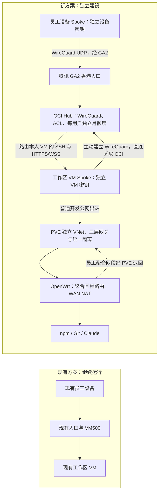

# OCI 员工 VPN Hub-and-Spoke 设计

状态：平行建设的原型源码与隔离测试已完成；统一自动开户仍有集成缺口，真实部署与配额验收未执行。创建：2026-10-28；审核修订：2026-10-30。

## 1. 已确定的目标

OCI 是 WireGuard 网络 Hub；员工设备和每台工作区 VM 都是独立 Spoke。OCI 根据公钥与固定 VPN 地址识别设备，执行员工→本人 VM 的三层访问控制、接入流量计量和月配额。SSH、SFTP、HTTPS/WSS 会话直接在目标 VM 终止。

**现有员工接入方案与本 OCI Hub 方案平行建设，不执行全员迁移、替换现有入口或退役 VM500。** 现有用户、VM、网关、路由、密钥、设备包和管理员操作继续按原方案管理；新方案独立分配资源并验收。

新方案每员工使用独立 PVE 虚拟网络/子网，由 PVE 提供三层网关和统一隔离，不做 PVE SNAT。OpenWrt 只为新方案增加一条无冲突的聚合回程路由并核对 WAN NAT/转发，不改现有员工子网的下一跳。新方案不依赖 VM500，也不把 OCI 变成应用代理。

### 两套方案的边界

| 维度 | `existing`：现有方案 | `oci-hub`：新方案 |
| --- | --- | --- |
| 接入与配置 | 保留既有网关、入口、WireGuard 和 Ansible 配置流程 | GA2→OCI Hub，Portal 只管理新方案指定接口/peer |
| 工作区资源 | 现有 VM 和网卡/默认路由保持 | 默认新建独立工作区/测试 VM、VNet、路由和 overlay；不自动改造现有员工 VM |
| 身份与交付 | 原凭据及已发包有效，原 BWS 项目保持 | 独立 BWS 项目/机器账号、方案身份及 bundle；新方案内重跑复用自己的身份 |
| 额度 | 保持现行规则 | 本方案内每用户独立 5 GB 双向月额度及 OCI 月账 |
| 管理入口 | 现有请求/命令继续走原路径 | 同一管理员工程显式选择 `oci-hub` profile；字段/参数为待实现契约 |

共享员工的业务 ID、代码组件和物理基础设施不意味着共享配置写入范围。用户—VM、设备、BWS 引用、事务、交付和运行账本都携带 profile；同一邮箱可有两套独立接入关系。新方案超额/撤销/重跑仅影响其自身，不能改变现有方案资格；5 GB 不宣称约束该用户通过现有方案使用的另一套工作区。

本文件此前涉及全员切换、关闭现有入口或退役 VM500 的描述已撤回。今后是否迁移/合并两套方案是独立决策，不属于本次建设。

以下业务规则仅适用于 `oci-hub`：

- 每用户（员工）每月独立 5 GB，上传＋下载合计；不同用户之间不共享额度，同用户多设备合并记入该用户。
- 接受定时统计造成的小额超用；检测超额后停止该用户全部受管接入并阻止重连，次月自动恢复额度资格。第一版不实现 nftables 内核硬额度。
- VM 自身访问 npm、Git、Claude API 等开发公网服务不计入，也不经过 OCI Hub 出网。
- 员工保留 VM sudo；认证、额度和跨员工隔离的最终防线必须在 VM 外。
- 次月不能恢复管理员停用、设备撤销、工作区维护关闭或其他独立封禁。

2026-10-29 已确认：十进制 5 GB = 5,000,000,000 字节，按 `Asia/Shanghai` 自然月于每月一日重置，首版采样间隔 5 秒。长停采跨月无法拆分的增量保留原始样本并标待核对，仅暂停受影响账户；不能自动把整段归新月或按零恢复。

## 2. 拓扑与职责



员工侧路径：设备 WireGuard → 香港 GA2 UDP → OCI。VM 侧路径：VM WireGuard → PVE 三层网关（不做 NAT）→ OpenWrt WAN NAT → 悉尼 OCI；这段不再经过 GA2 或 VM500 应用/站点代理。VM 主动连接及 keepalive 使它可以位于家中 NAT 后，不需要为每台 VM 配公网入站映射。

OCI 终止的是两段 WireGuard 加密，不终止里面的 SSH/TLS。Hub 在解密后验证和转发内层包，再加密到目标 VM peer；浏览器 TLS 与 SSH 内容仍由员工设备和 VM 的端点保护。目标选择是路由与 ACL 的结果，不是跳板 shell、SOCKS 或 HTTP 应用分派。

| 组件 | 正式责任 |
| --- | --- |
| GA2 | 员工段 UDP 加速、总带宽上限、云侧用量与预算告警 |
| OCI | 两类 Spoke 公钥认证、固定地址绑定、Hub 路由与 ACL；运行 WG Portal 和定时配额任务，按用户执行月额度及撤销 |
| WG Portal | 管理用户、设备 peer 与状态；提供统计/管理界面和停用、恢复 API，是 `oci-hub` 的 OCI 端指定 WireGuard 接口及 peer 配置/恢复的唯一写入者 |
| 配额任务 | 读取员工接口设备 RX/TX、持久记账，按用户判断超额；向 OCI 执行器提交停用/恢复动作，由它持锁调用 Portal API |
| 目标 VM | 作为 Spoke 连 OCI；SSH 验证员工设备公钥；提供本人的 HTTPS/WSS 桌面和开发环境 |
| PVE | 每员工独立 VNet/子网、三层网关和路由；在虚拟交换网络及其转发边界统一隔离，不依赖客户机或逐 VM 网卡防火墙 |
| OpenWrt | 一条员工聚合网段回程路由经 PVE；现有 WAN NAT/转发覆盖该网段，不承担逐员工隔离 |
| VM500 | 继续服务现有方案；新方案无依赖、不接管、不退役 |
| 私有管理员工程 | 员工/设备/VM 配置权威、BWS、开户、bundle、Temp.sh 交付和分方案配额/维护操作 |

OCI 上原有管理 SSH、Docker、Tailscale 和其他应用不属于员工服务。员工接口本机 input 默认拒绝，诊断/管理只走独立受管通道；不把它改成大家可登录的 SSH 跳板机。

## 3. 与现有实验的区别

[网络测试报告](../learningnotes/2026-10-28-ga-route-comparison.md)的 WireGuard → GA2 → OCI → 家中试验，实际复用 OCI→VM500 站点隧道和 VM500 第二跳 SSH，100 次命令回显中位数 213.031 ms、P95 263.689 ms；直连 OCI 同链路为 340.347 / 889.821 ms。试验使用临时 NAT，资源已回收。

这些结果证明了网络候选路径，并没有证明本版“每台 VM 都是 Spoke”的实现、桌面体验、两套方案并行隔离或 5 GB 配额已经通过。新路线需独立测试，不能继续把 213 ms 写成目标方案的已测性能。第一版接受单 OCI Hub 为单点；不承诺 HA 或低延迟 SLA。

## 4. VPN 地址、公钥与路由

以下是拟定值，实施前核查 NetBox、实际路由、接口、端口和旧试验占用：

| 项目 | 拟定值 | 约束 |
| --- | --- | --- |
| OCI 员工接口 | `wg-users`，`10.235.0.1/24`，UDP 51824 | GA2 香港同端口回源；与现有员工 VPN 地址段分开 |
| 员工设备 | 新分配 `10.235.0.x/32` | 一设备一 peer；不能多人/多设备共用包 |
| OCI VM 接口 | `wg-workspaces`，`10.234.0.1/24`，UDP 51825 | VM 从家中主动直连 OCI 公网；与员工入口分开 |
| 新方案测试 VM Spoke | 例如 `10.234.0.2/32` | 新 overlay 地址按台账分配，不由 VMID 推算，不替代物理网卡地址 |
| 其他工作区 | 各自独立 `10.234.0.x/32` | 一 VM 一 peer，与员工设备密钥完全不同 |

| 节点与 peer | AllowedIPs 与 Linux 路由 |
| --- | --- |
| 员工设备的 Hub peer | 仅本人 VM overlay `/32`；Endpoint 为 GA2 UDP，默认路由和公司 VPN 不改 |
| OCI 上的设备 peer | 仅该设备 `10.235.0.x/32`；公钥绑定来源地址，路由在 `wg-users` |
| OCI 上的 VM peer | 仅该 VM `10.234.0.x/32`；路由在 `wg-workspaces`，不接受该 VM 伪装员工或别的 VM 地址 |
| VM 的 Hub peer | 仅本员工登记设备的各 `/32`，以及显式批准的管理/探测地址；回设备路由走 `wg-workspace` |
| 新方案 VM 的物理默认路由 | 指向 PVE 上该 VM 私有子网的网关；OCI Endpoint 的物理路径必须不进入自身 WireGuard |

业务内层包在 Hub 路由时不做 SNAT，VM 能看到设备的 VPN 地址。PVE 对物理网卡出站只路由，保留 VM 私有源地址；OpenWrt 在 WAN 出口执行普通公网 NAT，并将还原后的回包按员工聚合路由送回 PVE。这是外层上网路径，不改变 VPN 内层身份。两端配置必须同时声明 Linux 路由和 WireGuard AllowedIPs。

员工侧 `PersistentKeepalive=15` 秒作为试点值，小于 GA2 当前 UDP idle timeout（API 默认/上限 20 秒）；VM 侧采用经验证的 NAT keepalive。每段测试空闲 60 秒、Endpoint 变更、重连和 MTU。1280 是之前测试的 MTU 种子，不预设最佳。

新方案可选备用可让同一员工 peer 直连 OCI 员工 UDP 端口；启用前单独定义并部署其来源策略，不能在只允许 GA2 回源 IP 的白名单下声称已可直连。备用仍经过同一 ACL 和额度，不自动切换或并行运行相同 peer；未验证前保持未启用。现有方案入口独立保留，不作为新方案的自动备用。外部接入 IP 不是员工身份；GA2 共享回源地址也不是可信员工。

## 5. 访问控制与 sudo 边界

OCI 在 `oci-hub` profile 内维护受管映射：设备公钥 → 固定设备 VPN `/32` → 员工 ID → 工作区 VM peer/overlay `/32` → 允许端口与状态。来自员工的每个包必须匹配自己的设备地址；WireGuard cryptokey routing 拒绝其他来源地址。

| 方向 | 允许 | 拒绝 |
| --- | --- | --- |
| 设备→本人 VM | TCP 22、8443；8080 如保留仅跳转；用户处于有效接入状态 | 任意其他 VM/端口、VM 管理 API、KasmVNC 原始后端端口 |
| VM→本人设备 | 上述连接的回包；检测该用户超额后随设备停用而停止 | VM 主动连接员工电脑、新建任意连接 |
| 设备→设备、VM→VM | 无 | 包括同一接口内 peer 横向流量 |
| Spoke→OCI 本机 | 仅独立批准的健康检查例外 | 管理 SSH、原有应用、VCN、Docker/Tailscale、面板和公网出口 |
| 物理 VM 网卡→家中网络 | 明确批准的开发公网访问、VM Spoke 的 OCI UDP Endpoint、必要基础服务 | LAN/PVE/其他员工网段、到 OCI 其他服务的旁路、公网回流 |

双接口 Hub 是逻辑分区，防火墙仍必须明确阻止未授权接口内/接口间流量；不能认为 WireGuard 自动提供员工隔离。只在目的 IP 前配置客户端 AllowedIPs 不算服务端隔离。

员工拥有 VM sudo，可以读取/修改本 VM WireGuard 私钥、接口、路由和桌面服务，这是既定权限模型。安全保证来自 OCI 对 VM peer 固定源地址和连接方向的约束，以及 PVE 的 VM 外规则；不把 VM 本机 firewall 当作最终防线。VM peer 密钥被复制后仍只能代表本 VM，不能声称其他员工或获取全网转发权限；撤销流程须能暂停该 VM peer。

若员工修改物理网卡 IP/MAC、启用 IPv6、增加 VLAN tag、修改默认路由或转发开关，仍必须无法进入别人的 VM、LAN 或 PVE。员工默认不启用 IPv6 overlay；宿主/其他应用的 IPv6 不因本项目关闭。

## 6. 新方案 SSH、桌面与现有契约边界

### SSH/SFTP

员工直接 `ssh employee@本VM的VPN地址`；SFTP 使用相同设备 SSH key。所有 VM 仍使用既定 `employee` 用户。OCI 不运行员工 sshd，不保存设备客户端 SSH 私钥、VM SSH 主机私钥或用于第二跳的 `gateway_ssh` 私钥。WireGuard Hub 私钥必须在 OCI 运行；Portal 对设备 WireGuard 私钥的存储行为按第 10 节单独核对，不能混同 SSH 密钥边界。

新方案 VM 的受管 `authorized_keys` 登记本方案设备的 client SSH 公钥，并用 `from=各设备 VPN /32` 限定来源；不得全放开。独立管理员维护 key 单独管理。新 bundle 固定验证分配的目标 VM SSH host key，写入本方案 HostName/User/Port/alias；不复制现有 VM 的私有 host key，也不改现有 VM 的第二跳 SSH 授权。

现有 gateway 第二跳身份继续属于现有方案，不因新方案开户/停用而变更。新方案设备身份仅授权新方案工作区，不自动授权到现有工作区；员工 root 修改自己的 SSH 授权仍受新方案 Hub 和外部网络隔离约束。

### KasmVNC

浏览器访问本人 VM 的 overlay 地址，例如 `https://10.234.0.2:8443/`，该地址属于新方案；现有共享 `10.230.0.1:8443` 入口继续保留。TLS 终止在目标 VM，证书 SAN 匹配该 VM overlay 地址；可沿用原专用 CA 的信任，但管理员签发策略需扩展并记录，CA 私钥不上 VM 或 OCI。

为沿用“不额外要求员工输入后台密码、不给浏览器后端秘密”的体验，设计首选在每台 VM 运行现成 nginx 本机前端，仅绑定本 VM WireGuard overlay IP，连接 loopback KasmVNC HTTPS/WSS 后端并注入该 VM 的受限读写凭据。OCI ACL 决定哪些已认证设备能到达该 VM；本机前端不维护第二份全局员工分派表。它是目标 VM 的展示组件，不是中心跳板/网关。

KasmVNC 原始后端绑定 loopback，外部仅开放该 VM 前端 HTTPS/WSS；保留 Host/Origin、路径/API 约束、上游证书验证和显式 backend 类型。直接暴露 KasmVNC 原生 Basic Auth 会带来额外登录和浏览器兼容差异，不未经确认替换既定体验。若采用本机前端必须验证固定版本/配置，并按仓库规则单独授权安装依赖；此次没有安装软件。

新方案复用 XFCE、独立 browser 服务、唯一 Firefox profile、`workspace-login` 个人 OAuth 和桌面生命周期的设计原则；不复制现有员工的个人 profile 或登录态。新方案 `workspace-browser`/bootstrap 输出自己的 VM overlay URL，现有方案输出不变。继续使用 WSS/TCP，不开启 WebRTC、STUN/TURN；外层 VPN UDP 不等于桌面应用改为 UDP。

既有 [VM502 桌面 final spine](../../_bmad-output/planning-artifacts/architecture/architecture-vm502-xfce-kasmvnc-2026-10-23/ARCHITECTURE-SPINE.md) 继续用于现有实施任务。新方案单独补充入口、认证、绑定、CA、writer/代次及撤销契约，不修改或替换该 final spine；复用组件时采用分方案配置，既有 Story 不自动证明新拓扑已通过。

## 7. PVE 独立虚拟网络与纯路由出网

采用 **PVE SDN Simple Zone + 每员工独立 VNet/Subnet + PVE 三层网关 + OpenWrt 聚合回程路由**。PVE 不启用 SNAT，不新增路由器 VM；员工 VM 不直接连接家庭 LAN。隔离统一配置在 PVE 虚拟交换网络及其三层边界，不改客户机防火墙，不新增逐 VM 网卡防火墙策略。

### 网络与回程路由

Simple Zone 的 VNet 是节点本地、不接物理接口的独立 bridge。每员工工作区使用自己的 VNet 和子网，PVE 在该网络持有网关地址，并启用受规则约束的 IPv4 转发；仅创建 bridge 不会自动成为三层网关。Subnet 设置 Gateway，SNAT 关闭；实施时核对该版本生成的接口、路由与转发开关。

```text
VM-A 10.236.1.2 → VNet-A / PVE 网关 10.236.1.1 ─┐
                                                ├→ PVE 路由 → vmbr0 → OpenWrt → WAN NAT → Internet
VM-B 10.236.2.2 → VNet-B / PVE 网关 10.236.2.1 ─┘
                       跨 VNet 转发默认拒绝

OpenWrt 回程：员工聚合网段 → PVE LAN 地址 → 对应 VNet → VM
```

| 项目 | 设计值/行为 |
| --- | --- |
| 新方案私有地址 | 例如新分配 `10.236.n.0/30`，每员工独立子网与 VNet；不复用现有 `10.231.n.0/30` |
| VM 默认网关 | 本方案子网在 PVE 上的 `.1` 地址，与 VM500 既有网关无关 |
| PVE 默认出口 | 保持现有经 OpenWrt 的上网路由；到员工子网的直连路由由各 VNet 提供 |
| OpenWrt 静态路由 | 例如 `10.236.0.0/16 via 192.168.1.52`；下一跳是 PVE 可达的 LAN 三层 IP，而非无 IP 的二层交换机 |
| 公网 NAT | 只在 OpenWrt WAN 出口完成；PVE 不配置员工 SNAT/masquerade |
| VM Spoke | 经上述普通出网主动连接 OCI UDP Endpoint，回包经 OpenWrt 聚合路由返回 |

`10.236.0.0/16` 是新方案聚合示例，实施前核对 NetBox、现有路由和业务占用，选择覆盖实际员工子网且无冲突的保留聚合范围；不自动将现有员工或其他业务网段纳入，也不修改它们的回程路由。`192.168.1.52` 也需核对为稳定、可达的 pve2 LAN 地址。PVE 对聚合范围内尚未分配的目的地址设置汇总丢弃路由，已分配子网的更具体直连路由优先，避免 OpenWrt→PVE→OpenWrt 路由环路。

OpenWrt 只增加聚合回程路由，并核对现有 LAN→WAN 转发和 WAN masquerade 是否覆盖员工源网段。若已有规则限制源地址，则需最小范围补充员工聚合段；一条静态路由本身不能替代 WAN 放行/NAT。无需物理 VLAN trunk、逐员工 OpenWrt 路由、员工公网入站映射或把隔离策略搬到 OpenWrt。

### 在 PVE 虚拟交换网络统一隔离

独立 VNet 保证二层分离，员工修改自己的 IP 也不会进入另一 VNet。由于 PVE 同时承担这些网段的三层路由，仍需一套统一转发策略阻止跨网段访问；不为每台 VM 堆叠重复防火墙规则。

| 位置 | 统一策略 |
| --- | --- |
| VNet 二层边界 | 不桥接员工 VNet、家庭 LAN 或其他员工网络；不接受任意 VLAN tag/IPv6 等旁路；将来源限制在所属 VNet 的分配范围，避免伪装其他网段 |
| PVE 本机 input | 拒绝员工网络访问网关 IP 及其他宿主地址上的 SSH、8006/API 等管理服务；仅保留必要网络服务 |
| PVE 三层 forward | 以员工 VNet 集合统一拒绝跨 VNet、家庭 LAN、管理网和受保护公网回流；允许获准公网开发出站及对应回包 |
| OCI Endpoint | 明确允许登记的 OCI 公网 UDP 51825；不因此放开 OCI 其他受保护服务 |
| 管理维护 | 仅批准的管理员来源可经 PVE 到指定工作区；员工不能反向进入管理网 |
| 出口与回流 | 规则持续匹配 VM 原始私有源；经 OpenWrt 再路由/端口映射回员工网段或管理网的旁路必须拒绝 |

这些规则仅匹配新方案 VNet/源网段及对应宿主路由边界，不依赖 VM 本机策略或逐 VM 网卡防火墙开关。已有 `pve-nftables.conf.j2` 的现有员工 bridge 规则保持；为新 VNet 单独生成网关 ARP/转发和宿主保护规则，不能为新网关放开现有接口或全局 input。

SDN 的 IPSet/Firewall Integration 不等于默认隔离。实施前核对本机防火墙后端能否覆盖 bridge、host input 与 routed forward；网络层策略按 VNet/网段集合生成，声明单一写入者。禁止全局 flush ruleset，不覆盖既有管理、Docker 或 Tailscale 链。

2026-10-28 只读预检：pve2 为 `pve-manager/9.2.2`，有 `libpve-network-perl 1.6.5`、`ifupdown2 3.3.0-1+pmx12`，尚无 SDN zone。`pve-firewall status` 为 `disabled/running`，另有 `proxmox-firewall` active；实际规则及生效后端仍需实施前核实，不能据此声称隔离已部署。

### 防火墙就绪与启动门控

新方案工作区必须有独立的 PVE `pre-start` hook。hook 只针对登记的新方案 VM，检查该 VM 的 VNet 归属、外部 bridge/input/forward 规则、禁用状态和当前策略代次；检查命令失败、规则缺失或身份不匹配时拒绝启动。校验实际生效规则，不能只检查 systemd 单元是否 active。现有 hook 中固定 VM500 tap 的规则不能直接照搬到 PVE 三层网关。

首次创建新工作区保持停止且 `on_boot=false`：先部署边界和 hook，再创建/核对 VNet、路由及 VM 配置，通过 pre-start 校验才允许受管首次启动。后续即使启用 onboot，宿主重启时也必须先恢复边界，hook 失败仍拒绝启动。运行中重载或停止边界服务时，先在同一新方案范围阻断转发/隔离相关接口，再变更；不能删除规则后让活跃 VM 暴露于默认转发。

OCI 使用相同原则：新方案 ACL 就绪校验成功，Portal 才能恢复新接口/peer；systemd 明确顺序、依赖和启动前校验。不得先开放 WireGuard 再异步安装 ACL。运行期间 ACL 失效或受控重载时，停止新方案转发/接口恢复，保留现有 OCI 管理及站点隧道。门控是网络隔离，不是新增内核流量硬额度。

原型必须验证宿主重启、边界单元启动失败、启动前移除规则及 Portal 重启四种场景；受控部署/重载路径不得先放行后过滤。任意宿主 root 全局删除所有规则不属于能由同机规则自保的威胁模型。SDN zone 限定 pve2，Apply 前比较实际网络变更和重载范围，并回归既有 bridge/连接；新方案配置隔离不代表 ifreload 一定不影响现有网络。

### Terraform 资源与模块契约

当前现有员工 VM 在 `terraform/proxmox/employee-workspace.tf` 直接声明专用资源，使用绑定 VM500 的 `employee_workspaces` schema，并有 `prevent_destroy`、hook 和 start_ready。它并非现成的通用 module 调用；新方案不能把自己的记录加入这份变量或接管这些资源地址。

新方案在独立服务文件中定义 `oci_hub_workspaces` 变量和 `oci_hub_workspace` module 调用键（拟定名），使用 `terraform/modules/proxmox-vm`、`proxmox.pve2` 及独立 inventory 分组。VMID、接口/VNet、IP/MAC、磁盘和模板来源明确分配；不继承 VM500 的 nic_slot/gateway_mac 约束。同一 employee_id 在两套变量中可以存在，不相互覆盖。

通用模块现有接口不足，实施前须最小扩展并核对以下契约：

| 要素 | 新方案要求 | 对其他模块调用者 |
| --- | --- | --- |
| PVE hook | 可传入本方案 hook_script_file_id；创建和启动时已有对应边界检查 | 新参数缺省为空，保留原行为 |
| 首次创建 | 可在创建后保持停止，准备期 onboot 关闭；验证通过再受管启动 | 首次启动参数缺省保持原行为，不改现有 started 的生命周期约定 |
| 删除保护 | 新工作区显式设 `protection=true`，销毁/替换必须先经过明确的维护解锁流程 | 使用现有模块参数，不给所有实例强加相同策略 |
| 模块兼容 | 原调用不补新参数仍生成同样的配置；新 VM 启动只能通过上述门控 | 验证相关模块消费者的计划没有意外变化 |

PVE 原生 `protection=true` 与 Terraform `prevent_destroy` 是不同机制，不能声称已继承现有专用资源的全部 lifecycle。通用模块不引入可变的 `prevent_destroy`：Terraform 该属性不能由普通输入动态决定。新资源计划需检查无现有资源销毁/替换，PVE 删除保护和启动 hook 另外验收；不得直接复制旧资源再声称复用了模块。

固定 provider 的 SDN 资源能力作为原型预检项；不能为本方案擅自升级整个 Proxmox provider。Terraform/Ansible 对 SDN 配置的具体单一写入者须在能力核对后固定，不能由两者同时管理。

### 独立建设与撤回

先创建新方案合成 VNet 和无凭据 VM，验证纯路由往返、OpenWrt WAN NAT、未分配地址丢弃、OCI UDP、跨网络阻断及持久化。新建 VM 继续使用既有 Proxmox VM module，使用独立资源键、VMID、VNet 名和未占用地址；不移动现有 VM 网卡、接管其子网或改默认路由。

共享 pve2、OpenWrt 和 OCI 主机上的改动必须是有明确新方案匹配范围的增量。先备份、预检并比较变更范围，不全局重建 bridge、flush 防火墙或覆盖现有 WireGuard；验证现有方案仍可连接。Portal 只接管新方案指定接口，不自动导入 OCI 上既有站点/管理隧道。

撤回只停用新方案入口、服务及登记资源，保存其台账/月账；新增 OpenWrt 聚合路由和 PVE 规则按精确目标撤回。不关闭 VM500、现有入口或站点隧道，也不因本方案验收通过而新增退役清单。本次仅修改设计，未执行网络变更。

## 8. WG Portal 与每用户月度配额

第一版采用 **WG Portal + 小型定时配额任务 + SQLite + systemd**。WG Portal 管用户和设备，配额任务补充按用户的月账、判断及恢复；保持上游面板，不维护分叉。此为新方案内部的软件选型收敛，现有方案不因此改用面板或配额。nftables 继续提供 OCI/PVE 网络隔离，但不执行流量硬额度，也不另外开发用户管理面板。

### 额度与统计方向

在 `oci-hub` profile 内，每用户每自然月独立 5 GB，按员工视角上传＋下载合计。不同用户互不借用额度；同用户增加设备不重新赠送 5 GB。例：用户 A 上传 1 GB、下载 4 GB 用完本月额度，用户 B 仍有自己的额度。

| 员工视角 | 路径 | OCI 员工接口 `wg-users` 上该设备 peer 的计数 |
| --- | --- | --- |
| 上传 | 员工电脑 → GA2 → OCI → 本人 VM | RX / received |
| 下载 | 本人 VM → OCI → GA2 → 员工电脑 | TX / sent |

只采集员工接口的登记设备 peer；工作区接口 `wg-workspaces` 的同一份数据不再次累加。VM 自身开发公网出站不经员工接口，不计入该用户额度。产品口径采用员工 VPN peer 报告的双向字节，包含该接入段计数可见的协议数据，不是文件净大小或严格过滤后的应用有效载荷，也不能继续写成“只统计解密后的内层 IP”。WireGuard 空载、握手和 keepalive 的具体计数行为需在固定版本验收记录，不预设与 GA2 账单逐字节一致。

### 统计、判断与停用

1. 以 5 秒作为首次试点的采样间隔，在 OCI 本地仅读取 `oci-hub` 明确登记的接口/设备；首次实现读取 `wg show wg-users transfer` 的 public key、RX、TX；与 Portal 统计使用同一 WireGuard 计数来源。只输出统计字段，不使用会带出 Hub 私钥的完整 dump 或配置日志。
2. 依私有台账映射设备公钥→用户，计算相邻样本的增量；用 SQLite 事务同时更新采样基线、用户周期上传/下载用量和待执行动作。历史设备即使撤销、删除，其已用额度仍留在所属用户本月账中。
3. 月累计 RX＋TX 达到额度后设置 `quota_exhausted`，经 WG Portal API 停用该用户在 `oci-hub` 员工接口上登记的全部设备 peer；不得匹配同邮箱在 `existing` 的设备或 VM Spoke。核对 Portal 状态和实际 WireGuard 活跃 peer，再记录动作成功。已经被管理员停用/撤销的设备保留原原因，不能覆盖成 quota 原因。失败保留待重试动作并告警，不能把 API 请求发出当成停用完成。判断与状态动作经下述 OCI 唯一命令执行器处理，任务不直接持另一套 Portal 写入通道。
4. 已超额用户新加设备仍保持停用；直连 OCI 的受管备用也使用相同 peer/状态。其他用户、VM Spoke、VM 普通开发出站和 `existing` profile 不被停用。

这是轮询截止，不承诺恰好在第 5,000,000,000 字节停止。超用来自采样间隔、任务调度和 API 生效延迟；原型要测量“检测时间→全部设备停止转发”的耗时。100 Mbps 持续流量在 5 秒内可多传约 62.5 MB，尚未计调度/API 延迟；不能把这一估算写成绝对上限。任务异常必须告警并能重试，不声称停机期间仍有内核硬截止。

设备从 WireGuard 活跃 peer 移除后应无法继续受管 SSH/SFTP/WSS 转发，需用持续流量实测。远端空闲 socket 的关闭提示可能由系统超时决定，不要求额外实现 TCP reset/桌面会话强杀。关闭接入不调用 desktop/browser stop，不关闭 VM 或个人 Firefox；SSH 前台任务的断线行为依 SSH/tmux/nohup 原生语义。

### 持久化与次月恢复

新方案专属 SQLite 保存 profile、用户周期、额度、上传、下载、设备采样基线、已知接口/peer 重建代次、动作状态及用户/设备/工作区各自的阻断原因集合；权限受限，备份时不包含设备私钥。systemd 运行单一记账任务，防止并发采样重复累加；周期切换与记账在同一事务/锁下串行处理。

| 场景 | 处理 |
| --- | --- |
| 正常采样/重跑 | 只累加新样本增量；重复样本不重复计费；重跑不清空月账 |
| 接口/peer 计数归零 | 识别已知重建或计数回退，保留已有月累计；新代次首个累计值作为该代次增量入账后建立基线，不能直接丢弃。丢失的重置前尾部单独标记；禁止负增量扣减或新赠额度 |
| 有计划停用/重建 | OCI 执行器先取最终样本，再持锁调用 Portal API，登记重建代次；不能只靠累计值下降识别重建 |
| 意外重启/短暂停机 | 保留最后已提交月账；可观测的新累计正常补记，重置前未采到的数据可能丢失并记录缺口。用户已接受小额误差，不因普通非干净重启自动封禁全部用户 |
| 数据库损坏/身份映射不明 | 不新建空白月账冒充恢复；告警并暂停受影响用户接入，等待修复 |
| 月初/离线跨月 | 每月一日归档旧周期、新建当前周期；不补发历史月份额度。同一周期重复执行只重置一次 |
| 长停采跨月 | 跨界区间无法按时间拆分的增量标为待核对缺口，不能整个自动计入新月。保留已提交历史用量及原始样本，由管理员核定归属；未核定不假装获得精确月账 |
| 月界附近采样 | 切月只归档月账，不重置 WireGuard 实时计数；基线跨月保留。以边界样本归集，记录可能存在一个采样间隔的归属误差，不把历史累计全部算入新月 |
| 恢复设备 | 只清除旧周期的 quota 原因；在 OCI 动作锁内重新读取映射代次、所有层级原因集合和到期状态，集合全空才调用 Portal 恢复；撤销、管理员停用和到期不因月重置复活 |

`effective_access = identity_valid AND block_reasons_empty AND accounting_ready AND ingress_active`。`identity_valid` 要求方案、归属及有效期匹配；`block_reasons_empty` 指用户、设备及工作区原因集合均为空。`accounting_ready` 由 OCI 执行器依据账本/运行映射可读且已核对基线设置，不等于某次采样是否按时完成；普通任务短暂停机告警并重试，不自动关停全体。`ingress_active` 由执行器依据本方案管理员启用状态及 ACL 启动门控结果确定。WireGuard 实时计数和月累计分别保存；同用户多设备归集不能通过面板分组标签自动假定完成。GB 单位、`Asia/Shanghai` 自然月及 5 秒采样已由用户确认，不重复询问。

### 面板、API 与配置所有权

WG Portal 稳定版 v2.3.1 的模型已有用户归属、`Disabled`、`DisabledReason`、到期和管理 API，但没有原生月流量额度。后续实施须固定受验证版本，核对 API 鉴权、禁用/恢复语义及统计刷新，不声称面板已经提供月额度柱状图。第一版月用量查询/增额由私有管理员 CLI 提供，Portal 保留自己的实时统计与设备状态。

固定版本源码中 `import_existing` 和 `re_enable_peer_after_user_enable` 默认均为 true；前者可能接管原有隧道，后者可能恢复已撤销设备。因此必须显式配置以下约束，而非只在文档声明“按 profile 隔离”：

| 配置/行为 | 本方案要求 |
| --- | --- |
| `core.import_existing` | `false`；只通过受管 API 创建新方案对象 |
| `backend.ignored_local_interfaces` | 明确排除 OCI 上现有站点/管理 WireGuard 接口；按实际枚举生成，新增原有业务接口时同步维护 |
| `core.re_enable_peer_after_user_enable` | `false`；月恢复逐设备核对，由配额任务显式执行 |
| `core.create_default_peer*` | 登录、用户创建、接口创建及兼容旧配置项全部关闭，避免自动发放未登记设备 |
| `core.self_provisioning_allowed` | `false`；设备经管理员工程登记后分发 |
| Portal 状态与导出 | 使用新方案独立数据库和配置目录；恢复/导出只涵盖新方案指定接口，禁止扫描写入现有 `/etc/wireguard` 配置 |

这些是部署要求，尚未在 OCI 验证。`ignored_local_interfaces` 是排除清单而非万能安全边界；还需核对首次启动、重启和状态恢复均不触碰现有接口。不能将 master 文档的新字段不加检查套到固定 release。

私有管理员工程保存人员归属和 BWS 私钥；开户/撤销任务与配额任务都经 OCI 执行器调用 Portal API。Portal 拥有新方案 OCI 端 WireGuard 接口和 peer 的创建、持久化及恢复；Ansible 部署 Portal、网络前置条件、外部路由/隔离规则及任务，通过受管 API 初始化新接口。不得为同一 OCI 接口再部署独立 `wg-quick` 配置/启动服务，也不得同时用模板或 `wg set` 改写 Portal 管理的 peer。VM 内的 Spoke 接口仍由 Ansible 管理；现有方案执行路径独立保留。

### 唯一写入口与多原因状态

新方案的开户、撤销、人工停用、增额和月恢复统一提交给 **OCI 上的命令执行器**；管理员工程通过现有受限管理通道调用它，配额采样任务也向它提交动作。只有执行器持有 Portal 写 API 凭据，管理员本机不持可绕过执行器直接写 Portal 的常驻凭据。部署初始化同样走该执行器；它是小型配额组件的命令入口，不另建公网控制面。

执行器在方案级锁内核对 profile、对象归属和预期代次，写入带唯一 action_id 的待执行记录及原因集合，再调用 Portal 并核对实际状态。中断重试复用同一 action_id，不重复赠额或重新创建对象。API 成功与 SQLite 提交不是原子事务，待执行记录和状态回读用于恢复；不假设 Portal 提供 CAS。

| 原因 | 作用范围 | 清除方式 |
| --- | --- | --- |
| quota_exhausted | 用户及当前周期 | 月切换/明确增额后由执行器处理 |
| admin_disabled | 用户或设备 | 明确的管理员恢复命令 |
| revoked | 设备永久撤销标记 | 月恢复不清除；重新登记按新身份处理 |
| expired / workspace_disabled | 身份到期或工作区状态 | 核对有效期/明确维护操作后重新计算 |

SQLite 是多原因状态权威，Portal `DisabledReason` 仅用于展示当前阻断摘要。管理员停用一个已经因 quota 而 disabled 的设备，也必须增加 admin_disabled 原因，不能因为 Portal 状态已经为 true 就跳过记录。月恢复只移除对应旧周期 quota 原因，在同一锁内重读原因集合和当前映射代次，仍有任何原因就保持停用。

Portal 面板用于日常查询；必须人工写入时，先由 OCI 执行器进入维护模式并暂停自动写动作，核对/登记人工停用原因及最终状态后再退出。常规恢复不能依赖 Portal 的“启用用户并恢复全部 peer”，也不假设当前版本提供只读管理员角色。现有方案管理员 API 和凭据不进入这个执行器的写入范围。

面板和 API 仅供管理员通道访问，不向员工 VPN 或公网开放。API 凭据按现有私有凭据流程交付；不授予面板任意 BWS 读写，不以面板配置替代 BWS 凭据台账。新方案公钥登记及配置导出需验证；不导入、旋转或覆盖现有方案身份，不用面板私钥副本替代 BWS。

## 9. 费用防护

实际香港普通 BGP 入口、香港终端节点组回源 OCI 的账单已核对：接入公网 0.700、回源公网 0.700、传输流量 0.525 元/GB，另加双向处理 CU 费用；同地域传输项实际收费，不能按零估算。员工视角上传/下载、OCI peer RX/TX 对应关系及小时公式见 [GA2 计费与方向核对](../learningnotes/2026-10-28-ga2-billing-directions.md)。

员工 5GB 不是 GA2 金额硬封顶。未知设备发往 GA2 的 UDP、握手、keepalive、外层开销、重传、到 OCI 前已传输的数据，以及超额员工继续发包均可能计费；在 Hub 丢弃不能取消已发生的云侧费用。

GA2 上线前必须配置整体带宽上限、月预算/用量告警、通知渠道和紧急停用 runbook。告警不等于自动断路。若需要自动总量关闭，应单独验证停用/删除监听器影响已有/新流量的范围、生效延迟、用量不可得时的关闭策略及人工重开权限；不得承诺账单延迟下精确金额硬停。

若要求任何来源下费用绝不超过固定金额，必须取得腾讯提供的账户硬封顶能力或改选固定套餐；不能用本方案的员工配额代替。新方案入口与其受管备用统一受本方案月账和停用状态控制，允许轮询/API 执行窗口的小额超用。现有方案入口独立运行，不在本月账管辖范围，也不为实现配额而关闭。新方案工作区默认不授权现有方案身份，避免出现通向同一新工作区的未计量路径。

OCI 云侧和本机分别放行员工 GA2 回源 UDP 与来自家中已批准公网的 VM Spoke UDP；来源清单变化差量维护且审计，不把同一公网来源当作同一员工。现有方案及 OCI 原有管理/站点隧道的 WireGuard peer 一律不在新方案清单同步删除范围。

## 10. 数据、凭据和两个仓库

### 管理员工程与 WG Portal 的分工

IaC 主 checkout 的 `remotecc/employee-admin` 独立私有仓库保留 `onboard.sh` 统一入口，相邻 `remotecc/employee-data` 保存不进 Git 的运行数据（旧 `~/Projects/employee-workspace-admin` 仅为兼容链接），复用现有 preflight/plan/apply、BWS、请求/检查点、用户—VM 台账、设备包和 Temp.sh 邮件交付。增加显式 profile 分派：`existing` 继续调用原“生成网关配置并由 Ansible 写入 peer”的流程；`oci-hub` 才调用新增 Portal API 适配层。共用入口和底层组件，不把原流程改成 Portal，也不用面板替代 VM provisioning。统一入口的 profile 分派和 Portal/账本后端已有原型；新方案仍依赖预设分配和登记/包请求，尚未完整复用原流程的自动分配及输入生成。以下约束继续适用于后续集成。

| 所有者 | 内容 |
| --- | --- |
| 私有管理员工程 | 唯一员工/设备/VM 归属、overlay 分配、Portal API 适配、启用/撤销和额度操作编排、分方案开户事务、Temp.sh 包与邮件交付；配额任务源码也归此工程 |
| WG Portal（OCI） | 私有台账的用户/设备映射、新方案 OCI 端指定 WireGuard 接口与 peer 的配置、启停和恢复；只接受 OCI 执行器发起的日常写 API 操作，唯一写入其范围内的 WireGuard 配置 |
| BWS 项目 | 现有 `EmployeeWorkspace` 原记录及令牌保持；新方案采用独立项目 `EmployeeWorkspaceOCIHub`（拟定名）及只授权该项目的机器账号。新项目分别保存设备、VM Spoke、Hub key 和 Portal API 凭据 |
| 配额组件（OCI） | 采样任务和持锁命令执行器常驻；SQLite 保存唯一月账、基线、多原因集合和待执行动作，管理员电脑离线仍工作 |
| IaC 仓库 | Terraform OCI 资源、PVE/VM/SDN VNet/子网定义、Ansible 部署 Portal 与配额任务及路由/隔离规则；包含部署契约/schema/验收/设计。新工作区使用独立变量/module 调用键、经门控扩展的通用 VM module 与 `proxmox.pve2` |
| 公开 bootstrap | 通用 CLI 接入/下载/验证指引；不含管理员工具、真实配置、私密链接或密钥 |

**运行位置与代码归属分开**：配额任务源码放私有工程，使用现有受控部署流程把指定版本交给 Ansible 部署到 OCI 并由 systemd 运行。管理员电脑只发起开户、交付和维护；关机或退出 Sandbox 不应停止 OCI 记账、超额停用或次月恢复。IaC 不复制维护第二套配额业务源码，也不将私有工具或员工数据放进公开 bootstrap；具体交付路径在实施时固定；服务名、配置/状态目录和部署目标按 profile 隔离。

### 台账关联与唯一写入者

私有台账增加以下关联字段，设备 roster、生成的 registry/WORKSPACES 继续由既有流程生成，不手工各维护一份：

| 层级 | 关联数据 |
| --- | --- |
| 用户—方案关系 | `(profile, employee_id)`、邮箱、该方案 VMID/overlay、Portal 用户 ID（仅新方案）、额度策略和状态；同一用户可绑定两套方案 |
| 设备—方案关系 | `(profile, device_id)`、所属 employee_id、该方案接口/peer 公钥/overlay、BWS 引用；不将两套密钥和地址混为一条记录 |
| 开户事务 | profile、请求/计划指纹、方案内对象关联、操作检查点、验证及交付回执；不保存明文私钥 |

私有工程是人员身份、归属和资源分配的权威；Portal 是新方案 VPN peer 配置及运行状态的权威；OCI SQLite 是新方案月用量的权威。现有配置权威保持。新方案台账记录 Portal 对象 ID/公钥关联与最近核对状态，不输出绕开 Portal 的第二份 Hub peer 配置；现有 roster 和生成配置仍只由现有后端维护。Portal 用户 ID 不替换既有员工/设备 ID，也不改变邮箱派生 ID 规则。

新方案创建和重试先按 `(profile, employee_id/device_id)` 的稳定关联查询 Portal 对象；已存在且属性一致则复用，不因中断重复创建用户、peer、密钥或地址。关联冲突先停止核对，不能按显示名称猜归属。Portal 手动停用/到期也纳入有效接入判断，普通开户重跑和月重置不能覆盖；身份/归属修改统一从管理员工程发起。

私钥由私有管理员流程通过标准工具生成并写入 BWS，不在 Terraform state、全局 IaC Vault、普通日志或仓库储存。新方案默认生成独立设备 SSH/WG 与 VM Spoke 身份，存入新方案独立 BWS 项目中带 profile 的记录；只在同一方案内重试时复用。不删除、轮换或挪用现有设备或 gateway 第二跳 key，也不跨方案共用同一 WireGuard peer 身份。

### BWS 项目与运行端凭据隔离

现有 `bws-store.py` 在原项目中遇到未知记录类型会拒绝加载；因此新方案采用独立 BWS 项目，**不向现有 EmployeeWorkspace 项目加入新方案记录、不放宽原加载器白名单来容纳新项目**。先配置显式 profile→项目 ID/机器账号绑定并做拒绝交叉访问的预检，再写入新方案记录；默认 existing 的项目 ID、令牌和读取路径保持。项目可用额度、项目 ID 和机器账号授权是实施预检项，本文件不声称已创建。

管理员部署端从新 BWS 项目读取所需值：VM 只收到自己的 Spoke key。用户已确认使用 Portal v2.3.1 标准 v1 API：OCI Portal 保存本方案 Hub key，以及本方案设备/VM Spoke 的 WireGuard 私钥副本；BWS 保持这些凭据的恢复权威，现有方案和员工 SSH 私钥不交付 OCI。OCI 命令执行器只收到单一 Portal API 凭据文件（限制所有者访问）。**OCI 不保存现有或新 BWS 项目的机器账号令牌，也不运行持令牌读取整个项目的定时任务。** Portal/采样任务不访问员工 SSH 私钥；采样只读 WireGuard 统计，实际 API 写入由执行器完成。

Portal API 凭据继续以独立记录存于新 BWS 项目供管理员恢复/轮换；不进 bundle、台账或公开仓库，也不作为管理员本机日常直写 API 凭据。固定版本的请求/响应含新方案 WG 私钥字段，标准 API 以受保护通道传输；数据库及备份限制访问，日志、动作记录和诊断不保存原始请求/响应。实施验证固定版本的鉴权和登记行为，BWS 继续承担凭据保管与恢复，Portal 不接管现有方案身份。

VM 内 native SSH 授权、自己的 TLS 叶证书及桌面呈现秘密只针对本 VM；员工有 sudo 可以读取自身秘密，不声称用来防止该员工控制自己的工作区。私有 CA 签发 key 继续仅在管理员侧。

管理员编排在 profile 范围内用 revision/锁维护身份及网络期望配置：新方案 OCI 端接口/peer 通过 OCI 执行器持锁调用 Portal API 写入，VM Spoke 接口、OCI 外部 ACL、PVE 虚拟网络/统一隔离及 OpenWrt 聚合路由由 IaC 部署。配额任务是串行的 Portal API 调用者，不成为第二个 WireGuard 配置写入者。首次开户先在禁用状态准备对象和配置，登记明确代次的用户—设备—VM 映射及额度策略到 OCI，再验证并开放；每次新增/撤销同步这份运行映射，不能让 OCI 运行时依赖管理员电脑读取台账。跨主机无原子事务，旧快照或普通部署不能恢复该方案内撤销或超额身份，也不能跨 profile 改变另一套状态。管理员 CLI/API 提供按员工查询、增额、周期和封禁原因，命令名/接口在实现确定，本文件不声称已存在。

### 统一开户与交付流程

```text
邮箱申请＋显式选择 oci-hub（VM 规格可选，使用管理员默认规格）
→ 现有 preflight/plan 与审批检查点
→ Terraform 分配/创建工作区 VM
→ BWS 登记新方案独立设备与 VM Spoke 身份（方案内重试复用）
→ Ansible 配置 VM、路由及隔离
→ 管理员工程提交开户动作给 OCI 执行器，持锁登记 Portal 用户/设备并回写关联
→ 发布新方案用户—设备—VM 映射及额度策略到 OCI，核对代次
→ 核对 OCI 路由、用户状态及剩余额度，验证本人访问与隔离
→ 生成匹配新 OCI Hub 的 bundle
→ Temp.sh 上传、下载回验、按既有审批范围发邮件
```

员工仍只需提供邮箱；由管理员显式选择方案，VM 规格使用默认值或原有规划中的参数。既有请求/命令缺省继续走 `existing`，不能静默切到 `oci-hub`；新字段/参数须在实现时验证，不把未实现示例当作可执行命令。员工无需 GitHub 账号。步骤复用同一事务与检查点：中断后继续缺失步骤，不重新分配身份，不重置月账；只有通过验证的配置才可交付。交付前重新检查撤销和额度状态，不能用新包恢复已停用设备。

bundle 生成器增加独立 `oci-hub` 后端，输出新方案 GA2/OCI peer、VM overlay、SSH/TLS pin；现有生成逻辑和已发包保持。包 manifest、输出目录、SSH alias、隧道标识、交付回执及邮件均标明方案，员工 Agent 不覆盖另一套配置；同一设备上的路由范围不得冲突。复用 Temp.sh/邮件模板和一句话引导，不自动给现有用户重发或替换包。邮件 API 接受和实际收件分别记录，不因 Portal 登记成功就宣告开户交付完成。

### 在线查询与维护

现有 `online` 保留原查询后端，新增按 profile 查询或带标签汇总的 Portal/OCI 后端；不得用新查询替换原查询。按方案分别报告 VPN 最近活动、设备停用原因、VM 归属和当前周期用量。VPN 最近握手不等于正在使用 SSH；SSH 会话如需展示须另取目标 VM 的实际会话数据。查询失败返回未知/错误，不能当作无人在线，也不能据此关闭宿主机。

增额、封禁和撤销仍从管理员工程进入，经受限管理通道提交给 OCI 执行器，在锁内更新原因/账本并调用 Portal API；新方案月用量从 OCI 读取，管理员本机不维护可覆盖 OCI 的第二份可写月账；命令的 profile、目标对象与回执须一致，撤销一套不影响另一套。开户停止、邮件发完或管理员电脑关机都不影响 OCI 配额服务。

## 11. 平行建设、原型顺序与撤回

1. **兼容与资源预检**：核对 existing/oci-hub 分派、现有配置指纹、未占用 VMID/CIDR/端口及 provider SDN 能力；确定独立 BWS 项目/机器账号绑定。核对旧读取路径不被新项目记录影响，模块扩展的默认参数不改变现有资源计划。
2. **先完成原型实现契约**：补齐通用 VM module 的 hook/首次停止创建配置；实现 OCI 持锁命令入口、原因集合、action_id 恢复及采样/月界处理。用合成记录验证 quota→admin_disabled→次月仍停用、撤销并发、重复请求和默认 existing 路径；此阶段不向真实用户发包。
3. **独立网络与测试 VM 原型**：按已核对目标准备新 PVE/OCI 边界及启动门控，再创建独立 VNet 和保持停止的测试 VM。hook 与路由核验后启动，接入 Portal/OCI，验证规则加载失败拒绝启动、正常重启可恢复和 SDN Apply 对现有连接的影响。首次只用无个人数据的测试环境；不改 VM502。
4. **端到端配额与桌面验证**：合成两用户、用户 A 两设备、每用户独立 VM，使用小测试额度验证 API 停用、原因叠加、跨月和管理员离线；再验证新工作区的 SSH/SFTP/KasmVNC、证书/host pin、本人登录及真实中国网络。既有桌面 Story 不代替本原型证据。
5. **新方案用户开户与并行验收**：原型通过后才能按实际批准的申请创建新方案工作区和独立凭据，经 OCI 执行器登记并验证，再生成 Temp.sh/邮件交付。回归现有方案连接、配置指纹和 online，证明重跑/撤销不影响原运行；不批量迁移现有用户。
6. **撤回新方案**：仅停止/撤回登记的新方案入口、服务和增量网络配置，保留其台账/月账；不触碰现有 VM500、隧道、身份和已发包。新计费资源清理按明确目标授权执行。

本次范围没有全员切换、现有入口关闭、VM500 退役或两方案合并步骤。模块、执行器原型及合成验证已完成；新方案 BWS 项目、真实网络部署和端到端验收仍待按批准范围落实。源码或文档完成不代表生产验收通过。

## 12. 上线门槛

| 编号 | 验收 |
| --- | --- |
| H-01 | 设备与目标 VM 都是独立 Spoke，经 OCI 直达应用；新方案连接不经 VM500/现有站点隧道或 OCI 应用代理；现有方案原路径继续运行 |
| H-02 | 本人 SSH/SFTP/WSS成功；跨员工、peer互访、伪装地址、OCI管理/VCN/LAN、VM主动访问设备和公网出口均被 Hub 拒绝 |
| H-03 | 每用户独立 5 GB；同用户两设备的 RX＋TX 合计记账，1 GB 上传＋4 GB 下载触额；用户间独立，VM 开发出网不计入，工作区 peer 不重复计数 |
| H-04 | 持续 SSH/SFTP/WSS 超额后经 Portal API 停用该用户全部新方案设备；记录轮询超用及停用生效时间，验证停止转发和重连拒绝；其他用户、现有方案及 VM 不停止 |
| H-05 | peer/接口重建不清空月账；新方案备用直连、Portal 普通部署及新增设备不能恢复该方案超额身份；现有入口不授权新方案 VM，不要求停用现有方案；采样/API 故障可告警重试，明确轮询可用性边界 |
| H-06 | 重启/月界/计数重建不清零或重复赠额，统计缺口可追踪；quota 后再叠加 admin_disabled，次月仍停用；撤销与恢复并发经同一锁及原因集合判断，API 中断重试不复活身份 |
| H-07 | VM root修改物理/VPN接口、路由、ARP、VLAN与IPv6也不能越过 PVE/OCI外部边界 |
| H-08 | VM本机桌面URL、CA/叶证书、SSH公钥及host pin、Host/Origin、后端路径/API和本机前端认证验收通过 |
| H-09 | PVE 独立网络/纯路由及 OpenWrt 回程/WAN NAT 验收；PVE 新 VM pre-start 与 OCI Portal 恢复均等待实际 ACL 就绪，规则缺失拒绝启动/转发，无重启暴露窗口；SDN Apply 回归现有业务，无新 SNAT 或现有网关/VM500 变更 |
| H-10 | 真实中国桌面延迟、尖峰、MTU、空闲/断线恢复、传输完整性和时段流量有记录，未用旧213ms成绩冒充 |
| H-11 | GA2总带宽/预算告警与紧急停用演练，明确无法精确金额硬封顶的部分；回源清单失配有关闭策略 |
| H-12 | Portal 是新 OCI 接口/peer 唯一配置写入者；仅 OCI 执行器持写 API 凭据，管理/配额动作经同一锁，人工面板进入维护模式；无并行 wg-quick、自动导入/批量恢复/建 peer，重启不复活身份 |
| H-13 | 同一 profile 请求经历中断/重跑后，方案内 VM、Portal 用户/设备、公钥及 BWS 关联保持唯一；台账、SSH/TLS pin、bundle 参数一致；验证通过才允许 Temp.sh/邮件交付 |
| H-14 | 发布到 OCI 的映射/策略代次可核对，管理员电脑/Sandbox 离线时配额仍运行；本机旧快照不覆盖月账或新撤销；online 区分 profile、VPN 活动与 SSH 会话，API/连接失败不报告无人在线 |
| H-15 | 新 BWS 项目写入后现有加载/导出仍正常，OCI 无任一 BWS 项目令牌；新方案部署/重跑/撤回不改现有 Secret/入口/VM500/路由，默认 existing 后端保持，交付/查询/计量均匹配 profile |
| H-16 | 新 Terraform schema/module 键独立，模块默认参数不改变现有消费者计划；新 VM 首次停止创建、hook 门控和 protection=true 生效，原型通过后才开放新用户交付 |

这些新门槛当前均未标为通过；现有方案不因本提案通过而被关闭或退役。本文件仅完成设计，不授权安装、部署、重启、基础网络修改、删除、提交或推送。

## 13. 设计核对与实施前验证

2026-10-28 完成一致性核对；2026-10-29 完成 Claude 独立审核并经用户同意落实四项设计修正：独立 BWS 项目、PVE/OCI 防火墙就绪启动门控、OCI 单一命令入口与多原因集合，以及独立 Terraform schema/模块保护契约。这里是方案修订完成，相关实现和原型未完成。历史测试报告保留原路径与原数据，不被新设计覆盖。

以下仍是实现验证项，不是已通过的能力：

- 使用合成 WG 密钥验证固定 Portal 标准 v1 API 的登记、停用、完整对象更新与恢复、接口排除和服务重启；验证已获准的 WG 私钥副本只进入新方案受保护存储，不进入日志/公开交付。
- 核对拟定 CIDR/端口、provider SDN 能力、模块保护及实际防火墙后端；验证 PVE/OCI 启动门控、OpenWrt 回程/WAN NAT 和 Apply 影响，新项目写入不影响现有 BWS 读取。
- 实测 OCI 执行器的原因叠加、并发和待执行动作恢复，以及采样/停用延迟、计数重建、长停机跨月；不把允许轮询超用解释为故障期间仍有硬上限。
- 用新建工作区验证 KasmVNC 本机前端、TLS/SSH pin、真实登录及中国侧体验；已有 VM502 桌面 Story 不替代新方案验收。

2026-10-29 Build 决策门已确认 WG 私钥副本范围、十进制 GB、结算时区、5 秒采样和跨月缺口处理；完整跨层计划获准保留。技术实现仍须按 Build 最终计划检查点获准后开始。

## 14. 参考

- [WireGuard cryptokey routing 与 AllowedIPs](https://www.wireguard.com/)
- [WireGuard peer 接口与计数](https://www.wireguard.com/xplatform/)
- [WG Portal 功能与范围](https://github.com/h44z/wg-portal)
- [WG Portal v2.3.1 用户归属、停用和原因字段](https://github.com/h44z/wg-portal/blob/v2.3.1/internal/app/api/v1/models/models_peer.go)
- [WG Portal v2.3.1 配置及默认值](https://github.com/h44z/wg-portal/blob/v2.3.1/internal/config/config.go)
- [WireGuard wg 命令与 transfer](https://git.zx2c4.com/wireguard-tools/about/src/man/wg.8)
- [nftables 网络访问控制](https://netfilter.org/projects/nftables/manpage.html)
- [KasmVNC 本机反向代理](https://kasmweb.com/kasmvnc/docs/master/how_to/reverse_proxy.html)
- [KasmVNC 服务端认证与传输](https://www.kasmweb.com/kasmvnc/docs/master/serverside.html)
- [GA2 计费](https://cloud.tencent.com/document/product/1817/128975)
- [GA2 UDP 监听器 idle timeout](https://cloud.tencent.com/document/api/1817/130171)

- [Proxmox SDN：Simple Zone、Subnet Gateway 与 Firewall Integration](https://pve.proxmox.com/pve-docs/chapter-pvesdn.html)


## 15. 原型实现契约（2026-10-29）

本轮已增加 Terraform 独立 schema、默认兼容模块输入、PVE/OCI/Spoke 角色、OCI SQLite/执行器原型和 v2 bootstrap。部署与恢复的实际字段、文件及命令见 [原型 runbook](../deployment/oci-hub-workspace-prototype.md)，合成环境入口见 [验证说明](../../tests/oci-hub/README.md)。原型源码完成、统一自动开户尚未完全接入、真实部署未验收是三个不同状态；新增代码不等同于 H-01～H-16 真实部署验收。管理员源码以独立私有仓库为准，不复制到公开 IaC；当前维护基线为 `ce10d14`。

执行器 action 固定携带 `profile=oci-hub`、action_id、generation；支持 register/reason/bonus/sample/reconcile/resolve_gap。register 的公开请求引用独立 BWS portal_refs，仅在受保护执行通道物化 WG 私钥。来源/归属/URL-body ID 校验在 Portal 写入前完成，整对象更新保留固定 API 的 ConfigOption 与私钥字段；SQLite 只存公开映射、摘要和多原因状态。长跨月缺口需用精确分配核定；普通开户重跑仅释放本次新建身份的初始原因。

PVE SDN 采用 API 全局锁拒绝无关 pending changes；内核规则 JSON 和当前策略摘要共同作为启动门槛，不以 systemd active 冒充隔离。Portal 单独持久化；OCI 部署不包含 BWS 令牌、员工 SSH 私钥或整目录私有工程。公开客户端 v1/v2 严格分派，v2 使用独立目录、alias、UDP 51824/15 秒及目标 VM 的 SSH/TLS pin。
