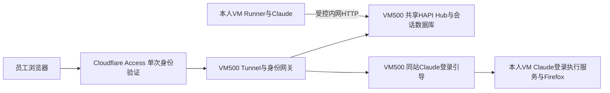

# HAPI 单一入口迁移与验收

> **2026-11-04 更新：** 入口已开放给全部员工。VM500 的路由、令牌、Hub 凭据、worker 防火墙规则和登录页资源由 `hapi-registry` role 维护，经 `wsctl hapi-sync` 运行；不要手工编辑这些文件。登录页远程画面用 noVNC 客户端连 KasmVNC，已适配其鼠标和剪贴板消息；手机上会提示改用电脑完成 Claude 登录。

2026-11-02已完成[内部HTTP简化](hapi-internal-http.md)现网切换及旧PKI服务退役，见[发布记录](../planning/2026-11-02-hapi-internal-http-rollout.md)。

状态核对：2026-11-02。现有所有者试点的统一入口、单Hub和会话数据库已迁入VM500；VM502保留Runner、Claude、登录执行服务和Firefox。用户已确认网页登录与远程浏览器可用，个人Claude认证保留在本人VM。源码经[PR #201](https://github.com/blue126/IaC/pull/201)完整CI与独立审核后合入`main`。独立HAPI开户候选已撤回；现有试点验收不等于新员工完整开户验收。

唯一正式网址为 `https://hapi.willfan.me`，Claude登录引导位于 `/_workspace/login/`。Cloudflare Tunnel、身份网关、共享HAPI Hub和会话数据库均位于VM500。网关验证Access身份并换取绑定本人namespace的短期HAPI会话，不要求用户再次输入HAPI令牌。员工VM运行Runner、任务、文件和个人Claude环境，通过受控内网HTTP连接控制面。这里的Hub是HAPI应用服务，与OCI WireGuard Hub不同。

## 入口切换历史（2026-10-30／31）

以下记录先于单Hub和PKI升级的入口切换步骤。Hub／数据随后完成集中迁移，签发权限的后续变化见[证书生命周期说明](hapi-pki-lifecycle.md)；不能将阶段内的旧布局当作当前部署。

- 将已有Access应用迁到正式域名，保留原所有者授权、应用AUD和168小时会话，不扩大可访问账户。
- 网关依已验证的邮箱与subject映射到当前登记工作区，在服务端换取短期HAPI票据；部署自动登录前端，不再要求浏览器填写长期HAPI令牌。
- 将原Tunnel连接器交接到VM500，远程配置只含正式主机名并指向本机身份网关。没有让两台宿主以不同localhost后端同时承载新配置。
- 停止并禁用VM502旧公网连接器，删除其本机Tunnel令牌副本，退役旧HAPI试点和独立登录域名的DNS。旧个人登录HTTP页面服务已停用，执行API改用同站Origin。
- VM500至VM502仅开放获批控制面源的私有TLS端口，验证服务器身份、客户端证书及CRL。原Hub和Tunnel令牌值保持原有BWS来源；签发CA私钥保留在管理员侧加密Vault，不部署到服务宿主。
- 更新Hub的公开URL与CORS Origin，并仅重载Hub。实际检查Runner进程未重启，任务目录、个人认证及Firefox配置没有迁移或重置。
- 既有WireGuard服务、员工VM通用出网和Cloudflare账户全局会话设置未随此次入口迁移修改。

本轮验收仅覆盖原获批所有者及其试点工作区。新增员工须在当前员工流程中明确本人VM、身份、凭据与路由，不共享试点，也不另建第二台工作VM或第二份Terraform state。员工管理以执行器上的`wsctl`为入口，见[当前操作约定](../deployment/oci-hub-native-provisioning.md)；旧独立HAPI执行器不再用于开户。新员工首次授权及两种接入的完整交付需另行验收。

## 真实问题与回归

原入口故障是VM502迁到受限出站网络后，TCP 7844未放行。HTTP/2模式的Tunnel仍需该端口；临时精确放行恢复服务后，将连接器迁至VM500，并撤销VM502的临时出站例外。没有为所有员工开放该端口。

首次迁移后的noVNC初始化失败来自认证Unix套接字等待队列：Python默认值为5，浏览器并发请求模块时发生排队溢出，表现为部分脚本随机500。顺序加载单个脚本无法发现此问题。

已将等待队列设为128，并补充真实noVNC模块依赖、JavaScript MIME／内容校验及64路同时请求回归。修复前并发测试复现500，修复后64路全部200。VM500现场检查监听队列为128；身份15项及代理18项回归均通过，用户再次刷新后确认远程浏览器画面出现。临时静态资源诊断日志配置随后关闭，未记录Cookie、JWT、授权码或请求体。

## 维护边界

### 从noVNC迁移到Kasm网页客户端

标准noVNC不识别KasmVNC的253／254消息（用户加入／离开共享会话），第二路viewer或旧连接离开时就会断开，页面每3秒重连后两路互相踢下线。登录页因此改用KasmVNC自带的网页客户端。

- **托管位置：** 客户端由VM500从校验过sha256的KasmVNC 1.5.0安装包解出，不由员工VM提供。同源iframe能读取登录页和授权码，所以这些页面不能来自VM。
- **连接路径：** WebSocket仍走`/_workspace/login/websockify`，Access鉴权和stream lease不变，员工VM无需改动。
- **切换方式：** `hapi_control_plane_kasm_viewer_workspaces`列出的工作区使用Kasm客户端，其余仍用noVNC。全部切换并验收后再移除noVNC。
- **版本约束：** 升级KasmVNC时要同步修改`hapi-control-plane`里的安装包地址、校验值、解压路径、资源文件名和内联脚本CSP摘要。

使用`hapi-control-plane`管理VM500身份与路由，`hapi-shared-hub`管理共享Hub，`hapi-ingress`只管理VM500的Tunnel连接器。员工VM一侧统一由`hapi` role管理，默认随开户（`prepare-employee-desktop.yml`的provision阶段）部署，不另设playbook（story 5.24）：固定版本的Runner、经本机127.0.0.1:3006连接VM500共享Hub的通道、供VM500访问的9443私有入口，以及固定的Claude登录API；登录页的远程画面是该VM的KasmVNC桌面（9443的`/websockify`经本机8443入口转发，桌面凭据只在8443入口）。旧试点`employee-hapi`、独立工作区`hapi-workspace`／`hapi-workspace-baseline`、`hapi-hub-client`、`claude-login-agent`、`hapi-network`与一次性的`hapi-internal-http`迁移已于2026-11-03删除；`hapi` role部署时会停用并清除VM上残留的旧试点服务。

PVE现有OCI边界需保留独立服务授权文件及相关编译器支持。现场编译器的既有Mosh等功能在修复时保留，不能直接用较旧分支覆盖现场版本。私有运行记录保存了部署基线、差异和回退配置；合并代码和后续部署应以当前边界所有者版本为基线集成作用域修复。

当前VM500到员工VM及Runner到Hub使用受控内网HTTP，来源绑定、HAPI原生令牌／JWT及固定工作区校验继续生效。内部证书签发／分发／巡检已退役；历史CA、证书和配置checkpoint仅供显式回退，不能把旧Vault覆盖回当前HTTP配置。VM500的VM级备份由用户负责。服务配置变更和凭据操作仍需相应授权。
