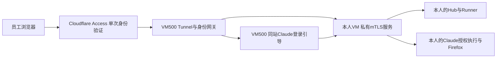

# HAPI 单一入口迁移与验收

状态：现有所有者试点已迁移；用户已确认同站Claude授权的远程浏览器画面恢复。2026-10-31。个人Claude官方授权由用户继续完成，不主动取消或清除个人凭据。独立新员工自动开户后端仍未完成。

唯一正式网址为 `https://hapi.willfan.me`，Claude登录引导位于 `/_workspace/login/`。Cloudflare Tunnel与身份网关均运行于VM500；VM502保留自身Hub、Runner、任务、文件和个人Claude环境，通过私有mTLS入口提供服务。

## 已执行的切换

- 将已有Access应用迁到正式域名，保留原所有者授权、应用AUD和168小时会话，不扩大可访问账户。
- 网关依已验证的邮箱与subject映射到当前登记工作区，在服务端换取短期HAPI票据；部署自动登录前端，不再要求浏览器填写长期HAPI令牌。
- 将原Tunnel连接器交接到VM500，远程配置只含正式主机名并指向本机身份网关。没有让两台宿主以不同localhost后端同时承载新配置。
- 停止并禁用VM502旧公网连接器，删除其本机Tunnel令牌副本，退役旧HAPI试点和独立登录域名的DNS。旧个人登录HTTP页面服务已停用，执行API改用同站Origin。
- VM500至VM502仅开放获批控制面源的私有TLS端口，验证服务器身份、客户端证书及CRL。原Hub和Tunnel令牌值保持原有BWS来源；签发CA私钥保留在管理员侧加密Vault，不部署到服务宿主。
- 更新Hub的公开URL与CORS Origin，并仅重载Hub。实际检查Runner进程未重启，任务目录、个人认证及Firefox配置没有迁移或重置。
- 既有WireGuard服务、员工VM通用出网和Cloudflare账户全局会话设置未随此次入口迁移修改。

当前登记仍限定原获批所有者及其试点工作区；新增员工必须独立登记身份、VM、令牌与路由，不能共享试点作为员工隔离方案。内部原型健康信息的完整开户就绪标记仍为false，不能据此将本次部署描述成完整新员工开户后端已经完成。

## 真实问题与回归

原入口故障是VM502迁到受限出站网络后，TCP 7844未放行。HTTP/2模式的Tunnel仍需该端口；临时精确放行恢复服务后，将连接器迁至VM500，并撤销VM502的临时出站例外。没有为所有员工开放该端口。

首次迁移后的noVNC初始化失败来自认证Unix套接字等待队列：Python默认值为5，浏览器并发请求模块时发生排队溢出，表现为部分脚本随机500。顺序加载单个脚本无法发现此问题。

已将等待队列设为128，并补充真实noVNC模块依赖、JavaScript MIME／内容校验及64路同时请求回归。修复前并发测试复现500，修复后64路全部200。VM500现场检查监听队列为128；身份15项及代理18项回归均通过，用户再次刷新后确认远程浏览器画面出现。临时静态资源诊断日志配置随后关闭，未记录Cookie、JWT、授权码或请求体。

## 维护边界

使用 `hapi-control-plane` 管理VM500身份与路由，`hapi-ingress`管理现有试点的私有适配和VM500连接器，`claude-login-agent`管理本人VM中的固定执行API。旧 `employee-hapi` 通过迁移标记拒绝重新部署旧公网试点，防止恢复旧域名或旧连接器。

PVE现有OCI边界需保留独立服务授权文件及相关编译器支持。现场编译器的既有Mosh等功能在修复时保留，不能直接用较旧分支覆盖现场版本。私有运行记录保存了部署基线、差异和回退配置；合并代码和后续部署应以当前边界所有者版本为基线集成作用域修复。

传输叶证书有效期90天，签发材料及回退记录位于本次迁移的Git忽略私有运行目录。回收任务工作树前必须按RemoteCC私有材料约定保存这些文件；不能只保留公开代码而丢弃签发Vault。实际迁移记录不构成commit、push、批量员工迁移或资源清理授权。
