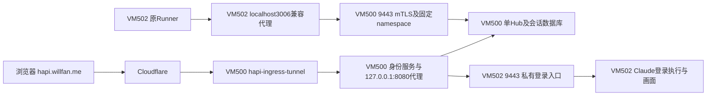

# VM500 单 Hub：已迁入口核对与后续迁移范围

> **历史实施日志。** 下文按阶段保留当时的“当前／尚未”状态，不作为今天的待办清单。Hub与数据库迁移已完成；后续PKI签发服务已[部署到VM500](2026-10-31-hapi-pki-rollout.md)，旧QA已[回收](2026-10-31-hapi-qa-retirement.md)，公开代码已通过[PR #201](https://github.com/blue126/IaC/pull/201)完整审核并合入`main`。现行拓扑见[统一入口说明](../guides/hapi-unified-entry.md)。

状态：本次独立BWS／namespace绑定及Hub、会话数据库迁移已完成验收。VM500运行唯一共享Hub，VM502原Runner PID保持不变；20项现场检查及持久化服务审计通过。用户已完成所请求的Cloudflare登录并确认HAPI可用，作为浏览器端验收反馈；完整新员工开户仍不据此自动放行。最后核对：2026-10-31（Sydney）。

## 2026-10-31 实施进展

用户随后要求完成独立凭据与 namespace 绑定，再迁移 Hub 和会话数据库。当前已准备固定版本的 Hub 鉴权补丁，独立凭据由服务端映射 namespace，应用 JWT 同时绑定凭据版本；撤销检查覆盖 HTTP、Runner／终端 Socket.IO 和既有 SSE。RPC 方法注册也按 namespace 隔离，避免跨租户同名方法覆盖。实际补丁 Hub 的 23 项隔离回归与 Hub TypeScript 检查通过，Linux x86_64 baseline 可执行文件已在专用 Sandbox 构建，尚未部署。

网关共享 Hub 模式已加入代码：网页／应用请求进入 VM500 loopback Hub；Claude 登录操作和画面仍进入所属员工 VM。身份服务交换票据时传入注册表中的固定 namespace，拒绝两身份因遗漏字段而同用default。17项身份服务测试与19项真实Nginx／mTLS回归通过；共享Hub现网切换尚未执行。

本机两份现有 BWS 机器授权实际只能分别看到 `EmployeeWorkspace` 与 `EmployeeWorkspace-OCIHub`。现有 HAPI API 与旧 Tunnel 秘密仍位于前者；没有找到独立 HAPI 项目绑定。已请求解锁现有 Bitwarden 管理页面，以继续核对组织内项目并配置独立机器授权；不以 WireGuard 专用机器授权代替 HAPI 授权。仅记录秘密名称与项目元数据，未在输出中记录秘密值。

实际本地`bws 2.1.0`可管理项目／秘密，但没有机器账号与授权token创建子命令；另一本地`bw status`返回locked。独立项目创建和专用机器授权是不同操作，不应据缺少授权直接宣称CLI不能创建项目。

用户随后解锁管理员网页。组织视图确认只有default、EmployeeWorkspace、EmployeeWorkspace-OCIHub三个项目；三个机器账号分别是employee-workspace-admin（22项秘密）、employee-workspace-oci-hub-admin（29项）、hermes（2项）。管理控制台明确显示Secrets Manager Free Organization；免费版上限为3个项目和3个机器账号，已用满。HapiWorkspace保存未成功，未创建项目或新token。当前需要用户决定释放哪些明确的现有资源，或先审阅升级方案；不自行退役其他业务资源或购买套餐。独立HAPI凭据尚未绑定，现网Hub和数据库未切换。

当前组织的实际升级对话框按年计费显示Teams为10美元／成员／月（每成员年费等价120美元，最终席位数和税费未确认），包含Password Manager与Secrets Manager；无限项目、包含20个机器账号。不能用官方独立Secrets Manager起价6美元／用户／月冒充本组织的完整升级报价。仅打开报价页，未填写付款信息或提交升级。

用户随后指定退役EmployeeWorkspace及前表对应的employee-workspace-admin。已读取并加密归档限定项目的22项秘密，AES-256-GCM与PBKDF2-HMAC-SHA256（600000轮）使用现有IaC Vault密码，归档写入私有运行目录，解密回读已验证。归档中的API token分别与VM500网关和VM502进程环境匹配，旧Tunnel token与VM500当前连接器文件匹配；输出只记录比较结果。项目删除本身不会删除所属秘密，后续仍须将HAPI记录绑定到新项目；旧秘密不在本步骤清除。

此时执行环境报告Work设置禁用本地浏览器操作，sbx的Docker刷新凭据也已失效。普通Docker设备登录已启动等待用户完成，未修改现网服务；旧项目与旧机器账号尚未删除，独立HAPI项目／机器授权尚未创建。此环境访问问题与已解决的资源选择问题应分开记录。

用户恢复sbx登录后，已通过`sbx exec ... true`验证原任务Sandbox可进入；它使用独立sbx/sandboxd，不依赖Docker Desktop。Chrome当前返回扩展弹窗阻止自动化。

随后按用户的CLI偏好执行了项目阶段：删除前重新核对22项秘密与加密归档逐项一致，使用BWS CLI删除指定EmployeeWorkspace项目，回读确认旧项目消失，再创建HapiWorkspace（ID保留在私有receipt）并回读确认。没有删除任何秘密，也没有删除旧机器账号。新项目由现有管理员机器作为本次退役的临时bootstrap创建，这不等于已完成专用HAPI机器身份切换。

旧项目删除后，两项旧HAPI秘密仍由BWS保留，但原项目作用域机器已不能读取，CLI不能直接把它们重绑到新项目。已验证的加密归档及现网物化凭据仍在；后续须由管理员把相同秘密记录重新分配到HapiWorkspace，再创建仅有该项目权限的新机器授权并退役旧机器账号。现网Hub／Runner／Tunnel未因项目管理动作重启或修改，Hub和会话数据库仍未迁移。

### 独立 BWS 与真实通道验证完成

用户在最终执行点确认后，旧employee-workspace-admin已永久删除；两项既有HAPI秘密以原ID、原值归入HapiWorkspace。新hapi-workspace-admin仅有该项目读写权限，90天访问token仅存本机私有HAPI目录，实际到期为2027-01-29 11:14（Sydney）。CLI回读只见HAPI项目，旧WireGuard秘密读取被拒，旧机器token已失效；原两项HAPI值与归档逐项相同。该授权未部署到服务VM。

新增7项HAPI专用服务秘密均已写入BWS并回读一致，包括default／test_alice／test_bob的固定凭据登记、不可作为租户凭据使用的bootstrap值、独立CA与三worker及VM500叶身份。实际运行Vault排除了CA签发私钥和BWS管理员token。VM500 shared-Hub角色、VM502兼容代理及两QA身份文件已仅准备到位，尚未进行现网Hub切换。

已在PVE实际安装helper基线上追加仅VM502→VM500:9443的新连接与回包例外，保留其他任务功能；两QA tap ACL增加仅控制面9443的新方向，VM500主机策略仅新增登记三源的9443例外。实际PVE内核检查、边界receipt／路由验证和更新后的35项真实网络回归全部通过，现有connector ready200。

编译Hub以独立临时数据在VM500运行，三真实worker的mTLS、固定namespace、拒绝suffix升级与管理端口检查通过。另经两个实际worker路径完成7项编译Hub回归，覆盖实际资源隔离、Runner WebSocket、HTTP polling、终端JWT、跨租户RPC注册及撤销时断开Runner／终端／SSE而保留另一worker。XHR测试连接将loopback Host改写为真实私有authority，与产品worker代理一致，未弱化TLS校验。VM502兼容代理的实际专用UID也在3007临时端口完成health与原凭据认证验证，原3006 Hub同时保持健康。

在线真实SQLite备份验证完成：1 session、1 machine、392 messages、default namespace、schema29；最终目标数据目录确认尚未初始化。最终停写快照和导入尚未执行。

### 控制面签名密钥修订

共享Hub不能沿用留在员工sudo边界内的旧JWT签名密钥。迁移工具仍归档原文件并在导入时校验原始数据完整性，但激活前应使用HAPI BWS中独立签名密钥替换VM500文件，且不得把新密钥部署到worker。旧HAPI网页票据本就缺少新cid／cver，浏览器通过既有CF会话换票；原Runner raw凭据及进程保持不变。角色已增加激活前密钥检查与只在控制面物化的步骤；12项数据／绑定／签名格式回归和production lint通过。

准备新增HAPI_SHARED_HUB_JWT_SECRET_V1时网页因空闲自动锁定；此新增签名秘密尚未写入BWS。已询问仅在任务Sandbox独立venv安装官方bitwarden-sdk的许可，以使用专用机器授权安全写入，避免秘密值进入bws参数；AGENTS.md要求安装依赖单独授权。官方2.1.0提供Linux ARM64 abi3 wheel，当前Sandbox未安装该SDK。此许可或网页再次解锁是最终切换前的当前依赖；现网仍由VM502 Hub提供服务。

新增`hapi-shared-hub`与`hapi-hub-client`角色及Deploy／Verify入口，默认仅准备文件。前者运行专用账号、loopback Hub和私有mTLS worker入口；后者保留员工VM的localhost3006地址，切换后通过客户端叶证书访问共享Hub。worker源地址、证书CN、凭据ID与namespace联合绑定；客户端不能通过自填头改变归属。旧Hub的启动条件与Runner未来依赖在激活时更新，不重启现有Runner。相关角色通过production lint与语法检查。

`scripts/hapi-hub-data.py`只处理Hub数据库及settings／owner-id／JWT密钥，使用SQLite backup API收齐WAL内容；最终快照和导入分别要求相应Hub服务已停止，校验完整性、表计数、namespace计数及文件SHA。导入会保留不同的已有目标文件并拒绝覆盖；同一快照重试不会覆盖新Hub已接受的写入。11项真实SQLite及绑定回归通过。实际VM502只读基线为1个session、1台machine、392条message，均属default；切换时须重新采最终基线，不能以此历史计数替代最终一致性校验。

Linux x86_64 baseline构建产物SHA256为`12709f07ca77b8eaafdc57e5111d050ea67f98cc2cfc16fca81902dfcf4fbd7e`，已暂存VM500的同摘要release目录。以ubuntu账号、随机loopback端口及合成home完成编译产物烟测；没有访问现网Hub数据、没有启动共享Hub系统服务，也没有切公开代理。

### 反向网络通道的现场缺口

已只读核对：PVE的现有HAPI grant只允许VM500主动连接VM502的9443及对应回包，不允许VM502主动连接VM500；两台QA VM的tap ACL同样仅有旧方向。VM500当前`employee_access`输入链只允许loopback、已建立连接及既有管理员SSH，未开放worker到9443的新连接。迁移需补精确worker源→VM500:9443及对应回包；保留VM500→worker的Claude登录执行通道。

PVE实际安装的boundary helper包含其他任务已部署但尚未进入本工作树的功能，不能直接用本工作树整文件覆盖。私有`application-plan/shared-hub-network-plan.json`已记录三台候选worker、端口、当前策略摘要与必须保留的边界；后续候选必须基于现场版本准备并拒绝并发漂移。此处完成的是现场核对与变更范围，反向规则尚未实现、部署或验收。

## 当前实际路径

现场经已验证PVE管理通道只读检查：

| 对象 | 观察 |
|---|---|
| VM500 | hapi-control-auth、hapi-control-proxy、hapi-ingress-tunnel均active；连接器本地ready返回200 |
| 公开入口 | 配置origin为hapi.willfan.me，当前试点路由启用且subject已固定 |
| VM500后端 | 应用流量进入本机Hub3006；登录操作与画面仍经原mTLS到10.236.2.2:9443 |
| VM500共享Hub | hapi-shared-hub与hapi-hub-transport均active／enabled，实际仅一个Hub进程；数据在/var/lib/hapi-shared-hub |
| VM502 | employee-hapi-hub已inactive／disabled并有启动条件门禁；原employee-hapi-runner PID996未变，localhost3006由hapi-hub-client接管 |
| 旧连接器 | VM502 employee-hapi-tunnel已inactive；旧独立employee-login-guide也停止，拆分后的claude-login-agent运行 |
| VM502私有服务 | hapi-ingress-proxy监听10.236.2.2:9443；登录API6082、画面6081保持loopback |
| 防误部署 | 已有unified-entry marker；旧employee-hapi角色增加拒绝重建已退役独立公网入口的断言 |
| VM500依赖 | noVNC静态资源现已存在，旧应用计划里的“缺noVNC”观察已过期 |

原入口与随后Hub迁移是两个阶段：当前入口、Hub及会话数据库均在500，Runner／Claude仍在502。变更复用原CF对象与登录传输，未部署BWS管理员token或CA签发私钥到服务VM，未读取或搬运个人Claude凭据。

## 已确认的目标

VM500运行一个Hub、集中HAPI网页和会话数据库，提供统一入口及身份／namespace绑定；员工VM运行Runner、Claude、工程文件、个人Firefox／授权和必要的私有执行通道。会话／消息存储随Hub集中，个人Claude凭据与工程文件保持在员工VM。

单Hub仍须完成[鉴权改造与跨租户验证](2026-10-30-hapi-shared-hub-assessment.md)。每VM仅持自己的凭据，服务端固定namespace；CF身份与应用JWT的namespace也必须一致。共享Hub的JWT不能像独立Hub那样天然依靠不同签名密钥拒绝另一员工的票据，网关／Hub需显式校验身份一致性。

## 不重做的部分

- 不重新创建或切换已经工作的Tunnel、DNS、Access应用，不把旧token再复制回VM502。
- 不覆盖side chat新增的hapi-ingress及control-plane配置；从实际部署版本继续。
- 不重复安装VM500已有的noVNC，不沿旧“每员工VM一个Hub”的角色创建新Hub实例。
- 不重建当前会话数据库，不替用户完成或清除个人Claude登录。

## 迁移前必须处理的状态兼容

VM502当前Runner使用`HAPI_API_URL=http://127.0.0.1:3006`。已有CLI会话可能也捕获该地址；仅改Runner的systemd环境不能更新既有进程。迁移方案需要保留本地兼容转发，或先验证既有会话的受控重连，不通过重启员工任务解决地址切换。

本轮只看文件元数据，确认/home/employee/.hapi包含hapi.db、非空WAL、settings.json、owner-id.json及jwt-secret.json；没有读取消息或秘密内容。需要一致性备份、写入收敛、校验及明确切换窗口，不能在Hub仍写入时只cp主db文件。

当前试点的数据属于既有namespace，迁移时先保留该namespace并绑定当前试点所有者；不能为了新命名方案改写或丢弃历史。已有CLI凭据若需兼容，必须只被服务器映射到固定的既有namespace，不能继续作为任意namespace的管理级基础token。新租户在该约束与全通道验收完成前不启用。

## 已执行的迁移与剩余验收

独立SDK已按用户授权安装到任务Sandbox专用venv，未改变宿主或Ansible环境；仅对该Sandbox放行Bitwarden身份／API两个HTTPS端点。新增签名密钥通过SDK写入并回读，无秘密值进入argv。BWS现有10项HAPI秘密，运行Vault排除CA签发私钥和管理员token，新Hub签名密钥仅物化到500。

最终停写快照与导入的snapshot ID及全部表／namespace计数逐项一致：1个session、1台machine、392条message、default namespace、schema29。导入先校验五文件SHA及SQLite完整性，再于500替换员工已知的旧签名密钥并启动共享Hub；旧签名文件仅留在原VM／私有归档作为历史材料。

20项现场检查确认全部旧message ID和session ID保留、历史消息API可用、原machine在线且实际Runner RPC可往返、原workspaceRoots边界保持、旧签名伪造及另一namespace JWT经本人网关被拒、Claude状态接口仍为authenticated=true。当前签名文件与BWS一致，模式0600、数据目录0700。

持久化审计确认500唯一Hub及相关服务active／enabled，验证服务已停止；502旧Hubinactive／disabled且条件门禁失败，Runner PID996保持，未来Wants已只指向network-online.target与hapi-hub-client。现场发现systemd drop-in不能清空依赖后，角色改为仅替换原unit内旧Hub依赖并保留其他依赖，未重启Runner。

统一URL先打开到正常CF邮箱验证码页。用户在所请求的入口验收问题中回复“完成了，可以用”，据此记录Cloudflare登录后HAPI可用的浏览器实测反馈；原自动化标签随后不可用，未声称额外自动浏览器回读或截图。验收后后台20项检查再次通过。未新增测试员工CF主体或发布两QA为正式用户；完整开户／新VM个人授权保持独立待办。

### 切换后的回退边界

500已开始承载正式数据库，不能直接启用502的原始Hub或从旧快照覆盖新写入。网关可用当前角色回退为经过502兼容代理的路径，Hub和权威数据仍留500；不得回退固定namespace鉴权或签名密钥隔离。应用／数据恢复前必须先对500当前库做新的停写一致性备份，并继续使用补丁Hub及控制面密钥。跨主机回迁另需审阅数据与信任边界，旧导入快照仅为历史恢复材料。

### 原迁移步骤（保留追溯）

1. 对锁定上游实现独立凭据→固定namespace认证，覆盖web auth、CLI HTTP、binding和Runner Socket.IO；审核全局管理／Hub本机执行入口，测试错误／停用凭据与跨namespace资源。
2. 将Hub与Runner部署职责拆开；Hub／网页／数据库放500，worker不再启动Hub。保留或明确替换登录执行／画面通道，不能因移Hub直接删私有TLS入口。
3. 验证员工VM→VM500的固定Hub端口和身份绑定。既有35／11网络测试验证的是旧方向，不能当新路径验收。
4. 封存实际入口、证书、源码／artifact及Hub数据布局，形成只影响Hub／必要转发的精确计划，列出两次写入收敛、一致性备份、校验及切换窗口；服务秘密及软件安装按当前明确授权范围处理。
5. 经批准后切换，核验既有机器／会话、消息、审批、终端与Runner重连，再接入另外测试身份。单Hub已接受新写入后，回退必须包含一致的数据逆向恢复及同等租户鉴权，不能直接重启过期旧Hub或丢弃新消息。

上述步骤最初是待审计划；现已按用户独立授权执行Hub／数据迁移及必要规则，实际状态以上方回读为准。两个测试邮箱仍只在私有待发布映射中，未自动创建生产员工或发布新CF身份。
