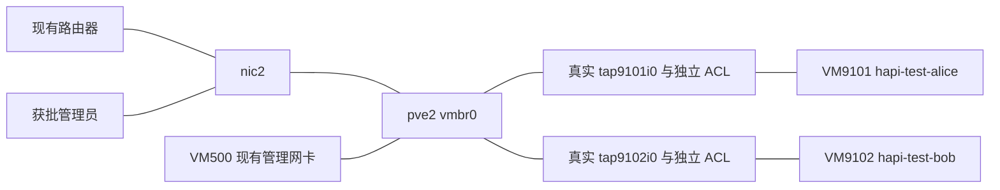

# pve2 两台 HAPI 测试 VM 的真实网络验收

状态：2026-10-30的35项真实通信与11项生命周期验收全部通过。2026-10-31已按单独授权由原Terraform state回收两台QA VM及磁盘，关联测试配置与巡检退役；本文保留历史验收记录，见[回收记录](2026-10-31-hapi-qa-retirement.md)。

用户明确要求直接使用pve2真实配置验证，因此取消单台Linux namespace实验室路线。本次创建、测试两台新VM；Python3、iproute2、nftables、qemu-guest-agent的安装已获单独授权，仅在新VM安装。旧VM、路由器配置、Cloudflare和BWS不在本轮推广范围。

## 实际拓扑与所有权

使用pve2现有vmbr0及真实tap端口，不开启或改造现有bridge的VLAN功能。每台测试VM独立的bridge-family nft表承担端口ACL；按实际网关、管理员及控制面源IP／MAC／入口端口绑定可信来源。员工仍保留sudo，隔离执行在PVE侧。测试流量通过已有上游出网，不新增VM500或PVE NAT。



本轮验证现有bridge上的端口隔离，不能记作VLAN／VNet验收。VLAN后端保留为未实测的独立路径，不以其Sandbox缺能力阻塞本次真实端口测试。

两台VM均为2vCPU、2048MiB、20GiB，使用pve2-ssd，从9000基础模板完整克隆；不使用9001员工业务bootstrap。初次保持停止、禁用自动开机并启用删除保护，VM外规则和启动门禁先就绪，再启动。具体分配、状态、凭据运行通道、计划及回执保存在独立的`remotecc/hapi-data/`任务目录，不加入WireGuard roster或旧state。

资源核对包含PVE来宾／宿主地址、MAC、VMID、DHCP范围及静态保留、NetBox地址查询和路由器邻居探测。两地址位于动态池之外，无已发现分配；创建前再次检查。PVE API读取、NetBox读取及SSH主机公钥校验与部署分别记录；没有写入IPAM或借用旧员工秘密。

## 自动化修正与真实发现

- 现有vmbr0未开启VLAN-aware，因此新增`access-bridge`配置，明确可信peer的IP、MAC和实际入口；其他来宾不能仅靠伪造网关MAC进入可信路径。
- 反MAC冒用与VLAN／IPv6拒绝在bridge prerouting执行，早于FDB学习；后续forward规则检查IPv4、ARP、连接状态与目标。只更新本次VM的表，不flush全局规则。
- 现场`local`没有snippets内容类型。hook改为显式存储绑定，通过PVE解析实际路径，不再假定`local:snippets`。
- 通用VM模块完整克隆时显式选择目标datastore，避免先在空间不足的源mainpool克隆再迁移。
- 原API token不能设置启动hook。首次尝试留下两台停止的部分克隆；未删除重建，核对归属后用受限恢复任务补齐其首次启动前的Cloud-Init引用，再以既有root管理认证让Terraform仅原地更新这两台。没有新增token或调整ACL。
- 对启动hook不能只信任Terraform计划值。角色在已发布分配范围内，对停止、尚无hook且IP／MAC／bridge全部匹配的VM执行root绑定，并以PVE配置digest防止并发覆盖；未知hook或运行中的无门禁VM均拒绝处理。绑定后再执行实际启动检查。

两次Terraform审阅均限制到本次两个资源：首次只有两项创建；恢复计划只有两项原地更新，没有删除、重建或既有资源变更。既有模板及业务VM没有被Terraform管理或接管。

## 验收入口与判定

在获批任务Sandbox中执行，使用独立私有运行目录：

```bash
python3 tests/hapi-workspace/test-pve-network.py --runtime RUNTIME --run-real-pve
python3 tests/hapi-workspace/test-pve-lifecycle.py --runtime RUNTIME --run-real-pve
```

两个入口限定到本次VMID、名称、标签和分配，保持SSH严格主机公钥校验。新VM的host key通过已认证PVE管理通道取得，不能使用accept-new。包与部署工具不在PVE宿主安装。

通信测试包括真实DNS／公网、获批管理员SSH、VM500来源的9443连通、宿主与网关管理端口拒绝、预置邻居绕过ARP后的双向跨VM拒绝，以及root发出的伪造IP／MAC、ARP、VLAN／QinQ、IPv6和WAN回流帧。对pve2物理上联只匹配本次随机marker，先证明合法帧可见，再证明攻击帧未发出；不记录其他业务报文。

生命周期测试包括停用后既有流停止交付、另一台VM继续工作、禁用状态拒绝启动、宿主规则漂移时拒绝启动、自动修复与恢复、另一台VM进程不重启，以及重复Ansible执行零变化。测试不替代HAPI协议、mTLS、Cloudflare身份、首次Claude登录或完整员工开户后端验收。

## 本轮结果

| 类别 | 实测结果 |
|---|---|
| 正常路径 | 两台VM均完成独立bootstrap，sudo／获批管理员SSH、DNS和公网正常；VM500来源可连通两个9443测试端点 |
| 横向与管理拒绝 | 预置真实对端MAC绕过ARP后，两个方向的SSH和9443均拒绝；PVE的22／8006及网关SSH也拒绝 |
| 反冒用 | 合法marker帧可在真实nic2上联观察到；伪造源IP／网关MAC、ARP投毒、VLAN／QinQ、IPv6和保护WAN的帧均未发出；攻击后两台继续正常出网 |
| 停用 | 真实既有SSH流不再交付数据；另一台继续出网且规则回执不变；被停用VM即使显式请求启动也被hook拒绝 |
| 漂移与恢复 | 停机状态修改本人的宿主nft表后拒绝启动；角色修复后可启动、SSH和出网恢复；另一台QEMU PID未变化 |
| 幂等与部署验证 | 最终重复Ansible零变化；18项离线计划／门禁回归、production lint、语法及固定provider模块validate通过 |

真实流量与生命周期分别记录35项和11项，均退出0。测试9443端点为临时TCP服务，测试后已停止；没有部署Hub、Runner或个人Claude认证，也没有开放公共HAPI域名。验收当时两台测试VM保留供审阅，未转为员工业务；随后按2026-10-31的明确授权完成回收。

物理上联抓包工具在首轮负向测试暴露了忙链路不断重置超时的问题，已修正为固定截止时间后完整重跑；只清理了以该次唯一marker精确匹配的本任务遗留抓包进程，没有放宽隔离规则或记录其他业务报文。

只有上述实际结果全部通过，才形成既有设备逐台变更与回退计划；本轮不会因为两台测试VM通过就批量更改现网地址、默认路由或旧WireGuard边界。
